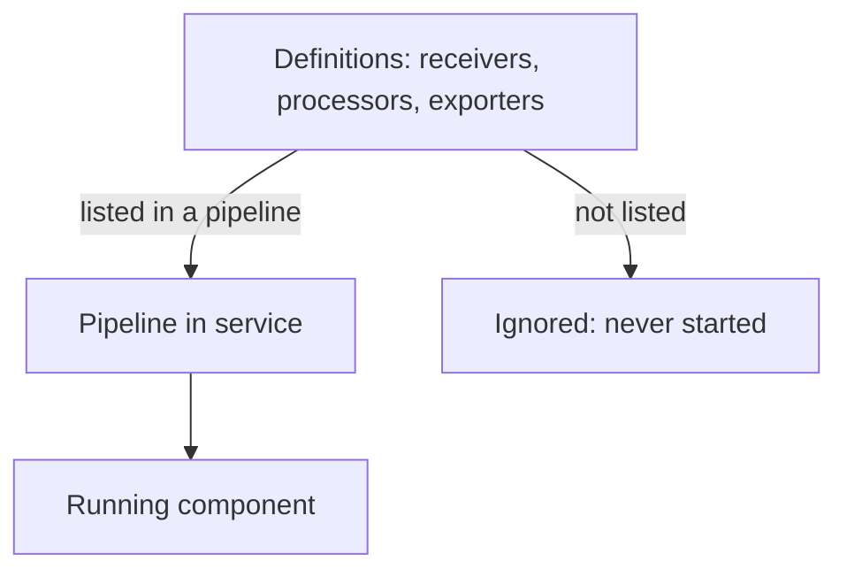

# Definitions And Enabled Pipelines

An OpenTelemetry Collector is a program that receives telemetry, changes it and sends it on. Telemetry is the data that applications produce about themselves, and it comes in three kinds called signals: traces, metrics and logs. The Collector reads one YAML file at start. That file has a long list of components, and a common mistake is to believe that every component in the list is running. This part shows what the file really means, using an agent Collector in the `starfleet` namespace and a backend Collector in the `outpost` namespace.

## The sections of the file

A configuration file has six top-level sections. Four of them define components that handle data, one defines components that support the service, and one decides what runs.

- `receivers` define how data comes in. A receiver either listens on a port (the `otlp` receiver accepts data in the OpenTelemetry Protocol, OTLP) or collects data from a source.
- `processors` change data on its way through. The `batch` processor groups data into larger sends. The `memory_limiter` processor refuses data when the process uses too much memory.
- `exporters` send data out. The `debug` exporter writes the data to the Collector log, and the `otlphttp` exporter sends it to another OTLP endpoint over HTTP.
- `connectors` join two pipelines. This module does not use them.
- `extensions` add behaviour that is not part of the data path, such as an HTTP endpoint for health checks.
- `service` lists which of the defined components run, and in which order data passes through them.

The first four sections only define. Defining a component means giving it an identifier and its settings. Nothing starts because of a definition alone.

## Definition is not activation

A component runs only when the `service` section refers to it. Receivers, processors and exporters are referred to from a pipeline. A pipeline is one path through the Collector for one signal, with a list of receivers, a list of processors and a list of exporters. Extensions are referred to from `service.extensions`.

The playground agent shows this. Its configuration defines two exporters, `debug` and `otlphttp/gateway`, but its only pipeline lists `debug`. The identifier `otlphttp/gateway` has two parts: the component type `otlphttp` and a name `gateway` after the slash, which lets one file hold several exporters of the same type.



The diagram shows the two ways out of a definition. Only a reference from the `service` section turns a definition into a running component.

The Collector is strict in one direction only. A pipeline that lists a component with no definition is an error, and the Collector does not start. A definition that no pipeline lists is not an error. The Collector does not report it as an error, because the file may be a shared base that several services use with different pipelines.

<!-- astrona:playground:renew -->

Time to see this on the cluster. Save these helper functions as `helpers.sh`. `send_otlp` posts a JSON file to the agent and prints the HTTP status code. `gateway_logs` and `agent_logs` print the end of the two Collector logs. `apply_config` stores a configuration file in the ConfigMap `otelcol-config` that the agent mounts at `/conf`, restarts the agent and waits until it is ready:

```sh
send_otlp() {
  kubectl -n starfleet exec -i deploy/shuttle -- curl -s -o /dev/null -w '%{http_code}\n' -H 'Content-Type: application/json' -d @- "http://otelcol.starfleet.svc.cluster.local:$2/v1/$1" < "$3"
}
gateway_logs() { kubectl -n outpost logs deploy/gateway --tail="${1:-60}"; }
agent_logs() { kubectl -n starfleet logs deploy/otelcol --tail="${1:-60}"; }
apply_config() {
  kubectl -n starfleet create configmap otelcol-config --from-file=config.yaml="$1" --dry-run=client -o yaml | kubectl apply -f - && kubectl -n starfleet rollout restart deployment/otelcol && kubectl -n starfleet rollout status deployment/otelcol --timeout=120s
}
```

Load them into the shell:

```sh
source helpers.sh
```

Next, save one span as `span.json`. OTLP over HTTP accepts JSON, and the identifiers of the trace and the span are written as hexadecimal text:

```json
{"resourceSpans":[{"resource":{"attributes":[{"key":"service.name","value":{"stringValue":"scout"}}]},"scopeSpans":[{"scope":{"name":"manual"},"spans":[{"traceId":"5b8efff798038103d269b633813fc60c","spanId":"eee19b7ec3c1b174","name":"read-sensor","kind":1,"startTimeUnixNano":"1700000000000000000","endTimeUnixNano":"1700000001000000000"}]}]}]}
```

Send it to the agent on port 4318, the OTLP/HTTP port, and read both logs:

```sh
send_otlp traces 4318 span.json
agent_logs 20
gateway_logs 20
```

The status code is `200`: the receiver accepted the span. The agent log has a line from the `debug` exporter that reports one span, because the `traces` pipeline lists `debug`. The gateway log has no span named `read-sensor`. The agent defines `otlphttp/gateway`, but no pipeline uses it, so the Collector never created it.

## Activating the exporter

Save the full configuration with the exporter added to the pipeline as `config.yaml`. The receiver stays on `0.0.0.0:4318`, and the pipeline now lists both exporters:

```yaml
extensions:
  health_check:
    endpoint: 0.0.0.0:13133
receivers:
  otlp:
    protocols:
      http:
        endpoint: 0.0.0.0:4318
processors:
  batch: {}
exporters:
  debug:
    verbosity: basic
  otlphttp/gateway:
    endpoint: http://gateway.outpost.svc.cluster.local:4318
service:
  extensions: [health_check]
  pipelines:
    traces:
      receivers: [otlp]
      processors: [batch]
      exporters: [debug, otlphttp/gateway]
```

Apply it, then send the same span again and read the gateway log:

```sh
apply_config config.yaml
send_otlp traces 4318 span.json
gateway_logs 40
```

The gateway log now has a span named `read-sensor` with the resource attribute `service.name` set to `scout`. The only change in the file was one word in a list. The definition was the same before and after, and the `service` section made the difference.

The restart matters too. The Collector reads its file once, when it starts. Changing the ConfigMap alone changes the file that the pod can see, but the running process keeps the pipelines it built at start.

In this part you saw that a definition describes a component and the `service` section runs it. The next question is what a pipeline is allowed to contain: which components can handle which signal, and in which order data passes through them.

## Common pitfalls

> [!WARNING]
> Do not search the file for a component name and call it proof that the component runs. Read the `service` section. A defined exporter that no pipeline lists never sends data, and the Collector does not treat it as an error. Remember that the Collector reads its file only at start, so restart the pod after every change.
