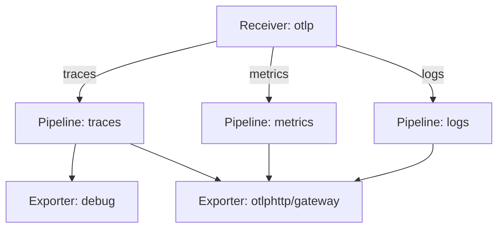

# Signals, Processors And Exporters In A Pipeline

A pipeline is the unit that the Collector builds from the `service` section. Each pipeline carries exactly one signal, and the components in it must be able to handle that signal. The order of the processors inside it changes what the exporter finally sends. This part explains how pipelines are named and typed, how components are shared between them, and which processor order protects the Collector and the data.

## One pipeline, one signal

The name of a pipeline starts with the signal it carries: `traces`, `metrics` or `logs`. A name may have a suffix after a slash, such as `traces/slow`, so that one file can hold two trace pipelines. The part before the slash decides the signal. A pipeline named `traces` accepts only trace data, and the Collector never mixes signals inside one pipeline.

A component supports a set of signals, and that set is part of its code. The `otlp` receiver and the `otlphttp` exporter support traces, metrics and logs. The `debug` exporter supports all three too. The `prometheus` exporter, which exposes metrics for scraping, supports metrics only. If a `traces` pipeline lists the `prometheus` exporter, the Collector cannot build that pipeline and fails when it starts. Two names that look alike do not mean the same support, so the README of each component is the place to check.

A receiver also decides which signals it accepts through the pipelines that list it. The `otlp` receiver serves the path `/v1/traces` over HTTP only when a traces pipeline lists it, `/v1/metrics` only when a metrics pipeline lists it, and so on. A request for a signal without a pipeline does not reach any exporter, and the sender gets an error status instead of `200`.

## Which components are shared

When one receiver or exporter appears in several pipelines, the Collector creates it once and shares it. The `otlp` receiver in the traces, metrics and logs pipelines is one listener on one port. The `otlphttp/gateway` exporter in three pipelines is one component with one set of settings.

Processors are different. The Collector creates a separate instance of a processor for each pipeline that lists it. A `batch` processor in the traces pipeline and a `batch` processor in the logs pipeline do not share their buffers, because the data of one signal must not wait for another.

A pipeline with two exporters sends a copy of each batch to both. This is called fan-out. If one exporter is slow or fails, it can delay the others, so fan-out is a design choice and not a free feature.



The diagram shows one receiver that feeds three pipelines and one exporter that receives from all three. The `debug` exporter is only in the traces pipeline.

## Processor order

Processors run one after another in the order of the list, and the output of one is the input of the next. The order is part of the behaviour. Two rules cover most files.

The `memory_limiter` processor goes first. It checks the memory of the Collector process at a fixed interval and refuses new data when the use passes a limit, so that the process is not stopped for using too much memory. If it ran after other work, that work would already have used the memory. The refusal travels back to the receiver, and the sender can retry.

The `batch` processor goes last, just before the exporters. It collects items until a size or a time limit is reached and then sends them as one group. Processors that filter, drop or change data come before it, so that a batch holds only data that will be sent.

Here is the memory limiter and batch block that the pipelines below use, as part of the file:

```yaml
processors:
  memory_limiter:
    check_interval: 1s
    limit_mib: 150
    spike_limit_mib: 30
  batch: {}
```

`limit_mib` is the memory limit in mebibytes, and `spike_limit_mib` is the space kept free for sudden growth. The container in the playground has a memory limit of 256 MiB, so a Collector limit of 150 leaves room for the process itself.

<!-- astrona:playground:renew -->

Now build the pipelines for all three signals. Save these helper functions as `helpers.sh`. `send_otlp` posts a JSON file to a port of the agent and prints the HTTP status code, `apply_config` stores a Collector configuration file in the ConfigMap `otelcol-config`, restarts the agent and waits for it, and the other two print the end of a Collector log:

```sh
send_otlp() {
  kubectl -n starfleet exec -i deploy/shuttle -- curl -s -o /dev/null -w '%{http_code}\n' -H 'Content-Type: application/json' -d @- "http://otelcol.starfleet.svc.cluster.local:$2/v1/$1" < "$3"
}
gateway_logs() { kubectl -n outpost logs deploy/gateway --tail="${1:-60}"; }
agent_logs() { kubectl -n starfleet logs deploy/otelcol --tail="${1:-60}"; }
apply_config() {
  kubectl -n starfleet create configmap otelcol-config --from-file=config.yaml="$1" --dry-run=client -o yaml | kubectl apply -f - && kubectl -n starfleet rollout restart deployment/otelcol && kubectl -n starfleet rollout status deployment/otelcol --timeout=120s
}
```

Load them into the shell:

```sh
source helpers.sh
```

Save one log record as `log.json` and send it to the agent. The agent at this point has only a traces pipeline, so the receiver has no handler for logs:

```json
{"resourceLogs":[{"resource":{"attributes":[{"key":"service.name","value":{"stringValue":"scout"}}]},"scopeLogs":[{"scope":{"name":"manual"},"logRecords":[{"timeUnixNano":"1700000000000000000","severityText":"INFO","body":{"stringValue":"fuel level checked"}}]}]}]}
```

```sh
send_otlp logs 4318 log.json
```

The status code is not `200`. The receiver answers an error because no pipeline accepts logs. Save the configuration with a pipeline for each signal as `config.yaml`:

```yaml
extensions:
  health_check:
    endpoint: 0.0.0.0:13133
receivers:
  otlp:
    protocols:
      http:
        endpoint: 0.0.0.0:4318
processors:
  memory_limiter:
    check_interval: 1s
    limit_mib: 150
    spike_limit_mib: 30
  batch: {}
exporters:
  debug:
    verbosity: basic
  otlphttp/gateway:
    endpoint: http://gateway.outpost.svc.cluster.local:4318
service:
  extensions: [health_check]
  pipelines:
    traces:
      receivers: [otlp]
      processors: [memory_limiter, batch]
      exporters: [debug, otlphttp/gateway]
    metrics:
      receivers: [otlp]
      processors: [memory_limiter, batch]
      exporters: [otlphttp/gateway]
    logs:
      receivers: [otlp]
      processors: [memory_limiter, batch]
      exporters: [otlphttp/gateway]
```

Apply it, send the log record again and look for the log body in the gateway log:

```sh
apply_config config.yaml
send_otlp logs 4318 log.json
gateway_logs 40
```

The status code is `200` now, and the gateway log shows a log record with the body `fuel level checked`. One `otlp` receiver and one `otlphttp/gateway` exporter serve all three pipelines, while each pipeline has its own `memory_limiter` and `batch` instance.

You now know that a pipeline is typed by its signal, that receivers and exporters are shared while processors are not, and that the order of processors is a design decision. What is still open is where the components come from. A file can name a component that the binary does not contain, and a receiver can run and still be unreachable.

## Common pitfalls

> [!WARNING]
> Do not put an exporter in a pipeline because it works in another one. Check that it supports the signal of this pipeline. Do not put `batch` before `memory_limiter` or before a processor that drops data. A pipeline that is missing for a signal is not an error in the file: the sender simply gets a failure status for that signal, so test every signal that applications send.
