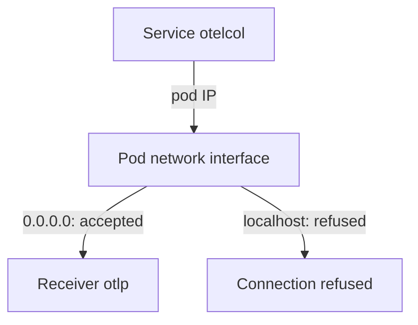

# Distributions, Validation And Listener Endpoints

A configuration file can be correct YAML and still fail in three ways. It can name a component that the program does not contain. It can break a rule that the Collector checks before it starts. Or it can run well and still be unreachable, because a listener is bound to the wrong address. This part covers all three and gives a habit that finds the first two before a pod restarts.

## Distributions decide which components exist

The Collector is built from Go code, and the person who builds it picks the components. A distribution is one such build. The core distribution, whose binary is `otelcol`, contains a small set of components: among them the `otlp` receiver, the `otlp` and `otlphttp` exporters, the `debug` exporter, and the `batch` and `memory_limiter` processors. The contrib distribution, whose binary is `otelcol-contrib`, adds many hundreds of components from the community repository, for example the `file` exporter and the `resource` processor. The Kubernetes distribution is a build that contains the components that are common on Kubernetes. An organization can also build its own distribution with the OpenTelemetry Collector Builder, a tool that takes a list of components and produces a binary.

A definition cannot add code to a binary. If a file names a component type that is not in the build, the Collector reports an unknown type and does not start. A file that works with `otelcol-contrib` may fail with `otelcol`, and the version matters too, because settings are renamed and removed between releases. The playground runs `otel/opentelemetry-collector-contrib:0.162.0`, so the file may use any contrib component of that release.

<!-- astrona:playground:renew -->

The binary can list its own components. Run the `components` command inside the agent pod and keep the lines that name a few components. The image has no shell, but `kubectl exec` can start the binary directly:

```sh
kubectl -n starfleet exec deploy/otelcol -- /otelcol-contrib components | grep -n -E 'otlphttp|prometheus|filelog'
```

The output lists each name with its stability level. The listing is the answer to the question "does this build have this component", and it is the only reliable one.

## Validating a file before a restart

The Collector has a `validate` command. It loads the files the same way as a normal start, checks the structure and the settings of each component, and then exits. A file with an error never reaches a running pod. A valid file prints no error.

Save a helper that runs `validate` in a short-lived pod from the same image, with the file in an environment variable. The `env:` prefix in `--config=env:CANDIDATE` tells the Collector to read the configuration text from the variable `CANDIDATE`. Save this as `validate.sh` and load it:

```sh
validate_config() {
  kubectl -n starfleet run validate --rm -i --restart=Never --quiet --image=otel/opentelemetry-collector-contrib:0.162.0 --image-pull-policy=IfNotPresent --env="CANDIDATE=$(cat "$1")" --command -- /otelcol-contrib validate --config=env:CANDIDATE
}
```

```sh
source validate.sh
```

Save a file with a mistake as `candidate.yaml`. The traces pipeline lists an exporter named `otlphttp/backend`, but the file only defines `otlphttp/gateway`:

```yaml
receivers:
  otlp:
    protocols:
      http:
        endpoint: 0.0.0.0:4318
exporters:
  otlphttp/gateway:
    endpoint: http://gateway.outpost.svc.cluster.local:4318
service:
  pipelines:
    traces:
      receivers: [otlp]
      exporters: [otlphttp/backend]
```

Run the helper:

```sh
validate_config candidate.yaml
```

The command prints an error that names the pipeline and the exporter that is not configured, and it exits with a failure. Change `otlphttp/backend` to `otlphttp/gateway` and run it again: it prints no error. This is the same rule as in the first part, seen from the other side. A pipeline may not list what the file does not define.

## Listener endpoints

A receiver that listens on a port has an `endpoint` setting with a host and a port. The host decides which network interfaces accept connections. The `otlp` receiver defaults to `localhost`, which means the loopback interface of its own pod. That default is safe for a Collector that only talks to processes in the same pod, and it is wrong for a Collector that other pods call.

A Kubernetes Service forwards a request to the IP address of the pod, not to its loopback interface. A receiver on `localhost:4318` refuses that connection. Binding to `0.0.0.0` accepts connections on every interface, including the pod IP address.

Save the agent file with the listener on `localhost` as `config.yaml`:

```yaml
extensions:
  health_check:
    endpoint: 0.0.0.0:13133
receivers:
  otlp:
    protocols:
      http:
        endpoint: localhost:4318
processors:
  batch: {}
exporters:
  otlphttp/gateway:
    endpoint: http://gateway.outpost.svc.cluster.local:4318
service:
  extensions: [health_check]
  pipelines:
    traces:
      receivers: [otlp]
      processors: [batch]
      exporters: [otlphttp/gateway]
```

Two steps need the helper functions. Save them as `helpers.sh` and load them with `source helpers.sh` first:

```sh
send_otlp() {
  kubectl -n starfleet exec -i deploy/shuttle -- curl -s -o /dev/null -w '%{http_code}\n' -H 'Content-Type: application/json' -d @- "http://otelcol.starfleet.svc.cluster.local:$2/v1/$1" < "$3"
}
gateway_logs() { kubectl -n outpost logs deploy/gateway --tail="${1:-60}"; }
agent_logs() { kubectl -n starfleet logs deploy/otelcol --tail="${1:-60}"; }
apply_config() {
  kubectl -n starfleet create configmap otelcol-config --from-file=config.yaml="$1" --dry-run=client -o yaml | kubectl apply -f - && kubectl -n starfleet rollout restart deployment/otelcol && kubectl -n starfleet rollout status deployment/otelcol --timeout=120s
}
```

Save a span as `span.json`:

```json
{"resourceSpans":[{"resource":{"attributes":[{"key":"service.name","value":{"stringValue":"scout"}}]},"scopeSpans":[{"scope":{"name":"manual"},"spans":[{"traceId":"5b8efff798038103d269b633813fc60c","spanId":"eee19b7ec3c1b174","name":"read-sensor","kind":1,"startTimeUnixNano":"1700000000000000000","endTimeUnixNano":"1700000001000000000"}]}]}]}
```

Apply the configuration and send the span:

```sh
apply_config config.yaml
send_otlp traces 4318 span.json
```

The status code is `000`. That is what `curl` prints when it gets no HTTP response, and here the connection was refused. The pod is ready, because its readiness check calls the separate health port 13133, which is bound to `0.0.0.0`. A ready pod and a refused listener at the same time is the pattern to remember. Change the endpoint back to `0.0.0.0:4318`, apply the file and send the span again to see `200`.

Binding to `0.0.0.0` has a cost. Any pod that can reach the pod IP address can send data. Limit the callers with a Kubernetes NetworkPolicy and use TLS or authentication where the data is sensitive.



The diagram shows that a Service reaches the pod interface and not the loopback interface, so only a receiver on `0.0.0.0` or on the pod address answers.

You can now check a file against the binary, validate it before a restart and choose a safe listener address. Together with the first two parts, this covers how a Collector configuration is built, enabled and reached.

## Common pitfalls

> [!WARNING]
> Do not copy a file from a contrib example into a core build without checking the component list. Do not trust a ready pod as proof that the receiver is reachable: the health port and the data port are separate listeners. Do not bind a receiver to `0.0.0.0` on a Collector that has a public address without limiting who can connect. `validate` finds a missing definition, but it cannot know that your endpoint address is the wrong one.
