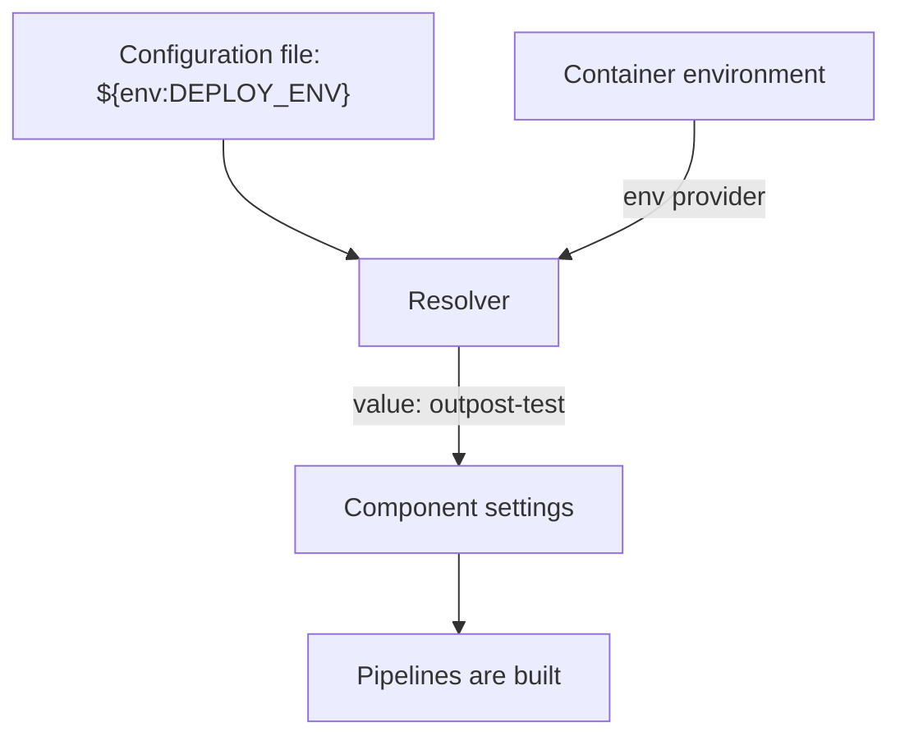

# Environment Variables In Configuration

The same Collector configuration often has to run in more than one place. The address of the backend differs between a test cluster and a production cluster, and a secret must never be copied into a file that many people can read. The Collector solves this with environment variable expansion: a value in the configuration can name an environment variable, and the Collector replaces the name with the value of the variable. This part shows the syntax, the moment of replacement and the limits, using an agent Collector in `starfleet` that sends data to a backend in `outpost`.

## The syntax

An environment variable is a named text value that the operating system gives to a process when it starts. In Kubernetes, the Deployment defines the variables of a container in its `env` list. A Collector configuration reads one with `${env:NAME}`.

- `${env:NAME}` is replaced by the value of the variable `NAME`.
- `${env:NAME:-fallback}` is replaced by the value of `NAME`, or by `fallback` when the variable is not set. An empty fallback, as in `${env:NAME:-}`, is allowed.
- `$$` stands for one literal dollar sign. Write `$${env:NAME}` when the text `${env:NAME}` itself must reach the component.

The playground agent has three variables: `GATEWAY_ENDPOINT` holds the address of the gateway, `DEPLOY_ENV` holds the text `outpost-test`, and `BACKEND_TOKEN` comes from a Secret. The configuration already uses the first one in the exporter `otlphttp/gateway`.

## When the value is read

The `env:` text is not a feature of YAML and not of the exporter. A part of the Collector called the resolver handles it. The resolver loads every configuration source, finds each `${...}` reference, asks the matching provider for the value and writes the value into the configuration. This happens when the Collector loads its configuration, before it checks the settings of the components and before it builds the pipelines.

Two consequences follow. The components never see the text `${env:NAME}`, only the result, so the result must be valid for the setting. A port number that comes from a variable must be a valid number text. And the value is read once, at start. If a variable changes while the Collector runs, the running Collector does not notice, and only a new process reads the new value.

An unset variable without a fallback becomes an empty value. That can turn an `endpoint` into an empty text. Use a fallback when an empty value would be wrong but not fatal, and no fallback when you want the start to fail so that someone notices.



The diagram shows that the resolver replaces the reference with the value before the pipelines are built.

<!-- astrona:playground:renew -->

Now try it. Save these helper functions as `helpers.sh`. `send_otlp` posts a JSON file to a port of the agent and prints the HTTP status code, `apply_config` stores the local files `base.yaml` and `override.yaml` in the ConfigMap `otelcol-config`, restarts the agent and waits for it, and the other two print the end of a Collector log:

```sh
send_otlp() {
  kubectl -n starfleet exec -i deploy/shuttle -- curl -s -o /dev/null -w '%{http_code}\n' -H 'Content-Type: application/json' -d @- "http://otelcol.starfleet.svc.cluster.local:$2/v1/$1" < "$3"
}
gateway_logs() { kubectl -n outpost logs deploy/gateway --tail="${1:-60}"; }
agent_logs() { kubectl -n starfleet logs deploy/otelcol --tail="${1:-60}"; }
apply_config() {
  kubectl -n starfleet create configmap otelcol-config --from-file=base.yaml --from-file=override.yaml --dry-run=client -o yaml | kubectl apply -f - && kubectl -n starfleet rollout restart deployment/otelcol && kubectl -n starfleet rollout status deployment/otelcol --timeout=120s
}
```

```sh
source helpers.sh
```

Save one span as `span.json`:

```json
{"resourceSpans":[{"resource":{"attributes":[{"key":"service.name","value":{"stringValue":"scout"}}]},"scopeSpans":[{"scope":{"name":"manual"},"spans":[{"traceId":"5b8efff798038103d269b633813fc60c","spanId":"eee19b7ec3c1b174","name":"read-sensor","kind":1,"startTimeUnixNano":"1700000000000000000","endTimeUnixNano":"1700000001000000000"}]}]}]}
```

The agent reads two files, and this part changes only the first. Save the first file as `base.yaml`. It adds a `resource` processor that sets two attributes on every item of data. The first value comes from `DEPLOY_ENV`. The second comes from `DEPLOY_REGION`, which the Deployment does not define, so its fallback is used:

```yaml
receivers:
  otlp:
    protocols:
      http:
        endpoint: 0.0.0.0:4318
processors:
  batch: {}
  resource:
    attributes:
      - key: deployment.environment
        value: ${env:DEPLOY_ENV}
        action: upsert
      - key: deployment.region
        value: ${env:DEPLOY_REGION:-unknown}
        action: upsert
exporters:
  debug:
    verbosity: basic
  otlphttp/gateway:
    endpoint: ${env:GATEWAY_ENDPOINT}
service:
  pipelines:
    traces:
      receivers: [otlp]
      processors: [resource, batch]
      exporters: [debug, otlphttp/gateway]
```

Save the second file as `override.yaml`. It stays small in this part:

```yaml
exporters:
  debug:
    verbosity: basic
```

Apply both files, send the span and read the gateway log:

```sh
apply_config
send_otlp traces 4318 span.json
gateway_logs 40
```

The status code is `200`. The gateway log shows the span with the resource attribute `deployment.environment` set to `outpost-test` and `deployment.region` set to `unknown`. The first value came from the environment of the container, and the second from the fallback in the file. The address of the gateway also came from `GATEWAY_ENDPOINT`, because the span reached the gateway at all.

Next, change the variable and see when the new value is used. `kubectl set env` edits the Deployment, which creates a new pod:

```sh
kubectl -n starfleet set env deployment/otelcol DEPLOY_ENV=changed
kubectl -n starfleet rollout status deployment/otelcol --timeout=120s
send_otlp traces 4318 span.json
gateway_logs 40
```

The newest span in the gateway log now has `deployment.environment` set to `changed`. The file did not change. The old pod kept `outpost-test` for as long as it ran, and the new process read the new value at start.

You now know the syntax, the fallback, the escape and the moment of replacement. The next question is how to organize values that differ per environment, and how to keep a secret value out of the file.

## Common pitfalls

> [!WARNING]
> Do not expect a running Collector to see a changed variable: restart the pod. Do not rely on an unset variable to give a sensible value, because it gives an empty value unless you write a fallback. Write `$$` when a literal `${...}` must stay in a value. Do not put a secret in a fallback, because the fallback is plain text in the file.
