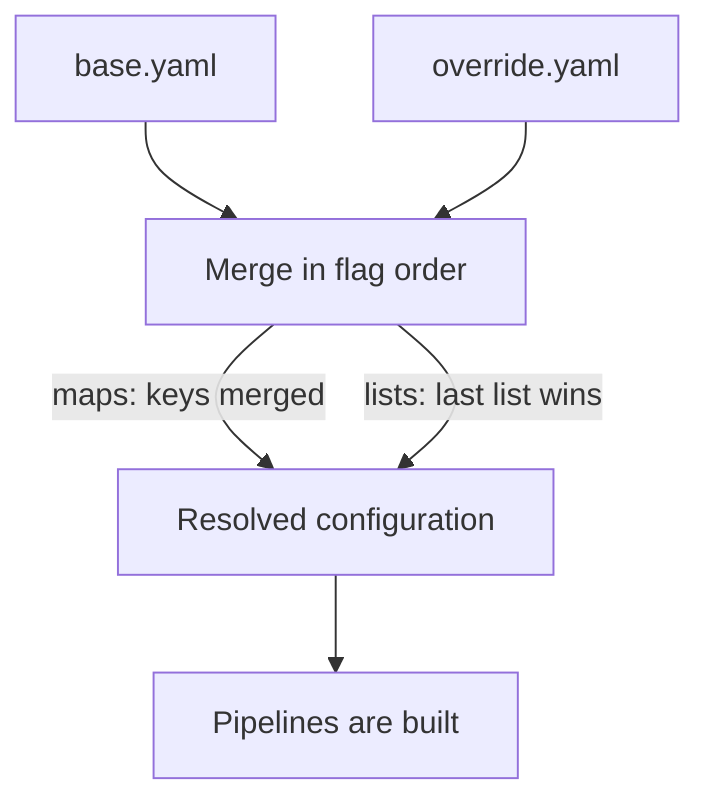

# Several Files, Providers And Secrets

One configuration file is easy to read and hard to share. A team usually wants a base file that every cluster uses and a small file that changes only what differs, such as an exporter address or one processor. The Collector supports this: the `--config` flag can be given more than once, and the Collector merges the sources in order. This part explains the merge rules, where a configuration source can come from, and how to keep a secret out of every file.

## Merging several sources

Each `--config` value is one source. The Collector loads the sources in the order of the flags and merges them into one configuration. A source may be a complete configuration or a part of one, and a part can refer to components that another source defines. The merged result must be complete. If a pipeline lacks a receiver after the merge, the Collector reports an error.

The merge follows two rules. Maps are merged key by key: a later source adds new keys and changes the keys it names, and every other key stays. Lists are replaced: if a later source has the same list, its list is the result and the earlier list is gone. The lists in a pipeline (`receivers`, `processors` and `exporters`) and `service.extensions` are lists, so a later file that sets one of them must write the complete list.

This is a common source of lost data. The base file has `exporters: [debug, otlphttp/gateway]` for the traces pipeline. An override file that only wants to add detail to the debug exporter writes `exporters: [debug]` and removes the gateway from the merged result, and the configuration stays valid. Nothing reports an error, and the backend stops receiving data.



The diagram shows that both files go through one merge. Map keys from both files survive, and for a list only the last file counts.

## Providers

A provider is the part of the Collector that reads one kind of source. The `--config` value and every `${...}` reference start with a scheme that names the provider. These providers are available in the Collector builds from the OpenTelemetry project:

- `file:` reads a file. A plain path without a scheme also means a file.
- `env:` reads the configuration text from an environment variable. `--config=env:MY_CONFIG` takes the YAML from the variable `MY_CONFIG`.
- `yaml:` reads a YAML text given directly on the command line. A `::` separates the levels of the key, as in `--config="yaml:exporters::debug::verbosity: detailed"`.
- `http:` and `https:` read a file from a web address.

The playground agent uses plain paths, `--config=/conf/base.yaml --config=/conf/override.yaml`, where both files are keys of one ConfigMap. The same providers work inside a value. In `${env:NAME}`, the scheme is `env` and the rest is the variable name. A value such as `${file:/secrets/token}` would be replaced by the content of that file.

## Keeping secrets out of the file

A ConfigMap is plain text. Anyone who may read ConfigMaps in the namespace reads every value in it, and so does anyone who sees a copy of the file in a Git repository. A token written into a configuration file is therefore exposed to all of them. The Kubernetes object for secret values is a Secret. A Secret is stored separately and can be given its own access rules. Its data is only base64 encoded, which is not encryption, so the access rules and the cluster settings are what protect it.

There are two ways to give a Secret to the Collector, and both keep the value out of the configuration. The Deployment can read the Secret into an environment variable with `secretKeyRef`, and the file writes `${env:BACKEND_TOKEN}`. Or the Deployment can mount the Secret as a file, and the file writes `${file:/secrets/token}`. The playground agent uses the first way: the Deployment defines `BACKEND_TOKEN` from the key `token` of the Secret `gateway-token`.

<!-- astrona:playground:renew -->

Save these helper functions as `helpers.sh` and load them. `send_otlp` posts a JSON file and prints the HTTP status code, `apply_config` stores `base.yaml` and `override.yaml` in the ConfigMap `otelcol-config`, restarts the agent and waits for it:

```sh
send_otlp() {
  kubectl -n starfleet exec -i deploy/shuttle -- curl -s -o /dev/null -w '%{http_code}\n' -H 'Content-Type: application/json' -d @- "http://otelcol.starfleet.svc.cluster.local:$2/v1/$1" < "$3"
}
gateway_logs() { kubectl -n outpost logs deploy/gateway --tail="${1:-60}"; }
agent_logs() { kubectl -n starfleet logs deploy/otelcol --tail="${1:-60}"; }
apply_config() {
  kubectl -n starfleet create configmap otelcol-config --from-file=base.yaml --from-file=override.yaml --dry-run=client -o yaml | kubectl apply -f - && kubectl -n starfleet rollout restart deployment/otelcol && kubectl -n starfleet rollout status deployment/otelcol --timeout=120s
}
```

```sh
source helpers.sh
```

Save a span as `span.json`:

```json
{"resourceSpans":[{"resource":{"attributes":[{"key":"service.name","value":{"stringValue":"scout"}}]},"scopeSpans":[{"scope":{"name":"manual"},"spans":[{"traceId":"5b8efff798038103d269b633813fc60c","spanId":"eee19b7ec3c1b174","name":"read-sensor","kind":1,"startTimeUnixNano":"1700000000000000000","endTimeUnixNano":"1700000001000000000"}]}]}]}
```

Save the base file as `base.yaml`. It sends traces to the gateway and reads the token from the variable in the `authorization` header:

```yaml
receivers:
  otlp:
    protocols:
      http:
        endpoint: 0.0.0.0:4318
processors:
  batch: {}
exporters:
  debug:
    verbosity: basic
  otlphttp/gateway:
    endpoint: ${env:GATEWAY_ENDPOINT}
    headers:
      authorization: "Bearer ${env:BACKEND_TOKEN}"
service:
  pipelines:
    traces:
      receivers: [otlp]
      processors: [batch]
      exporters: [debug, otlphttp/gateway]
```

Now save an override file that makes the mistake from above. It raises the detail of the debug exporter, which is a map key, and it writes a short exporter list for the pipeline. Save it as `override.yaml`:

```yaml
exporters:
  debug:
    verbosity: detailed
service:
  pipelines:
    traces:
      exporters: [debug]
```

Apply both files and send the span. Then read the agent log and the gateway log:

```sh
apply_config
send_otlp traces 4318 span.json
agent_logs 40
gateway_logs 40
```

The status code is `200`, because the receiver accepted the span. The agent log shows the full span with its name, so the map key `verbosity` was merged: the `debug` exporter in the merged result has the value `detailed` and the rest of the `base.yaml` definition. The gateway log has no new span, because the list `exporters` was replaced and `otlphttp/gateway` is no longer in the merged pipeline.

Fix the override by writing the complete list. Save this as `override.yaml`, then apply and send the span again:

```yaml
exporters:
  debug:
    verbosity: detailed
service:
  pipelines:
    traces:
      exporters: [debug, otlphttp/gateway]
```

```sh
apply_config
send_otlp traces 4318 span.json
gateway_logs 40
```

The gateway log has the span again. The token comes from the Secret and never appears in either file. Prove it from the cluster. The first command shows that the Deployment reads the variable from the Secret, and the second counts how often the token text appears in the ConfigMap (it prints `0`):

```sh
kubectl -n starfleet get deployment otelcol -o jsonpath='{.spec.template.spec.containers[0].env}'
kubectl -n starfleet get configmap otelcol-config -o yaml | grep -c 's3cr3t-lab-token'
```

The base64 text of a Secret decodes with one command, which shows why access rules matter more than the encoding. Run `kubectl -n starfleet get secret gateway-token -o jsonpath='{.data.token}' | base64 --decode` to see the token text.

You now know how several sources merge, which providers exist and how a Secret reaches a value without entering a file. The part of a configuration that this does not cover is the supporting behaviour around the pipelines: health checks and more than one instance of the same component.

## Common pitfalls

> [!WARNING]
> Do not write a short list in a later file and expect it to add to the earlier list: it replaces it, and the configuration stays valid. Write the complete list or keep the list in one file only. Do not put a token in a ConfigMap, even for a test, because every reader of the namespace sees it. Remember that base64 is an encoding, not protection. Keep the order of the `--config` flags in mind, because the last source wins.
