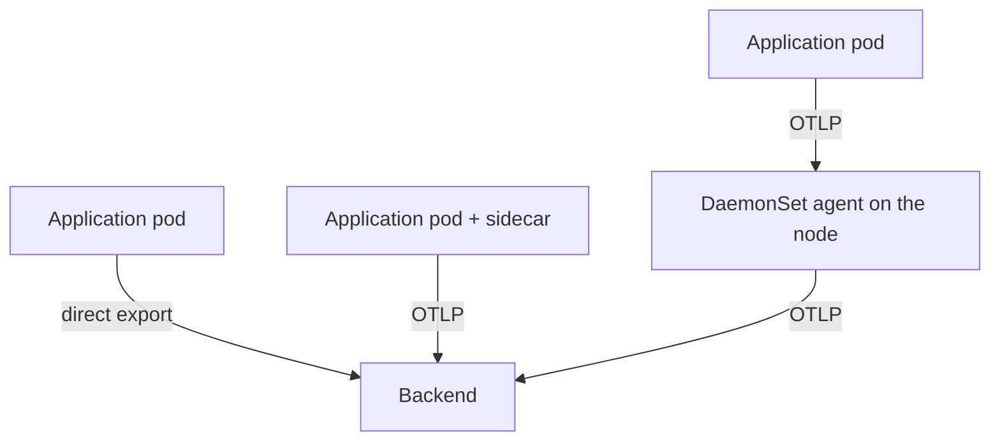

# Agent Topologies: Sidecar, DaemonSet And Direct Export

Every application that uses an OpenTelemetry software development kit (SDK) has to send its telemetry somewhere. The simplest answer is to send it straight to the observability backend. The Collector exists because that answer stops working as soon as many teams, many languages and a backend that changes over time are involved. This part compares the three places where telemetry can first land, and shows which team owns each choice.

## Three patterns

The first pattern uses **no Collector**. The SDK in each application exports with the OpenTelemetry Protocol (OTLP) directly to the backend. The application owns the backend address, the credentials, the retry behavior and the batching. Nothing else runs in the cluster, so nothing else can fail. The cost is that every application image carries backend knowledge, and a change of backend means a change in every application.

The second pattern is a **sidecar** Collector. A sidecar is a second container in the same pod as the application. The application exports to `localhost:4318`, and the sidecar container receives the data over the loopback interface of the pod. The sidecar starts and stops with its pod, and its CPU and memory come out of the budget of that one pod. It sees exactly one workload, so it can add attributes for that workload without any lookup.

The third pattern is a **DaemonSet agent**. A DaemonSet is a Kubernetes workload that runs one pod on every node. Every application on a node exports to the agent pod on that same node. One agent serves all pods of its node, so the cluster runs as many agents as it has nodes and not as many as it has pods. The agent can read things that belong to the node, such as host metrics and container log files, and it can look up the pod that sent each request.



The diagram shows the three paths. The first application sends to the backend itself, the second sends to a Collector in its own pod, and the third sends to the agent of its node.

## What each pattern owns

The patterns differ in who owns which decision. The table lists the main ones.

| Decision | No Collector | Sidecar | DaemonSet agent |
| --- | --- | --- | --- |
| Backend address and credentials | Each application | Each pod template | The platform team, once per node |
| Retry and queue behavior | The SDK of each application | The sidecar | The agent |
| Kubernetes metadata of the sender | The application, if it adds it | Known from the pod, no lookup | Looked up per request |
| Host and node metrics | Not available | Not available | The agent |
| Cost per workload | None | One container per pod | One pod per node |

The table shows why the DaemonSet agent is the usual choice for a platform team. It is one object to deploy, update and secure. The sidecar is the choice when a workload needs its own pipeline, for example its own sampling rule or its own credentials, or when strict isolation between workloads matters more than cost. Direct export fits small systems and tests.

## A node-local address for the application

An application needs an address for its agent. A normal Service spreads requests over all pods that match, so a request from a pod on node A could land on the agent of node B. That breaks two things: the agent on node B does not run on the sender's node, and the extra network hop adds a point of failure. The playground avoids this with one field.

The Service `otel-agent` sets `internalTrafficPolicy: Local`. With this value the cluster routes a request for the Service only to endpoints on the node where the request starts. If the node has no ready agent pod, the request fails instead of going to another node. Two other ways to reach the local agent exist. A pod can use a `hostPort` on the agent container and send to the IP address of its node, which the Kubernetes downward API provides in the field `status.hostIP`. Or a pod can send to a Service address that the platform team documents.

Run these commands to look at the agent. First paste two helper functions. `send_trace` posts one span as OTLP/HTTP JSON from the `shuttle` pod to the agent and prints only the HTTP status. `agent_logs` prints the recent output of the agent.

<!-- astrona:playground:renew -->

```sh
send_trace() {
  kubectl -n starfleet exec deploy/shuttle -- curl -s -o /dev/null -w '%{http_code}\n' --max-time 5 \
    -X POST -H 'Content-Type: application/json' \
    -d '{"resourceSpans":[{"resource":{"attributes":[{"key":"service.name","value":{"stringValue":"'"$1"'"}}]},"scopeSpans":[{"scope":{"name":"reading"},"spans":[{"traceId":"5b8efff798038103d269b633813fc60c","spanId":"eee19b7ec3c1b174","name":"demo","kind":2,"startTimeUnixNano":"1700000000000000000","endTimeUnixNano":"1700000001000000000"}]}]}]}' \
    http://otel-agent.starfleet.svc:4318/v1/traces
}
agent_logs() {
  kubectl -n starfleet logs -l app=otel-agent --tail="${1:-80}"
}
```

Now list the DaemonSet and its pods with the node of each pod, and read the traffic policy of the Service:

```sh
kubectl -n starfleet get daemonset,pods -o wide
kubectl -n starfleet get service otel-agent -o jsonpath='{.spec.internalTrafficPolicy}{"\n"}'
```

The DaemonSet shows `DESIRED` and `READY` counts that match the number of nodes, which is one in the playground. The second command prints `Local`.

## Send a span and read it at the agent

The JSON in `send_trace` is an OTLP trace request with one resource, one scope and one span. The `resource` block describes the sender, and here it only holds `service.name`. The Collector receives it on the `otlp` receiver and passes it to the `debug` exporter, which prints it. Send one span and read the output:

```sh
send_trace scout
agent_logs 60
```

The first command prints `200`, which means the `otlp` receiver accepted the span. In the output of the second command, look for a block that starts with `ResourceSpans` and has a `Resource attributes` section. It lists the attributes in the form `-> service.name: Str(scout)`. Only the attribute that the sender wrote is there. The agent knows which node it runs on, and it can find out which pod sent the span, but it adds nothing yet.

## Failure domains

A failure domain is the set of things that stop working together when one component fails. Each pattern has a different one. With direct export the failure domain of the backend is every application, and each SDK keeps its own queue and gives up in its own way. With a sidecar the failure domain of a Collector crash is one pod, and the application keeps running. With a DaemonSet agent the failure domain is one node: while the agent pod restarts, every application on that node has nowhere to send telemetry, and each SDK decides how long it retries and how much it keeps in memory.

The node boundary also decides what an agent can break. A DaemonSet agent that mounts the host file system, reads the logs of all pods and holds a ClusterRole is a powerful workload. A sidecar is limited to what its pod can see. Platform teams weigh this when they decide how much to put in one agent.

You now know the three places where telemetry can land and the decisions that each place gives to a different team. The agent on a node still adds nothing to what an application sends, and the next question is how it learns which pod sent a span.

## Common pitfalls

> [!WARNING]
> A normal Service does not keep a request on the node of the sender. Without `internalTrafficPolicy: Local` or a host address, a request can reach an agent on another node, and attributes that depend on the node are wrong. With `Local`, a node without a ready agent pod drops the request instead of forwarding it, so the DaemonSet must tolerate every node taint that application pods tolerate. Also do not read a successful `200` from the receiver as proof that the backend got the data: the status only says that the first Collector accepted it.
