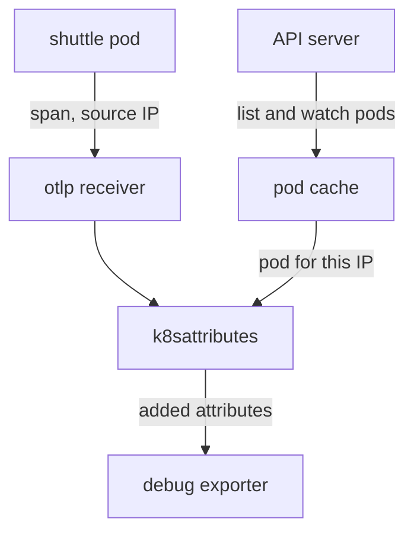

# Enriching Telemetry At The Edge

A span that says `service.name: scout` is useful, but it does not say which pod, which node or which namespace produced it. During an incident that is the first thing an engineer needs. The application often does not know these facts, and teams that add them in every application add them differently. The agent is the best place to add them, because it sits next to the sender and can ask the Kubernetes API which pod owns a request.

## What the k8sattributes processor does

The `k8sattributes` processor is a Collector component that adds Kubernetes metadata to the resource attributes of traces, metrics and logs. A resource is the description of the entity that produced the telemetry, and resource attributes are the key and value pairs in that description. The processor works in three steps.

First, it keeps a local cache of pods. At start it asks the Kubernetes API server for the list of pods and then keeps a watch open, so the cache follows every change. Second, for each batch of telemetry it finds the pod that sent it. This step is called pod association. Third, it copies the requested metadata from the cached pod into the resource attributes.

The API server must allow the first step. The processor needs `get`, `list` and `watch` on `pods` and `namespaces` through a ClusterRole when it works cluster-wide. Without that permission the cache stays empty, the Collector logs an error that contains `forbidden`, and the telemetry passes through without the new attributes.

## Pod association

Pod association is the rule that turns a request into a pod. The `pod_association` option is a list of rules. The processor tries them in order and uses the first rule that matches. A rule has a list of `sources`, and all sources of one rule must match. A source reads either a resource attribute (`from: resource_attribute` with a `name`, such as `k8s.pod.ip`) or the network address of the connection (`from: connection`).

Association by connection is the right default for an agent. The agent receives the request from the pod over the cluster network, and a request that stays inside the cluster keeps the pod IP address as its source address. The processor looks that address up in its cache. This works only when the request reaches the agent directly. A request that passes through a gateway or a proxy carries the address of that hop, not the address of the pod. That is one reason to enrich at the agent and not further down the path.



The diagram shows the cache that the API server fills and the processor that reads it for each span.

## The node filter keeps the agent small

A cluster can have thousands of pods. An agent only needs the pods on its own node, because only those pods send to it. The option `filter.node_from_env_var` limits the list and watch calls to the pods whose `spec.nodeName` equals the value of an environment variable. The DaemonSet fills that variable with the Kubernetes downward API:

```yaml
env:
  - name: KUBE_NODE_NAME
    valueFrom:
      fieldRef:
        fieldPath: spec.nodeName
```

Without the filter, each of the agents in a large cluster would hold the whole pod list in memory and would put the same load on the API server. With the filter, the memory and the API load grow with the pods per node and not with the cluster.

## Add the processor

Start with the environment variable. Save this as `patch-agent-node.yaml`. It is a strategic merge patch that adds the variable to the `collector` container of the DaemonSet:

<!-- astrona:playground:renew -->

```yaml
spec:
  template:
    spec:
      containers:
        - name: collector
          env:
            - name: KUBE_NODE_NAME
              valueFrom:
                fieldRef:
                  fieldPath: spec.nodeName
```

Apply it:

```sh
kubectl -n starfleet patch daemonset otel-agent --patch-file patch-agent-node.yaml
```

Now save the new agent configuration as `otel-agent-config.yaml`. It adds the processor to the `traces` pipeline and lists the four attributes to copy. `k8s.deployment.name` is in the list because the processor adds it only when you ask for it:

```yaml
apiVersion: v1
kind: ConfigMap
metadata:
  name: otel-agent-config
  namespace: starfleet
data:
  config.yaml: |
    extensions:
      health_check:
        endpoint: 0.0.0.0:13133

    receivers:
      otlp:
        protocols:
          http:
            endpoint: 0.0.0.0:4318

    processors:
      k8sattributes:
        filter:
          node_from_env_var: KUBE_NODE_NAME
        extract:
          metadata:
            - k8s.namespace.name
            - k8s.pod.name
            - k8s.node.name
            - k8s.deployment.name
        pod_association:
          - sources:
              - from: connection

    exporters:
      debug:
        verbosity: detailed

    service:
      extensions: [health_check]
      pipelines:
        traces:
          receivers: [otlp]
          processors: [k8sattributes]
          exporters: [debug]
```

Apply it and restart the agent, because the Collector does not reload its file while it runs. Then define two helper functions: `send_trace` posts one span from `shuttle` and `agent_logs` prints the agent output.

```sh
kubectl apply -f otel-agent-config.yaml
kubectl -n starfleet rollout restart daemonset/otel-agent
kubectl -n starfleet rollout status daemonset/otel-agent
send_trace() {
  kubectl -n starfleet exec deploy/shuttle -- curl -s -o /dev/null -w '%{http_code}\n' --max-time 5 \
    -X POST -H 'Content-Type: application/json' \
    -d '{"resourceSpans":[{"resource":{"attributes":[{"key":"service.name","value":{"stringValue":"'"$1"'"}}]},"scopeSpans":[{"scope":{"name":"reading"},"spans":[{"traceId":"5b8efff798038103d269b633813fc60c","spanId":"eee19b7ec3c1b174","name":"demo","kind":2,"startTimeUnixNano":"1700000000000000000","endTimeUnixNano":"1700000001000000000"}]}]}]}' \
    http://otel-agent.starfleet.svc:4318/v1/traces
}
agent_logs() {
  kubectl -n starfleet logs -l app=otel-agent --tail="${1:-80}"
}
```

## See the permission error, then fix it

Send a span and read the output of the agent:

```sh
send_trace scout
agent_logs 100
```

The span is accepted with `200`, but the service account `otel-agent` has no rights yet. In the output, look for an error line that contains the word `forbidden` and names `pods`. The span in the debug output has only `service.name`. This is the failure to learn: the pipeline does not stop, so nothing alerts you, and the telemetry loses its context silently.

Save this as `rbac-otel-agent.yaml`:

```yaml
apiVersion: rbac.authorization.k8s.io/v1
kind: ClusterRole
metadata:
  name: otel-agent
rules:
  - apiGroups: [""]
    resources: ["pods", "namespaces"]
    verbs: ["get", "list", "watch"]
---
apiVersion: rbac.authorization.k8s.io/v1
kind: ClusterRoleBinding
metadata:
  name: otel-agent
roleRef:
  apiGroup: rbac.authorization.k8s.io
  kind: ClusterRole
  name: otel-agent
subjects:
  - kind: ServiceAccount
    name: otel-agent
    namespace: starfleet
```

Apply it, restart the agent so the processor retries its first list call, wait for the new pod and send another span:

```sh
kubectl apply -f rbac-otel-agent.yaml
kubectl -n starfleet rollout restart daemonset/otel-agent
kubectl -n starfleet rollout status daemonset/otel-agent
send_trace scout
agent_logs 100
```

Now the resource attributes of the span should also list `k8s.namespace.name`, `k8s.pod.name` (a name that starts with `shuttle-`), `k8s.node.name` and `k8s.deployment.name`. The agent found the sender by its source address, read the cached pod and copied the metadata.

## Passthrough: a different division of work

The processor has a second mode for agents. With `passthrough: true` the agent does not call the Kubernetes API and does not cache pods. It only adds the pod IP address as an attribute to the telemetry, and a later Collector does the lookup. This keeps agents free of API permissions, but the later Collector must receive the telemetry with the pod address intact, and it needs the read access itself. Whether to enrich at the agent or defer the lookup is a decision about where the API permission lives, and it is worth making on purpose.

The agent now adds the identity of the sender. The telemetry still lacks facts that belong to the environment and the host, and the agent has to protect itself while it collects more.

## Common pitfalls

> [!WARNING]
> A missing RBAC rule does not stop the pipeline. The agent keeps accepting spans and exports them without the Kubernetes attributes, and the only sign is an error line in its own log. Check the agent log after every change to the processor. Also set `filter.node_from_env_var` on a DaemonSet, and make sure the environment variable exists: a filter with a variable that nobody sets does not select the pods of the node. Finally, restart the agent after a ConfigMap change; the Collector reads its file only at start.
