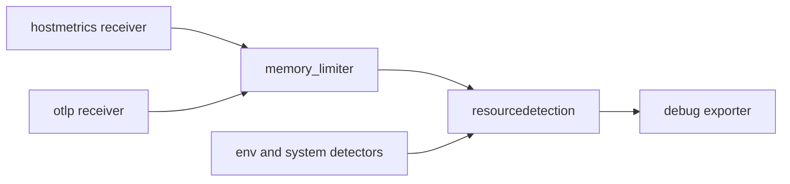

# Resource Attributes, Host Metrics And Failure Domains

An agent that runs on every node can describe more than the pods on it. It can describe the node itself, and it can measure the node. That is a second job, and it brings a new risk: the agent now uses CPU and memory on a machine that runs the business workloads. This part covers the detection of resource attributes, the collection of host metrics, the memory protection that keeps the agent from harming its neighbours, and what breaks when the agent stops.

## Resource attributes from the environment and the host

The `resourcedetection` processor adds attributes that describe where the Collector runs. It works through a list of detectors. Two detectors matter for a basic agent:

- `env` reads the environment variable `OTEL_RESOURCE_ATTRIBUTES`, a comma-separated list of `key=value` pairs. It is the way to attach facts that the platform team knows but no API reports, such as the name of the deployment environment.
- `system` reads facts from the operating system, such as `host.name` and `os.type`.

Two options decide how the processor behaves. `timeout` limits how long detection may take at start. `override` decides what happens when the telemetry already has an attribute with the same key. The default is `true`, which replaces the value that the sender set. Setting `override: false` keeps the value from the sender and only fills the gaps. For an agent that serves many applications, `false` is the safer choice, because an application usually knows its own `service.name` better than the agent does.

## Host metrics

The `hostmetrics` receiver is a pull receiver: it does not wait for a sender. On a schedule set by `collection_interval`, it reads the operating system and produces metrics. Each entry under `scrapers` turns on one family of metrics, such as `load` for load average and `memory` for memory use.

On a DaemonSet, the receiver sees the file system of the container, not the file system of the node. For the `load` and `memory` scrapers this is not a problem, because the kernel reports values for the whole machine to every process. Scrapers that read mounted file systems or processes are different. They need the root of the node mounted into the container, and the receiver option `root_path` must point at that mount. That change also grants the container read access to the host, so add it only when you need those scrapers.

## Protect the node with memory_limiter

An agent that is out of memory is killed by the kernel, and then it restarts, which loses its in-memory data. The `memory_limiter` processor acts before that. It checks the memory use of the Collector at an interval. When use passes the soft limit, which is `limit_mib` minus `spike_limit_mib`, the processor starts to refuse data, and the receivers answer the sender with a retryable error. When use passes `limit_mib`, it also forces a garbage collection.

Two rules make the processor work. It must be the first processor in each pipeline, so that data is refused before more work is done on it. And `limit_mib` must be lower than the memory limit of the container, or the kernel acts first. In this part the container limit is `256Mi` and the processor limit is `150`.



The diagram shows the memory limiter at the front of the path, and the detection processor adding the attributes before data reaches the exporter.

## Build the agent

Reset the playground so that the agent starts from the plain version. Then save this as `patch-agent-env.yaml`. It sets one environment variable on the agent container for the `env` detector:

<!-- astrona:playground:renew -->

```yaml
spec:
  template:
    spec:
      containers:
        - name: collector
          env:
            - name: OTEL_RESOURCE_ATTRIBUTES
              value: deployment.environment.name=lab
```

Apply it:

```sh
kubectl -n starfleet patch daemonset otel-agent --patch-file patch-agent-env.yaml
```

Save the agent configuration as `otel-agent-config.yaml`. It has two pipelines: traces from the OTLP receiver and metrics from `hostmetrics`, both with the same processors in the same order:

```yaml
apiVersion: v1
kind: ConfigMap
metadata:
  name: otel-agent-config
  namespace: starfleet
data:
  config.yaml: |
    extensions:
      health_check:
        endpoint: 0.0.0.0:13133

    receivers:
      otlp:
        protocols:
          http:
            endpoint: 0.0.0.0:4318
      hostmetrics:
        collection_interval: 10s
        scrapers:
          load:
          memory:

    processors:
      memory_limiter:
        check_interval: 1s
        limit_mib: 150
        spike_limit_mib: 30
      resourcedetection:
        detectors: [env, system]
        timeout: 2s
        override: false

    exporters:
      debug:
        verbosity: detailed

    service:
      extensions: [health_check]
      pipelines:
        traces:
          receivers: [otlp]
          processors: [memory_limiter, resourcedetection]
          exporters: [debug]
        metrics:
          receivers: [hostmetrics]
          processors: [memory_limiter, resourcedetection]
          exporters: [debug]
```

Apply it, restart the agent and wait for the new pod. Then read the output. The first host metrics arrive after one collection interval, so wait about fifteen seconds before the check:

```sh
kubectl apply -f otel-agent-config.yaml
kubectl -n starfleet rollout restart daemonset/otel-agent
kubectl -n starfleet rollout status daemonset/otel-agent
kubectl -n starfleet logs -l app=otel-agent --tail=120
```

In the output, look for resource attributes `host.name` and `deployment.environment.name` with the value `lab`, and for metric names that start with `system.cpu.load_average` and `system.memory`. The names come from the receiver, so read them in your own output and do not rely on a remembered list.

## What fails when the agent stops

The agent is on the path of every sender on its node. To see the failure domain, delete the agent pod and send a span at once:

```sh
kubectl -n starfleet delete pod -l app=otel-agent --wait=false
kubectl -n starfleet exec deploy/shuttle -- curl -s -o /dev/null -w '%{http_code}\n' --max-time 3 \
  -X POST -H 'Content-Type: application/json' -d '{"resourceSpans":[]}' \
  http://otel-agent.starfleet.svc:4318/v1/traces
```

While the pod is gone, the request fails or times out, because the Service has no ready endpoint on that node. With `internalTrafficPolicy: Local` there is no fallback to another node. The DaemonSet controller starts a replacement quickly, and the readiness probe on port 13133 keeps traffic away until the new pod is ready. Telemetry that was in the memory of the old pod is gone. Only the senders on that one node are affected, and that is the point of the pattern: the failure domain is one node. It is also why the senders need their own retry, and why the agent should stay small and simple.

## Common pitfalls

> [!WARNING]
> Put `memory_limiter` first in every pipeline, and keep `limit_mib` below the container memory limit. If the order is wrong, or the limit is higher than the container limit, the kernel kills the agent before the processor can act, and the data in memory is lost. Also remember that `override: true` is the default for `resourcedetection`: it silently replaces attributes that your applications set. Finally, do not add scrapers that need the node file system without setting `root_path` and mounting the node, or they report the container and not the node.
