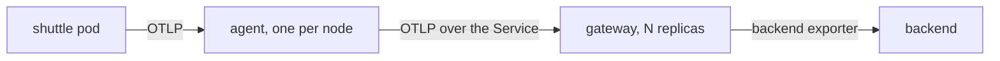

# Deploying A Gateway And Exporting To It

A gateway is a Collector that receives telemetry from other Collectors and applications, and sends it on. It does not sit on a node and it does not serve one workload. It is deployed once for a cluster or for a team, and every agent sends to it. This part shows what a gateway is made of in Kubernetes, how an agent finds it, and how to check that data takes the new path.

## Why a gateway is a Deployment

A DaemonSet agent has one pod per node because its job is tied to the node: it sees the local pods and the local host. A gateway has no such tie. It receives data over the network, holds no state that must survive a restart, and any replica can handle any request. These three facts make it a normal stateless workload:

- A `Deployment` runs the replicas and replaces a pod that fails.
- A `Service` gives the replicas one stable DNS name and spreads new connections over the ready pods.
- A `ConfigMap` holds the Collector configuration, mounted at `/conf` with `--config=/conf/config.yaml`.

The number of replicas is a decision about capacity and availability, and it can change without touching the agents. The Service name is the contract. Agents know `otel-gateway.starfleet.svc` and nothing about the pods behind it.

## What the gateway owns

The reason to add a tier is to move decisions out of the agents. The gateway owns the connection to the backend: the address, the credentials and the retry behaviour. It is also the place for work that needs a wider view than one node, such as one common set of attribute rules for all clusters. The agent owns what only the edge can know. When the backend changes, you change one Deployment and not every node.



The diagram shows two hops: the application to its agent, and the agent to the gateway, with only the gateway talking to the backend.

## Deploy the gateway

Start with a gateway that only prints what it receives. This isolates the new hop from the backend, so a problem is easy to place. Save the Deployment, the Service and the configuration as `gateway.yaml`:

<!-- astrona:playground:renew -->

```yaml
apiVersion: v1
kind: ConfigMap
metadata:
  name: otel-gateway-config
  namespace: starfleet
data:
  config.yaml: |
    extensions:
      health_check:
        endpoint: 0.0.0.0:13133

    receivers:
      otlp:
        protocols:
          http:
            endpoint: 0.0.0.0:4318

    processors:
      memory_limiter:
        check_interval: 1s
        limit_mib: 150
        spike_limit_mib: 30
      batch:

    exporters:
      debug:
        verbosity: detailed

    service:
      extensions: [health_check]
      pipelines:
        traces:
          receivers: [otlp]
          processors: [memory_limiter, batch]
          exporters: [debug]
---
apiVersion: apps/v1
kind: Deployment
metadata:
  name: otel-gateway
  namespace: starfleet
  labels:
    app: otel-gateway
spec:
  replicas: 2
  selector:
    matchLabels:
      app: otel-gateway
  template:
    metadata:
      labels:
        app: otel-gateway
    spec:
      containers:
        - name: collector
          image: otel/opentelemetry-collector-contrib:0.162.0
          args: ["--config=/conf/config.yaml"]
          ports:
            - name: otlp-http
              containerPort: 4318
            - name: health
              containerPort: 13133
          readinessProbe:
            httpGet:
              path: /
              port: 13133
          resources:
            requests:
              cpu: 50m
              memory: 128Mi
            limits:
              memory: 256Mi
          volumeMounts:
            - name: conf
              mountPath: /conf
      volumes:
        - name: conf
          configMap:
            name: otel-gateway-config
---
apiVersion: v1
kind: Service
metadata:
  name: otel-gateway
  namespace: starfleet
spec:
  selector:
    app: otel-gateway
  ports:
    - name: otlp-http
      port: 4318
      targetPort: otlp-http
```

Apply it and wait for both replicas. Then list the endpoints of the Service, which are the pod addresses that receive traffic:

```sh
kubectl apply -f gateway.yaml
kubectl -n starfleet rollout status deployment/otel-gateway
kubectl -n starfleet get endpoints otel-gateway
```

The endpoint list should show two addresses on port `4318`. A pod appears in the list only after its readiness probe on port `13133` passes, so a gateway pod that is still starting receives no traffic.

## Point the agent at the gateway

The agent receives OTLP as before. Its exporter changes: the `otlphttp` exporter sends OTLP over HTTP to an endpoint, and the endpoint is now the Service of the gateway. The `batch` processor groups spans into larger requests, which lowers the number of calls between the tiers. Save the new agent configuration as `otel-agent-config.yaml`:

```yaml
apiVersion: v1
kind: ConfigMap
metadata:
  name: otel-agent-config
  namespace: starfleet
data:
  config.yaml: |
    extensions:
      health_check:
        endpoint: 0.0.0.0:13133

    receivers:
      otlp:
        protocols:
          http:
            endpoint: 0.0.0.0:4318

    processors:
      memory_limiter:
        check_interval: 1s
        limit_mib: 150
        spike_limit_mib: 30
      batch:

    exporters:
      otlphttp/gateway:
        endpoint: http://otel-gateway.starfleet.svc:4318

    service:
      extensions: [health_check]
      pipelines:
        traces:
          receivers: [otlp]
          processors: [memory_limiter, batch]
          exporters: [otlphttp/gateway]
```

The name `otlphttp/gateway` is a type and a name. The part after the slash lets one configuration hold several exporters of the same type. Apply the file and restart the agent, because the Collector reads its file only at start:

```sh
kubectl apply -f otel-agent-config.yaml
kubectl -n starfleet rollout restart daemonset/otel-agent
kubectl -n starfleet rollout status daemonset/otel-agent
```

## Send a span and follow it

Post a span through the agent. Then read the output of the gateway. The batch processor waits for its timeout before it sends, so allow a few seconds:

```sh
kubectl -n starfleet exec deploy/shuttle -- curl -s -o /dev/null -w '%{http_code}\n' --max-time 5 \
  -X POST -H 'Content-Type: application/json' \
  -d '{"resourceSpans":[{"resource":{"attributes":[{"key":"service.name","value":{"stringValue":"scout"}}]},"scopeSpans":[{"scope":{"name":"reading"},"spans":[{"traceId":"5b8efff798038103d269b633813fc60c","spanId":"eee19b7ec3c1b174","name":"demo","kind":2,"startTimeUnixNano":"1700000000000000000","endTimeUnixNano":"1700000001000000000"}]}]}]}' \
  http://otel-agent.starfleet.svc:4318/v1/traces
kubectl -n starfleet logs -l app=otel-gateway --tail=60 --prefix
```

The request answers `200`, which means that the agent accepted the span, not that the gateway has it. The log command prints the output of both gateway replicas with a pod prefix. One of them should show the span with `service.name` set to `scout`. Which replica it is depends on how the Service spread the connection, so look in both outputs. The debug gateway accepts anything without a password, which is the point of this first step.

## Common pitfalls

> [!WARNING]
> An answer of `200` from the agent proves only that the first hop worked. Always read the log of the next tier before you say that data arrives. The most common mistakes are a wrong Service name or port in the exporter endpoint, forgetting to restart the agent after a ConfigMap change, and a gateway pod that is not ready, so the Service has no endpoint. Check the endpoint list first when the agent log shows connection errors.
