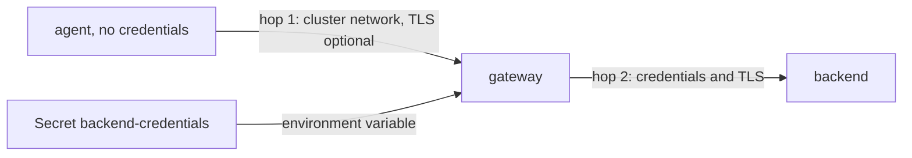

# Centralising Credentials And Securing The Hop

A backend almost always asks the sender to prove who it is. If every agent exports straight to the backend, every agent holds the secret, and a cluster with a hundred nodes has a hundred copies of it. Rotating the secret means changing and restarting all of them. A gateway fixes this by changing who the backend talks to: only the gateway holds the credentials, and agents hold none. This part shows how to move the credentials, and then looks at how the two hops can be protected.

## Where the secret lives

In the starting state, the agent configuration contains the password in plain text, inside a ConfigMap. A ConfigMap is not meant for secrets: anyone who can read ConfigMaps in the namespace can read the password, and it appears in every copy of the manifest that you keep in version control. A Kubernetes Secret is a better place. A Secret has its own access rules and can be encrypted at rest by the cluster, depending on how the cluster is set up.

The Collector can read environment variables inside its configuration. The expression `${env:BACKEND_PASSWORD}` is replaced with the value of the variable when the Collector starts. Together with a `secretKeyRef` in the Deployment, this keeps the password out of the ConfigMap: the ConfigMap holds only the name of the variable, and the Secret holds the value. Do not put the password in the container `args`, because arguments are visible in the pod description.

## Authentication options

The component that adds credentials to outgoing requests is an extension on the client side, and the component that checks them is an extension on the server side. Both are named in the `auth` setting of the exporter or the receiver. This part uses `basicauth`, which sends a user name and a password. It is chosen here because it needs no certificates, so it works in a plain-manifest playground. Other options exist, and the choice depends on what the backend supports:

- `bearertokenauth` sends a token in the `Authorization` header. Many hosted backends use an API key in this way. Check the documentation of the component for the transport it requires before you use it.
- `oauth2client` fetches short-lived tokens from an identity provider. It suits platforms that do not accept long-lived keys.
- A header on the exporter itself, with the `headers` option, covers backends that expect a custom header such as an API key.

Basic authentication sends the password in every request, encoded and not encrypted. Without TLS, anyone who can read the network traffic can read the password. In this playground the traffic stays inside one cluster and the risk is accepted to keep the exercise small. In a real cluster, protect the hop.

## Transport security, conceptually

TLS (Transport Layer Security) encrypts the connection and lets the client check the identity of the server. Both the receiver and the exporter have a `tls` section. On the receiving side, you set the certificate and key that the server shows. On the exporting side, you set the certificate authority that the client trusts. Mutual TLS adds a client certificate, so the server also checks the client, and then a password is not needed on that hop at all.

Where the certificates come from is a separate operational question. A cluster certificate manager can create them and mount them as Secrets, and the Collector reads the files. Certificate rotation then means that the files change, and the Collector must reload them. The `tls` section supports a `reload_interval`, which makes the Collector check the files again. These features need infrastructure that this course does not install, so this part describes them and does not run them.



The diagram shows that the Secret reaches only the gateway, and that the second hop is the one that carries the credentials out of the cluster.

## Move the credentials

First look at the state. Count where the password is written, and confirm that the Secret exists:

<!-- astrona:playground:renew -->

```sh
kubectl -n starfleet get configmap otel-agent-config -o jsonpath='{.data.config\.yaml}' | grep -n password
kubectl -n starfleet get secret backend-credentials -o jsonpath='{.data.username}' | base64 -d; echo
```

The first command should print the line with the password in the agent configuration. The second prints the user name from the Secret and does not print the password.

Save the gateway as `gateway.yaml`. The ConfigMap uses the variable for the password, and the Deployment fills the variable from the Secret. The backend exporter uses the `basicauth/backend` extension:

```yaml
apiVersion: v1
kind: ConfigMap
metadata:
  name: otel-gateway-config
  namespace: starfleet
data:
  config.yaml: |
    extensions:
      health_check:
        endpoint: 0.0.0.0:13133
      basicauth/backend:
        client_auth:
          username: gateway
          password: ${env:BACKEND_PASSWORD}

    receivers:
      otlp:
        protocols:
          http:
            endpoint: 0.0.0.0:4318

    processors:
      memory_limiter:
        check_interval: 1s
        limit_mib: 150
        spike_limit_mib: 30
      batch:

    exporters:
      otlphttp/backend:
        endpoint: http://otel-backend.starfleet.svc:4318
        auth:
          authenticator: basicauth/backend

    service:
      extensions: [health_check, basicauth/backend]
      pipelines:
        traces:
          receivers: [otlp]
          processors: [memory_limiter, batch]
          exporters: [otlphttp/backend]
---
apiVersion: apps/v1
kind: Deployment
metadata:
  name: otel-gateway
  namespace: starfleet
  labels:
    app: otel-gateway
spec:
  replicas: 2
  selector:
    matchLabels:
      app: otel-gateway
  template:
    metadata:
      labels:
        app: otel-gateway
    spec:
      containers:
        - name: collector
          image: otel/opentelemetry-collector-contrib:0.162.0
          args: ["--config=/conf/config.yaml"]
          env:
            - name: BACKEND_PASSWORD
              valueFrom:
                secretKeyRef:
                  name: backend-credentials
                  key: password
          ports:
            - name: otlp-http
              containerPort: 4318
            - name: health
              containerPort: 13133
          readinessProbe:
            httpGet:
              path: /
              port: 13133
          resources:
            requests:
              cpu: 50m
              memory: 128Mi
            limits:
              memory: 256Mi
          volumeMounts:
            - name: conf
              mountPath: /conf
      volumes:
        - name: conf
          configMap:
            name: otel-gateway-config
---
apiVersion: v1
kind: Service
metadata:
  name: otel-gateway
  namespace: starfleet
spec:
  selector:
    app: otel-gateway
  ports:
    - name: otlp-http
      port: 4318
      targetPort: otlp-http
```

Apply it and wait for the rollout:

```sh
kubectl apply -f gateway.yaml
kubectl -n starfleet rollout status deployment/otel-gateway
```

Now change the agent. Its configuration loses the extension and the `auth` line, and its exporter points at the Service of the gateway. Save this as `otel-agent-config.yaml`:

```yaml
apiVersion: v1
kind: ConfigMap
metadata:
  name: otel-agent-config
  namespace: starfleet
data:
  config.yaml: |
    extensions:
      health_check:
        endpoint: 0.0.0.0:13133

    receivers:
      otlp:
        protocols:
          http:
            endpoint: 0.0.0.0:4318

    processors:
      memory_limiter:
        check_interval: 1s
        limit_mib: 150
        spike_limit_mib: 30
      batch:

    exporters:
      otlphttp/gateway:
        endpoint: http://otel-gateway.starfleet.svc:4318

    service:
      extensions: [health_check]
      pipelines:
        traces:
          receivers: [otlp]
          processors: [memory_limiter, batch]
          exporters: [otlphttp/gateway]
```

Apply it, restart the agent, and then prove three things. The agent configuration has no password. The backend still refuses anonymous requests. A span sent through the agent reaches the backend:

```sh
kubectl apply -f otel-agent-config.yaml
kubectl -n starfleet rollout restart daemonset/otel-agent
kubectl -n starfleet rollout status daemonset/otel-agent
kubectl -n starfleet get configmap otel-agent-config -o yaml | grep -c password
kubectl -n starfleet exec deploy/shuttle -- curl -s -o /dev/null -w '%{http_code}\n' --max-time 5 \
  -X POST -H 'Content-Type: application/json' -d '{"resourceSpans":[]}' \
  http://otel-backend.starfleet.svc:4318/v1/traces
```

The `grep -c` command should print `0`. The `curl` call goes to the backend without credentials and should print `401`. To finish, send a span through the agent and read the output of the backend. Because the batch processor waits, allow a few seconds before you read:

```sh
kubectl -n starfleet exec deploy/shuttle -- curl -s -o /dev/null -w '%{http_code}\n' --max-time 5 \
  -X POST -H 'Content-Type: application/json' \
  -d '{"resourceSpans":[{"resource":{"attributes":[{"key":"service.name","value":{"stringValue":"scout"}}]},"scopeSpans":[{"scope":{"name":"reading"},"spans":[{"traceId":"5b8efff798038103d269b633813fc60c","spanId":"eee19b7ec3c1b174","name":"demo","kind":2,"startTimeUnixNano":"1700000000000000000","endTimeUnixNano":"1700000001000000000"}]}]}]}' \
  http://otel-agent.starfleet.svc:4318/v1/traces
kubectl -n starfleet logs deploy/otel-backend --tail=60
```

The backend output should show the span with `service.name` set to `scout`. The gateway added the credentials, so the span passed the check that the anonymous request failed.

## Rotation

To change the password, you update the Secret and the htpasswd line of the backend. A pod reads an environment variable only at start, so the gateway needs a restart to see the new value. If you mount the Secret as a file and read it with the `${file:...}` syntax or with a file option, the file updates in place, but the Collector still reads its configuration only at start, so a restart is still needed for this pattern. The gain of the gateway is the scope: one Deployment restarts, and no agent changes.

## Common pitfalls

> [!WARNING]
> Moving the password is not finished until the old copies are gone. Check the agent ConfigMap, the DaemonSet and any manifest in version control for the old value, and rotate the password if it was ever committed. Also remember that a Secret is only base64 encoded, not encrypted, unless the cluster encrypts it at rest, and that basic authentication without TLS sends the password readable on the network. Do not put secrets in the `args` of the container, where `kubectl describe pod` shows them.
