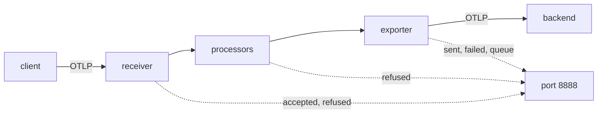

# Reading The Collector's Own Metrics

Before you can scale a Collector, you must know where it is slow. The Collector is a program that receives telemetry, changes it and sends it on, and each of those three jobs can be the one that falls behind. The Collector reports on all three. This part shows where the reports are, what the main numbers mean, and how to read them in a gateway that is under load.

## Where the numbers come from

Every Collector produces **internal telemetry**, also called self-telemetry: metrics and logs about its own work. The metrics are served on port 8888 at the path `/metrics` in the Prometheus text format. A Collector that is running on a laptop answers on `127.0.0.1:8888`, because the default address is the loopback interface of the process. In a pod, that default is not reachable from other pods, so a gateway must bind the endpoint to all interfaces.

You set this under `service.telemetry.metrics.readers`. A **reader** is a component of the Collector's own metrics system that turns the numbers into an output. A `pull` reader with a `prometheus` exporter serves them over HTTP. The gateway in the playground already has this block:

```yaml
service:
  telemetry:
    metrics:
      readers:
        - pull:
            exporter:
              prometheus:
                host: 0.0.0.0
                port: 8888
```

The block is part of the ConfigMap `gateway-config`, so there is nothing to apply here. The `host` value `0.0.0.0` makes the process listen on every interface of the pod. The Service `gateway` forwards its port 8888 to that port, which is how other pods read the numbers.



The diagram shows that each stage reports its own counters on the same endpoint, so one request to port 8888 describes the whole path.

## The numbers that matter

The Collector exposes many metrics, and a few answer most capacity questions. All names start with `otelcol_`. Depending on the version, a counter name may end in `_total` and a metric may carry a unit suffix, so match on the prefix and not on the full name.

- `otelcol_receiver_accepted_spans` counts spans that the receiver passed into the pipeline. It grows with the load that reaches the Collector.
- `otelcol_receiver_refused_spans` counts spans that the receiver could not pass on, because a processor or the next component returned an error. The sender sees an error response and may retry.
- `otelcol_processor_refused_spans` counts spans that a processor refused. The memory limiter is the usual source.
- `otelcol_exporter_sent_spans` counts spans that the exporter delivered to the destination.
- `otelcol_exporter_send_failed_spans` counts spans that the exporter tried to send and could not, even after its retries.
- `otelcol_exporter_enqueue_failed_spans` counts spans that the exporter could not even put in its queue, because the queue was full.
- `otelcol_exporter_queue_size` is the number of items that wait in the exporter queue now, and `otelcol_exporter_queue_capacity` is the most the queue can hold. The unit is requests (batches), not single spans, with the default queue settings.
- `otelcol_process_memory_rss` and the CPU metrics describe the process itself.

Each metric carries labels, for example the name of the exporter, so a Collector with two exporters has two queue size lines.

## Which part is the bottleneck

A **bottleneck** is the component that limits how much data the whole path can carry. The metrics point at it in a repeatable way. Compare the incoming rate with the outgoing rate, and look at the queue between them.

If `accepted` rises and `sent` rises with it, and the queue stays near zero, the Collector keeps up. If the queue size grows toward its capacity while `sent` stays flat, the destination is the bottleneck: the exporter cannot deliver as fast as data arrives. If `refused` grows at the receiver or at the memory limiter, the Collector itself is the limit: it is protecting its memory and pushing the work back to the senders. If `accepted` stays flat while clients report timeouts, the limit is before the Collector, in the network or the senders.

## Read the numbers in the playground

The playground helpers are two shell functions. `gateway_metrics` reads port 8888 through the Service, and `send_span` sends one span with OTLP over HTTP. Paste them once in each terminal.

<!-- astrona:playground:renew -->

```sh
gateway_metrics() {
  kubectl -n outpost exec deploy/drifter -- curl -s http://gateway.starfleet.svc.cluster.local:8888/metrics
}
send_span() {
  kubectl -n outpost exec deploy/drifter -- curl -s -o /dev/null -w '%{http_code}\n' \
    -X POST -H 'Content-Type: application/json' \
    -d "{\"resourceSpans\":[{\"resource\":{\"attributes\":[{\"key\":\"service.name\",\"value\":{\"stringValue\":\"scout\"}}]},\"scopeSpans\":[{\"spans\":[{\"traceId\":\"5b8efff798038103d269b633813fc60c\",\"spanId\":\"eee19b7ec3c1b174\",\"name\":\"$1\",\"kind\":1,\"startTimeUnixNano\":\"1700000000000000000\",\"endTimeUnixNano\":\"1700000001000000000\"}]}]}]}" \
    http://gateway.starfleet.svc.cluster.local:4318/v1/traces
}
```

Send one span and read the counters:

```sh
send_span first-span
gateway_metrics | grep -E '^otelcol_(receiver_accepted_spans|exporter_sent_spans|exporter_queue_)'
```

The first command prints `200`, the HTTP status of the receiver. The second prints a few lines. The accepted and sent counters show 1 (the batch processor waits up to one second, so repeat the command if `sent` still shows nothing). The queue size is 0 and the queue capacity is 1000, the value in the gateway configuration.

## Force a backlog

To see a destination bottleneck, stop the destination. Scale the `backend` to zero pods, send ten spans, and read the queue and the failure counters:

```sh
kubectl -n starfleet scale deployment/backend --replicas=0
for n in 1 2 3 4 5 6 7 8 9 10; do send_span "span-$n"; done
sleep 5
gateway_metrics | grep -E '^otelcol_exporter_(queue_size|send_failed_spans)'
```

Every `send_span` call still prints `200`, because the receiver accepts the spans and the batch processor and the queue take over. After a few seconds the exporter has tried to deliver the batches and failed. The queue size line is above 0, because the exporter keeps the failed batches in the queue for a retry. The failure counter starts to grow when the retry time runs out, which is controlled by `retry_on_failure` in the next part.

Bring the backend back and watch the queue drain:

```sh
kubectl -n starfleet scale deployment/backend --replicas=1
kubectl -n starfleet rollout status deployment/backend
sleep 20
gateway_metrics | grep -E '^otelcol_exporter_(queue_size|sent_spans)'
```

When the backend answers again, the next retry of each batch succeeds, the queue size returns to 0 and the sent counter grows. Spans that waited in the queue were delivered late, and no data was lost, as long as the outage was shorter than the retry limit.

## What you can and cannot conclude

A metric on port 8888 describes one Collector process since it started. When the pod restarts, counters begin at zero again, so rates matter more than totals. A single Collector pod shows only its own work. With several replicas, you need to read every pod, or collect the metrics of all pods in one place, to know the total. The numbers also describe spans in this example. The same set of metrics exists for metric points and for log records, with `metric_points` and `log_records` in the names.

You can now find the counters that show where a Collector falls behind, and you have seen a queue fill when the destination stops. What remains open is how to configure the queue, the retries and the memory protection so that a slow destination or a burst of input degrades the Collector gracefully.

## Common pitfalls

> [!WARNING]
> - **Leaving the metrics endpoint on the default address.** Port 8888 listens on `127.0.0.1`, so other pods and Prometheus cannot reach it. Set `host: 0.0.0.0` in the reader.
> - **Matching exact metric names.** Names can gain a `_total` or a unit suffix between versions. Match on the prefix.
> - **Reading totals instead of rates.** Counters reset when the pod restarts. Look at how fast they change.
> - **Treating a full queue as a Collector fault.** A growing queue usually means the destination is slow or down.
> - **Reading one pod and calling it the fleet.** Each replica has its own counters.
