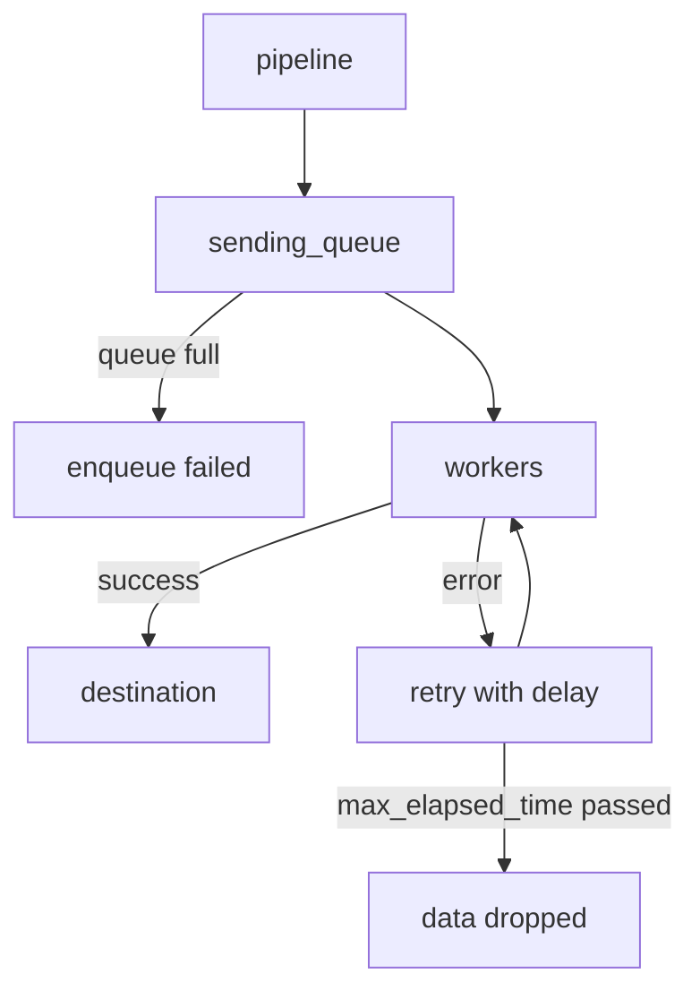

# Queues, Retries And Memory Limits

A Collector sits between senders and a destination, and neither side is under its control. A destination can slow down or stop for minutes. A sender can send ten times its normal volume after a deployment. If the Collector accepts everything and holds it in memory, the process grows until the container is killed, and everything that was in memory is lost. This part shows the four settings that decide what the Collector does instead: the exporter queue, the retry policy, the memory limiter and the batch processor.

## What an exporter does with a batch

An exporter does not send each span as soon as it arrives. The exporter helper, shared code that all the standard exporters use, puts each request into a **sending queue** and a pool of worker routines takes requests from the queue and sends them. If a send fails, the worker retries it with a growing delay until it succeeds or the retry time runs out.

Three groups of options control this. They sit directly under the exporter in the configuration file.

- `sending_queue` holds `enabled` (default `true`), `queue_size` (default `1000` requests with the default sizer), `num_consumers` (default `10` workers) and `block_on_overflow` (default `false`). A `storage` option can place the queue on disk through a storage extension, so queued data survives a restart.
- `retry_on_failure` holds `enabled` (default `true`), `initial_interval` (default `5s`), `max_interval` (default `30s`), `multiplier` (default `1.5`) and `max_elapsed_time` (default `300s`). The delay grows by the multiplier after each failed attempt, up to `max_interval`, and the exporter gives up when the total time passes `max_elapsed_time`. When it gives up, the data is dropped and `otelcol_exporter_send_failed_spans` counts it.
- `timeout` (default `5s`) limits one attempt to send.



The diagram shows two places where data can be lost: when the queue is full at the moment of arrival, and when the retries run out. The queue size and the retry time together set how long an outage the Collector can absorb. With the defaults, one worker retries for up to five minutes, and the queue can hold 1000 requests.

When the queue is full and `block_on_overflow` is `false`, the exporter rejects the new request and the error goes back up the pipeline. The receiver then answers the sender with an error, and a sender that retries keeps the data. When `block_on_overflow` is `true`, the call waits for room in the queue. That slows the sender instead of refusing it, which is called **backpressure**: the pressure of a slow stage moves back toward the source.

## The memory limiter

A queue holds data in memory, and memory is the resource that kills a Collector. The `memory_limiter` processor watches the memory use of the Collector at a fixed interval and refuses new data when the use is too high. It has two thresholds.

The **hard limit** is `limit_mib` (or `limit_percentage` of the total memory). The **soft limit** is the hard limit minus `spike_limit_mib`, which is the amount of memory that the Collector can gain between two checks. The default spike limit is 20 percent of the hard limit. `check_interval` sets how often the memory is measured. The documentation recommends `1s`.

Above the soft limit, the processor refuses data: it returns an error to the component before it, and the receiver passes a retryable error to the sender. Above the hard limit, it also forces garbage collection to free memory. When memory falls below the soft limit again, the processor accepts data again. Refused data is not lost by the Collector. It is lost only if the sender does not retry.

Two placement rules follow from this. First, `memory_limiter` must be the first processor in every pipeline, so that the error reaches the receiver before any other processor spends memory on the data. Second, the container memory limit must be higher than the hard limit. The container limit is enforced by the kernel and kills the process, and the Collector limit tries to avoid that. The documentation also recommends setting the environment variable `GOMEMLIMIT` to about 80 percent of the hard limit, so that the Go runtime collects garbage before the limiter acts.

## The batch processor

The `batch` processor collects spans and sends them on together, either when it has `send_batch_size` items or when `timeout` has passed since the first item. A batch makes exports more efficient, because one request carries many spans, and it makes the queue size count larger units. In the playground, `timeout` is `1s`. Place `batch` after `memory_limiter` and after any processor that drops or changes data, so that the batch has the final size.

## Trigger the limiter

The playground gateway has `limit_mib: 200`. To see the limiter act, lower the limit far below what an idle Collector uses. Save this as `gateway-config-tight.yaml`:

<!-- astrona:playground:renew -->

```yaml
apiVersion: v1
kind: ConfigMap
metadata:
  name: gateway-config
  namespace: starfleet
data:
  config.yaml: |
    receivers:
      otlp:
        protocols:
          grpc:
            endpoint: 0.0.0.0:4317
          http:
            endpoint: 0.0.0.0:4318
    processors:
      memory_limiter:
        check_interval: 1s
        limit_mib: 10
        spike_limit_mib: 2
      batch:
        timeout: 1s
    exporters:
      otlp:
        endpoint: backend.starfleet.svc.cluster.local:4317
        tls:
          insecure: true
        sending_queue:
          queue_size: 1000
        retry_on_failure:
          enabled: true
          max_elapsed_time: 120s
    extensions:
      health_check:
        endpoint: 0.0.0.0:13133
    service:
      extensions: [health_check]
      telemetry:
        metrics:
          readers:
            - pull:
                exporter:
                  prometheus:
                    host: 0.0.0.0
                    port: 8888
      pipelines:
        traces:
          receivers: [otlp]
          processors: [memory_limiter, batch]
          exporters: [otlp]
```

Apply it, and restart the gateway, because the Collector reads its file once at start:

```sh
kubectl apply -f gateway-config-tight.yaml
kubectl -n starfleet rollout restart deployment/gateway
kubectl -n starfleet rollout status deployment/gateway
```

Define the two helper functions from the previous part again if this is a new terminal (`gateway_metrics` reads port 8888 and `send_span` sends one span and prints the HTTP status). Then send a span and read the refusal counters:

```sh
send_span refused-span
gateway_metrics | grep -E '^otelcol_(receiver|processor)_refused_spans'
```

The status is not `200`: the memory limiter refused the data, and the receiver returned an error that tells the sender to try again later. The refused counters are above 0. Nothing reaches the backend, and the gateway pod stays running, because the limiter protects the process instead of letting it grow. The exact status code and the exact counter that grows (the processor or the receiver) depend on the version, so read both.

Restore the playground values by changing the two numbers in the live ConfigMap and restarting:

```sh
kubectl -n starfleet get configmap gateway-config -o yaml | sed 's/limit_mib: 10$/limit_mib: 200/; s/spike_limit_mib: 2$/spike_limit_mib: 40/' | kubectl replace -f -
kubectl -n starfleet rollout restart deployment/gateway
```

After the rollout, `send_span` prints `200` again.

## Choosing the numbers

Start from the container memory limit, because everything else follows from it. Set the hard limit to about 80 percent of it, the spike limit to 20 to 25 percent of the hard limit, and `GOMEMLIMIT` to 80 percent of the hard limit. Then size the queue: the queue size times the typical request size must fit in the memory that remains. A large queue with a small memory limit only moves the failure from the queue to the limiter. Finally, choose `max_elapsed_time` so that the retry time matches the longest outage that you want to absorb.

You now know how the Collector turns overload into refusals, retries and delay in place of a crash, and which setting limits each kind of loss. The open question is what to do when the protected Collector is still too small for the load: give the process more resources, or run more of them.

## Common pitfalls

> [!WARNING]
> - **Putting `memory_limiter` after other processors.** Other processors spend memory on data that the limiter would refuse. Keep it first.
> - **Setting `limit_mib` equal to or above the container memory limit.** The kernel kills the container before the limiter acts. Keep it lower.
> - **Expecting refused data to be safe.** The Collector only refuses it. A sender without retries drops it.
> - **A huge queue with no memory limit.** The queue grows until the process is killed, and the queued data is lost.
> - **Forgetting to restart after editing the ConfigMap.** The Collector reads its file only at start.
