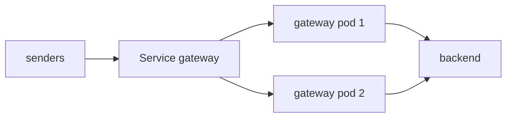

# Vertical And Horizontal Scaling

When the signals from the previous parts show that one Collector is the bottleneck, there are two ways to add capacity. **Vertical scaling** gives the same pod more CPU and memory. **Horizontal scaling** runs more pods and splits the traffic between them. Each has limits, and which one works depends on what the Collector does with the data. This part covers resource settings, the effect of the Go runtime on memory, and what happens when a stateless gateway gets a second replica.

## Vertical scaling: requests and limits

A container has a CPU request, a memory request and optional limits. The **request** is what the scheduler reserves on a node. The **limit** is the most the container may use. The two resources behave differently when the limit is reached.

- **CPU** above the limit is throttled. The process runs slower but keeps running. A throttled Collector shows a growing queue and growing latency, with no error.
- **Memory** above the limit is not throttled. The kernel kills the container, Kubernetes restarts it, and the data in memory and in the queue is lost. The pod status shows `OOMKilled`.

Because of this difference, memory needs more care. Set the memory request equal to the memory limit, so that the pod has a predictable amount, and set `memory_limiter` below the limit as described in the previous part. For CPU, set a request that matches the normal load and either set no limit or a generous one, so that bursts are not throttled.

The Collector is written in Go, and the Go runtime decides when to free memory. By default it lets the heap grow to twice its live size before a collection. Set the environment variable `GOMEMLIMIT` to about 80 percent of the hard limit of `memory_limiter`, and the runtime collects garbage more often as memory approaches that value. Together the three settings form layers: the Go runtime collects first, the limiter refuses next, and the kernel kills only if both failed.

Vertical scaling has a ceiling. A pod cannot be larger than a node, a very large pod is slow to reschedule, and one pod is still a single point of failure. More CPU also helps only if the work can use it. The exporter `num_consumers` option (default `10`) sets how many workers send from the queue in parallel, and the receiver and processors use as many goroutines as there are requests. A Collector with more CPU can use more workers; a Collector with a slow destination cannot go faster by getting more CPU.

## Horizontal scaling: more replicas

Horizontal scaling adds pods behind one Service. Every replica has the same configuration and receives a share of the traffic. This works without further design when the Collector is **stateless**: each batch of data is processed on its own, and the result does not depend on any other batch. A gateway with `memory_limiter`, `batch`, an attribute processor and an exporter is stateless. Any replica can handle any request, and a replica can be added or removed at any time.



The number of replicas can be set by hand or by a **HorizontalPodAutoscaler**, a Kubernetes controller that changes the replica count of a Deployment to keep a metric near a target. The usual metric for a gateway is CPU use relative to the CPU request, so the CPU request must be set for this to work. Memory is a poor trigger, because a Go process does not give memory back quickly. A queue that keeps growing while the CPU is low points at the destination, and adding replicas then adds more load on the same destination.

## Try it: add a replica

The helper functions from the first part (`send_span`, and a function that reads a metrics endpoint) are used here again. Define a function that reads the metrics of one pod by its IP address, because the Service address chooses a pod for you. Save the commands as part of your shell session:

<!-- astrona:playground:renew -->

```sh
pod_metrics() {
  kubectl -n outpost exec deploy/drifter -- curl -s http://$1:8888/metrics
}
send_span() {
  kubectl -n outpost exec deploy/drifter -- curl -s -o /dev/null -w '%{http_code}\n' \
    -X POST -H 'Content-Type: application/json' \
    -d "{\"resourceSpans\":[{\"resource\":{\"attributes\":[{\"key\":\"service.name\",\"value\":{\"stringValue\":\"scout\"}}]},\"scopeSpans\":[{\"spans\":[{\"traceId\":\"5b8efff798038103d269b633813fc60c\",\"spanId\":\"eee19b7ec3c1b174\",\"name\":\"$1\",\"kind\":1,\"startTimeUnixNano\":\"1700000000000000000\",\"endTimeUnixNano\":\"1700000001000000000\"}]}]}]}" \
    http://gateway.starfleet.svc.cluster.local:4318/v1/traces
}
```

Scale the gateway to two replicas and wait until both are ready:

```sh
kubectl -n starfleet scale deployment/gateway --replicas=2
kubectl -n starfleet rollout status deployment/gateway
kubectl -n starfleet get pods -l app=gateway -o wide
```

Both pods are `Running` and have different IP addresses. Each `kubectl exec` starts a new `curl` process, and each `curl` opens a new connection, so the Service can send each request to a different pod. Send twenty spans and then read the accepted counter of each pod:

```sh
for i in $(seq 1 20); do send_span "spread-$i" > /dev/null; done
for ip in $(kubectl -n starfleet get pods -l app=gateway -o jsonpath='{.items[*].status.podIP}'); do
  echo "pod $ip"
  pod_metrics $ip | grep '^otelcol_receiver_accepted_spans'
done
```

The two counters add up to 20, and each pod accepted some of them. The split is not exactly even, because the Service chooses by connection and not by load. Two replicas now share the receiving work and each holds its own queue and its own memory limit, so the total capacity is about twice that of one pod.

Scale back to one replica:

```sh
kubectl -n starfleet scale deployment/gateway --replicas=1
```

## What horizontal scaling cannot fix

Replicas help with CPU and memory load on the gateway itself. They do not help in these cases, and the signals from the first part show which case you are in.

- **A slow or full destination.** All replicas export to the same place, and the queues of all replicas fill.
- **Stateful processing.** A processor that needs several related spans on the same instance gives wrong answers when the spans are split between replicas. That case needs routing by key, and it is the subject of the next module.
- **A long-lived connection.** A sender that keeps one connection open is pinned to one pod by the Service, so the second replica stays idle. The next module shows this effect.

Use the signals to choose. A high CPU with a growing receiver-to-processor lag points at more CPU or more replicas. A full queue with a healthy destination points at more `num_consumers` or a larger queue. A full queue with a slow destination points at the destination.

## Common pitfalls

> [!WARNING]
> - **Setting a memory limit and no `memory_limiter`.** The kernel kills the container on overload, and the queue is lost.
> - **Setting a low CPU limit.** The Collector is throttled without any error, and the queue grows.
> - **Adding replicas to fix a slow destination.** More replicas send more load to the same destination.
> - **Scaling a stateful pipeline by adding replicas.** Related spans end up on different pods, and the result is wrong.
> - **Using memory as the autoscaling metric.** A Go process holds memory after load falls, so the replica count does not come down.
