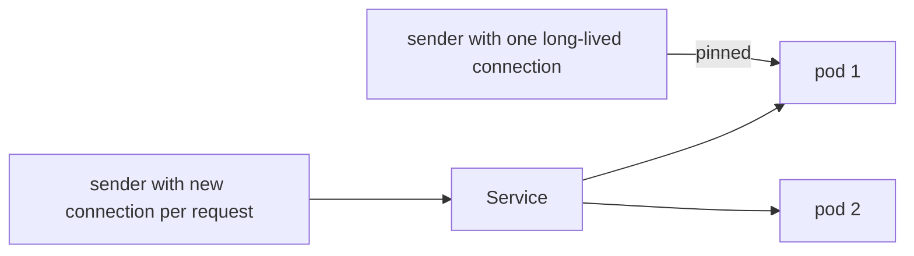

# Stateless Replicas Behind A Service

The simplest way to scale a Collector is to run several identical copies behind one Kubernetes Service. This works when the Collector is stateless, and the way a Service spreads traffic has one detail that decides whether the copies share the work equally: it balances connections, not requests. This part explains what that means for OTLP traffic and shows the effect in the playground.

## What a Service does with traffic

A ClusterIP Service gives a set of pods one stable address. On each node, `kube-proxy` programs rules in the kernel that pick a pod when a new connection to that address starts. The choice is made once per connection. All packets of that connection go to the same pod until the connection closes.

For a client that opens a new connection for every request, this spreads the work across the pods. OTLP over HTTP with a short-lived client, like `curl`, behaves this way. For a client that opens one connection and keeps it open, the Service made its choice once and cannot change it. OTLP over gRPC works this way: the HTTP/2 connection carries many calls, and the SDKs and Collectors keep it open for as long as they can. A sender with one gRPC connection to a Service sends everything to one pod, and the other replicas have no traffic.



There are three ways to deal with pinned connections. The sender can close and reopen connections now and then (some SDKs and the Collector gRPC settings allow a maximum connection age). The Service can be headless, so that the DNS name returns all pod addresses and a client-side balancer, such as the gRPC client, spreads calls itself. Or a layer in front can balance by request, such as a proxy that understands HTTP/2. The next part uses the second way with the `load_balancing` exporter.

## Why stateless matters

A Collector is stateless when processing a batch needs nothing from any other batch. `memory_limiter`, `batch`, attribute changes and filtering by one span attribute are stateless. A replica can be added, removed or restarted at any time, and the Service sends new connections to the pods that are ready. A replica that is not ready, because its `health_check` readiness probe fails, receives no new connections.

The batch processor holds spans for up to its timeout, so it has a small amount of state in memory. That state is not related to any other replica, so it is still safe to scale. What is lost on a restart is the content of the memory and the queue, which is why the graceful shutdown time and a persistent queue matter.

## Try it: two gateway replicas

The gateway in the playground sends spans on to the samplers. Define a function that sends one span, and then scale the gateway to two replicas:

<!-- astrona:playground:renew -->

```sh
send_span() {
  kubectl -n outpost exec deploy/drifter -- curl -s -o /dev/null -w '%{http_code}\n' \
    -X POST -H 'Content-Type: application/json' \
    -d "{\"resourceSpans\":[{\"resource\":{\"attributes\":[{\"key\":\"service.name\",\"value\":{\"stringValue\":\"$4\"}}]},\"scopeSpans\":[{\"spans\":[{\"traceId\":\"$1\",\"spanId\":\"$2\",\"name\":\"$3\",\"kind\":1,\"startTimeUnixNano\":\"1700000000000000000\",\"endTimeUnixNano\":\"1700000001000000000\",\"status\":{\"code\":$5}}]}]}]}" \
    http://gateway.starfleet.svc.cluster.local:4318/v1/traces
}
kubectl -n starfleet scale deployment/gateway --replicas=2
kubectl -n starfleet rollout status deployment/gateway
```

Send twenty spans, each from a new `curl` process and so on a new connection, and read the accepted counter of each gateway pod through its IP address:

```sh
for i in $(seq 1 20); do send_span "$(printf '%032x' $i)" "$(printf '%016x' $i)" "spread-$i" scout 0 > /dev/null; done
for ip in $(kubectl -n starfleet get pods -l app=gateway -o jsonpath='{.items[*].status.podIP}'); do
  echo "pod $ip"
  kubectl -n outpost exec deploy/drifter -- curl -s http://$ip:8888/metrics | grep '^otelcol_receiver_accepted_spans'
done
```

The two values add up to 20 and both pods accepted some. A split of 10 and 10 is not guaranteed, because each choice is made separately.

Now delete one gateway pod and send a span right away:

```sh
kubectl -n starfleet delete $(kubectl -n starfleet get pods -l app=gateway -o name | head -1) --wait=false
send_span 0000000000000000000000000000aaaa 00000000000000aa after-delete scout 0
```

A pod that was deleted is removed from the Service endpoints, and a new pod is started by the Deployment. The span is accepted by a pod that is still ready. If the status is not `200`, the connection went to the pod that was shutting down; send it again.

Scale back to one replica:

```sh
kubectl -n starfleet scale deployment/gateway --replicas=1
```

## Limiting the age of a connection

The gRPC server of the OTLP receiver can close connections by itself, so that senders reconnect and the Service picks a pod again. The setting is `keepalive` under the `grpc` protocol of the receiver. This fragment closes each connection after one minute and gives running calls ten seconds to finish:

```yaml
receivers:
  otlp:
    protocols:
      grpc:
        endpoint: 0.0.0.0:4317
        keepalive:
          server_parameters:
            max_connection_age: 1m
            max_connection_age_grace: 10s
```

This is a fragment for reading and not a step to run. A well-behaved sender reconnects when the connection closes, so new replicas receive traffic within about a minute after they start. A shorter age gives faster rebalancing and more connection setups.

## What stays correct and what does not

Everything on the gateway layer stays correct with two replicas, because the gateway only forwards. The data that reaches the samplers is a different matter. Each gateway replica now sends the spans that it received, and the spans of one trace can arrive at different gateway replicas, because the Service chose a replica per connection. The next part shows what a gateway must do so that this does not matter.

## Common pitfalls

> [!WARNING]
> - **Expecting even load from one long-lived gRPC connection.** The Service picks a pod once per connection, so one pod gets everything.
> - **Judging the split from a few requests.** The choice is made per connection and the numbers are only even over a larger count.
> - **Scaling a stateful component this way.** Replicas split related data between them and the answers are wrong.
> - **Deleting pods without a readiness probe.** A pod that is not ready yet still receives connections and refuses them.
