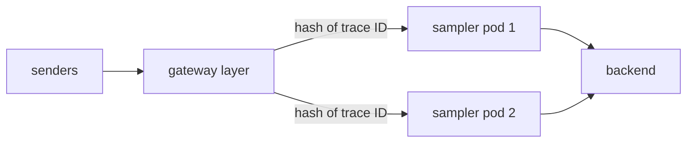

# Routing By Trace ID For Tail Sampling

Tail sampling decides whether to keep a trace after it has seen the whole trace. That decision needs all spans of the trace in one process. When the sampling layer has several pods, something in front of them must send every span of a trace to the same pod. This part explains the mechanism, shows the `load_balancing` exporter that does it, and demonstrates what goes wrong when the routing key is not the trace ID.

## Why tail sampling is stateful

The `tail_sampling` processor keeps the spans of each trace in memory. For each new trace ID it starts a timer of `decision_wait` (default `30s`). When the timer ends, it evaluates the policies against the spans collected so far, for example a policy that keeps a trace when any span has status ERROR, and it passes the trace on or drops it. The option `num_traces` (default `50000`) limits how many traces are held.

Two consequences follow. The processor holds data, so its memory use grows with the trace rate times `decision_wait`, and it needs a memory limit. And the answer depends on which spans it received. If one pod holds only the OK spans of a trace and another pod holds the ERROR span, the first pod drops its part and the second keeps a single span without its context. Neither pod made a wrong decision for the data it had, and the result is still wrong.

## The two-layer design

The fix is two layers. The first layer is the stateless gateway: it receives spans from every sender and, for each span, picks a sampler pod from the trace ID. The second layer is the sampler: each pod receives complete traces only.



The `load_balancing` exporter does the picking. It has three parts.

- `routing_key` chooses what is hashed. For traces the common values are `traceID` (default) and `service`. With `traceID`, all spans of a trace go to one backend. With `service`, all spans of one service go to one backend, which keeps a trace together only when it has a single service.
- `protocol.otlp` is the exporter template for each backend. It takes the usual options, such as `tls` and `sending_queue`, and has no `endpoint`, because the endpoints come from the resolver.
- `resolver` finds the backends. The `static` resolver takes a fixed list, the `dns` resolver reads the addresses of a DNS name and refreshes them at an `interval`, and the `k8s` resolver watches the endpoints of a Service through the Kubernetes API and needs permission to read them.

The exporter hashes the key onto a ring of the backend addresses, so the same trace ID goes to the same address while the list does not change. In the playground the `dns` resolver reads `sampler-headless`, a headless Service. A headless Service returns the pod addresses directly, which is what the exporter needs, and it also avoids the connection pinning from the previous part, because the exporter opens its own connection to each pod.

## When the backends change

When a sampler pod is added or removed, the ring changes and some trace IDs map to a different pod. A trace that is in progress during the change can be split: spans that arrived before the change are on the old pod and spans after it are on the new one. The exporter does not re-send the old spans. For the same reason the exporter does not re-route when a backend fails: it returns an error and the sending queue retries the same backend. Plan for a small loss of sampling accuracy during a rollout, and keep the number of pod changes low.

## Try it: find the pod for a trace

Define the helpers. `send_span` takes the trace ID, span ID, span name, service name and a status code (2 is error). `sampler_logs` prints the log of every sampler pod, each line starting with the pod name:

<!-- astrona:playground:renew -->

```sh
send_span() {
  kubectl -n outpost exec deploy/drifter -- curl -s -o /dev/null -w '%{http_code}\n' \
    -X POST -H 'Content-Type: application/json' \
    -d "{\"resourceSpans\":[{\"resource\":{\"attributes\":[{\"key\":\"service.name\",\"value\":{\"stringValue\":\"$4\"}}]},\"scopeSpans\":[{\"spans\":[{\"traceId\":\"$1\",\"spanId\":\"$2\",\"name\":\"$3\",\"kind\":1,\"startTimeUnixNano\":\"1700000000000000000\",\"endTimeUnixNano\":\"1700000001000000000\",\"status\":{\"code\":$5}}]}]}]}" \
    http://gateway.starfleet.svc.cluster.local:4318/v1/traces
}
sampler_logs() {
  kubectl -n starfleet logs -l app=sampler --prefix --tail=-1
}
```

Send three spans of one trace from three services, with the middle one marked as an error, in three separate calls:

```sh
T=5b8efff798038103d269b633813fc60c
send_span $T 00000000000000a1 hail scout 0
send_span $T 00000000000000a2 scan probe 2
send_span $T 00000000000000a3 dock shuttle 0
```

Wait about ten seconds, which is the `decision_wait` of five seconds plus the batch time, and count the lines of this trace per pod:

```sh
sleep 10
sampler_logs | grep $T | cut -d' ' -f1 | sort | uniq -c
```

One pod name appears, with the three spans of the trace. The other pod does not appear. The trace was kept because one span has the error status, and the whole trace was routed to one pod because the key is the trace ID.

Now send twenty traces of the same shape and list which pods hold them:

```sh
for i in $(seq 1 20); do
  t=$(printf '%032x' $((i + 1000)))
  send_span $t $(printf '%016x' $((i * 3))) hail scout 0 > /dev/null
  send_span $t $(printf '%016x' $((i * 3 + 1))) scan probe 2 > /dev/null
  send_span $t $(printf '%016x' $((i * 3 + 2))) dock shuttle 0 > /dev/null
done
sleep 12
sampler_logs | grep -E '[0-9a-f]{32}' | cut -d' ' -f1 | sort | uniq -c
```

Both pods appear, and each trace is on exactly one of them. Different traces hash to different pods, which is how the sampler layer shares the load.

## Break the routing key

Change the routing key to `service`, restart the gateway and repeat the three-span trace with a new trace ID. The ConfigMap is edited in place with `sed`, which is enough for a one-word change:

```sh
kubectl -n starfleet get configmap gateway-config -o yaml | sed 's/routing_key: traceID/routing_key: service/' | kubectl replace -f -
kubectl -n starfleet rollout restart deployment/gateway
```

After the rollout, send the three spans with a new trace ID such as `5b8efff798038103d269b633813fc60d` and read the logs as before. The spans come from three services, so they can land on different pods, and a pod that holds the ERROR span keeps only that span. Whether they land on one pod or two depends on the hash of the service names, so repeat with other service names if all three land together. Restore the key with the reverse `sed` and a restart:

```sh
kubectl -n starfleet get configmap gateway-config -o yaml | sed 's/routing_key: service/routing_key: traceID/' | kubectl replace -f -
kubectl -n starfleet rollout restart deployment/gateway
```

## Common pitfalls

> [!WARNING]
> - **Running several tail sampling pods behind a plain Service.** Spans of one trace reach different pods and the decisions are wrong.
> - **Routing by `service` for tail sampling.** A trace with several services is split.
> - **Using a ClusterIP address as the resolver target.** The exporter sees one address and routes everything to it. Use a headless Service name.
> - **Expecting re-routing when a pod fails.** The exporter retries the same backend and does not choose another.
> - **Forgetting `decision_wait` when reading results.** Nothing appears in the sampler logs until the wait has passed.
