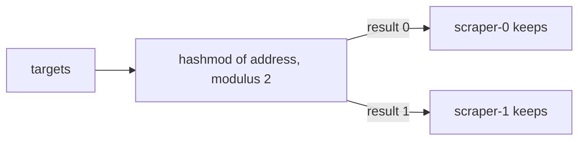

# Sharding Scrapes And Avoiding Duplicates

Receivers that listen, such as the OTLP receiver, scale by adding replicas, because the senders choose where to send. Receivers that pull, such as the `prometheus` receiver, work the other way: the Collector chooses what to scrape. Running two copies of a pulling Collector does not share the work. Both copies scrape every target, and the backend stores every sample twice. This part shows how to divide the targets so that each one has exactly one owner, and where duplicates still come from.

## Why a replicated scraper duplicates data

The `prometheus` receiver contains a Prometheus scrape configuration. Each Collector that runs it reads the same list of targets and scrapes every one on every interval. Two replicas scrape each target twice, and the data has two series that differ only in which Collector produced them, or, when nothing marks the origin, identical samples at slightly different times.

The solution is **sharding**: every replica keeps only the targets that belong to it and drops the others. Two ideas make this work. Every target needs a stable owner, so that it does not move on each restart. And every replica needs to know its own number.

## Sharding with hashmod

Prometheus relabeling can do the division. The `hashmod` action hashes the value of the source labels and takes the remainder after division by `modulus`, and writes it to a target label. The `keep` action drops every target whose label does not match the regular expression. Together they keep a target only when its hash equals the number of this replica.



The replica number comes from a StatefulSet. A StatefulSet gives its pods stable names, `scraper-0` and `scraper-1`, and Kubernetes sets the label `apps.kubernetes.io/pod-index` on each pod. In the playground, the pod passes that label to the container as the environment variable `SHARD`. The Collector replaces `${env:SHARD}` in its configuration when it starts, before the Prometheus part reads it, so the same ConfigMap works on every pod and each pod keeps a different set. The modulus must equal the number of replicas. When the replica count changes, the modulus changes and targets move between replicas, so changing it is a planned event.

With a few targets the split can be uneven, because the hash is not aware of load. Three targets and two shards can give two and one, or all three to one shard. With hundreds of targets the split becomes close to even.

## The Target Allocator

Static hashing in each Collector has limits. Targets come from service discovery and change often, each Collector reads all of them just to drop most, and the split ignores how heavy each target is. The **Target Allocator** is a separate component of the OpenTelemetry Operator that moves this work out of the Collectors. It does the service discovery once, divides the targets between the Collector pods with a strategy (consistent hashing, least weighted, or per node), and each Collector asks it for its own list over HTTP. The `prometheus` receiver is then configured to fetch its targets from the allocator and not from a local list. The playground has no operator, so this part is for knowing what exists and why, and the hands-on step uses `hashmod`.

## Try it: see the duplicates, then remove them

The playground scraper has two pods and an unsharded job with three targets: the gateway, the sampler and the scraper metrics endpoints. Read the logs of both scraper pods and list the targets that each pod scraped:

<!-- astrona:playground:renew -->

```sh
sleep 20
kubectl -n starfleet logs -l app=scraper --prefix --tail=-1 | grep 'service.instance.id' | sort | uniq -c
```

Each line has the pod name and the target address that the pod scraped. Every target appears under both pods: that is the duplication. The count per target is the number of scrapes in the logs so far.

Save this as `scraper-config.yaml`. It is the same job with a `relabel_configs` block that keeps a target only when its hash matches `${env:SHARD}`:

```yaml
apiVersion: v1
kind: ConfigMap
metadata:
  name: scraper-config
  namespace: starfleet
data:
  config.yaml: |
    receivers:
      prometheus:
        config:
          scrape_configs:
            - job_name: starfleet-collectors
              scrape_interval: 15s
              static_configs:
                - targets:
                    - gateway.starfleet.svc.cluster.local:8888
                    - sampler.starfleet.svc.cluster.local:8888
                    - scraper.starfleet.svc.cluster.local:8888
              relabel_configs:
                - source_labels: [__address__]
                  modulus: 2
                  target_label: __tmp_hash
                  action: hashmod
                - source_labels: [__tmp_hash]
                  regex: ${env:SHARD}
                  action: keep
    exporters:
      debug:
        verbosity: detailed
    extensions:
      health_check:
        endpoint: 0.0.0.0:13133
    service:
      extensions: [health_check]
      telemetry:
        metrics:
          readers:
            - pull:
                exporter:
                  prometheus:
                    host: 0.0.0.0
                    port: 8888
      pipelines:
        metrics:
          receivers: [prometheus]
          exporters: [debug]
```

Apply it and restart the StatefulSet, because the Collector reads its file only at start:

```sh
kubectl apply -f scraper-config.yaml
kubectl -n starfleet rollout restart statefulset/scraper
kubectl -n starfleet rollout status statefulset/scraper
```

Wait for two scrape intervals and read only the new log lines:

```sh
sleep 40
kubectl -n starfleet logs -l app=scraper --prefix --since=30s | grep 'service.instance.id' | sort | uniq -c
```

Each target now appears under one pod only. One pod can show all three targets and the other none, because of the hash and the small number of targets; the rule that matters is that no target appears under both.

## Where duplicates still come from

Sharding removes duplicates from scraping. Other sources remain.

- **Retries.** An exporter that times out may have sent the data successfully, and the retry sends it again. Delivery is at least once, and a backend that must not count twice needs idempotent writes or deduplication.
- **Rollouts.** While a replica restarts, its targets have no owner for a moment, and when two Collector versions overlap, a target can be scraped by both.
- **A changed replica count.** The modulus and the replicas must change together, and in between some targets have two owners or none.

## Common pitfalls

> [!WARNING]
> - **Setting the modulus to a different number than the replica count.** Some shards get no targets and some targets get no owner.
> - **Using a Deployment for sharded scraping.** Pods of a Deployment have no stable index, so there is no number to put in `SHARD`.
> - **Forgetting to restart after editing the ConfigMap.** The environment value and the file are read once at start.
> - **Judging the split from three targets.** The hash is not load aware, so small sets split unevenly.
> - **Treating sharding as protection against retries.** It divides scrape work and does not remove duplicates caused by repeated sends.
