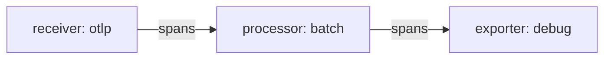

# Signal Paths And Pipeline Names

The OpenTelemetry Collector is a program that receives telemetry, changes it and sends it on. Telemetry is the data that applications produce about themselves, and it comes in three types called signals: traces, metrics and logs. A Collector has to know which components handle which signal and in which order, and the part of its configuration that answers this question is the `service` section with its pipelines. This part explains what a pipeline is, how it is named and what the Collector checks about it when it starts.

## Definitions and wiring are two different things

A Collector configuration file has two kinds of sections. The first kind defines components: `receivers`, `processors`, `exporters`, `connectors` and `extensions`. A receiver is a component that accepts telemetry, for example by listening on a network port. A processor is a component that changes, filters or groups telemetry between the receiver and the exporter. An exporter is a component that sends telemetry to a destination. A definition only says what a component is called and how it is set up.

The second kind is the `service` section. It lists which of the defined components the Collector actually starts and how they connect. The list `service.pipelines` holds the pipelines. A component that is defined but not listed in any pipeline is not started, and the Collector does not complain about it. This is the most common reason why a configuration that looks complete does nothing.

Look at the starting configuration of the `gateway` Collector in the playground. The file defines one receiver (`otlp`), two processors (`batch` and `attributes/redact`) and two exporters (`debug` and `otlphttp/backend`). The `service` section then uses only some of them.

## What a pipeline is

A pipeline is the path that one signal takes through the Collector. It has three lists: `receivers`, `processors` and `exporters`. Data enters through a receiver, passes through the processors in list order and leaves through every exporter in the list. The key of the pipeline has the form `type` or `type/name`, where the type is `traces`, `metrics` or `logs`. The type decides which signal the pipeline carries, and every component in the pipeline must support that signal.



The diagram shows the `traces` pipeline of the playground: one receiver, one processor and one exporter, with spans moving from left to right.

The name after the slash is free text. A second pipeline for the same signal needs a different key, so the Collector accepts `traces` and `traces/audit` in the same file but not two pipelines both called `traces`. The name has no meaning for the Collector beyond identifying the pipeline. It appears in logs and in error messages, so a descriptive name such as `traces/public` helps a person who reads them later.

## Look at the running gateway

The playground runs the `gateway` Collector in the namespace `starfleet`, with its file in the ConfigMap `collector-config`. A second Collector, `backend`, runs next to it and prints everything it receives. A pod named `shuttle` has `curl`, and you send telemetry from it. Paste the helper first. It posts one OTLP trace over HTTP from the `shuttle` pod to the `gateway` and prints the HTTP status code. OTLP is the OpenTelemetry protocol, the standard format for telemetry on the network. The argument you pass is the span name, which you use as a marker later.

<!-- astrona:playground:renew -->

```sh
send_trace() {
  now="$(date +%s)000000000"
  kubectl -n starfleet exec deploy/shuttle -- curl -s -m 15 -w '\nHTTP %{http_code}\n' -X POST -H 'Content-Type: application/json' \
    -d "{\"resourceSpans\":[{\"resource\":{\"attributes\":[{\"key\":\"service.name\",\"value\":{\"stringValue\":\"scout\"}}]},\"scopeSpans\":[{\"scope\":{\"name\":\"lab\"},\"spans\":[{\"traceId\":\"5b8efff798038103d269b633813fc60c\",\"spanId\":\"eee19b7ec3c1b174\",\"name\":\"$1\",\"kind\":1,\"startTimeUnixNano\":\"$now\",\"endTimeUnixNano\":\"$now\",\"attributes\":[{\"key\":\"user.email\",\"value\":{\"stringValue\":\"pilot@example.com\"}}]}]}]}]}" \
    http://gateway.starfleet.svc.cluster.local:4318/v1/traces
}
```

First read the file that the `gateway` runs. The command asks the API server for the ConfigMap and prints the key `config.yaml`:

```sh
kubectl -n starfleet get configmap collector-config -o jsonpath='{.data.config\.yaml}'
```

Find the `service.pipelines` block at the end. It lists one pipeline, `traces`, with `otlp` as receiver, `batch` as processor and `debug` as exporter. The exporter `otlphttp/backend` and the processor `attributes/redact` appear above it, in the definitions, and nowhere in the pipeline.

Now send a span and look at both Collectors. The `gateway` prints the span through its `debug` exporter, which writes telemetry to the standard output of the Collector. The `backend` should not show the span, because no exporter of the `gateway` sends to it:

```sh
send_trace first-span
kubectl -n starfleet logs deploy/gateway --since=2m | grep first-span
kubectl -n starfleet logs deploy/backend --since=2m | grep first-span
```

The helper prints `HTTP 200`. The first `grep` prints a line that holds the span name, and the second prints nothing. The batch processor holds a span for up to one second before it passes it on, so run the two `grep` commands again if the first one is empty. The result shows that a defined exporter changes nothing until a pipeline lists it.

## One receiver, three signals

The receiver `otlp` is configured with the `http` protocol on port 4318. The OTLP receiver supports traces, metrics and logs, and the HTTP protocol uses one URL path for each: `/v1/traces`, `/v1/metrics` and `/v1/logs`. What the Collector does with a request on one of these paths depends on the pipelines. A request for a signal that no pipeline uses the receiver for has no consumer, and the receiver does not report success for it.

Right now only the `traces` pipeline uses `otlp`. A log request therefore reaches a receiver that has nobody to hand the data to. Send one and read the status code to see the effect:

```sh
kubectl -n starfleet exec deploy/shuttle -- curl -s -m 15 -o /dev/null -w 'HTTP %{http_code}\n' -X POST -H 'Content-Type: application/json' -d '{"resourceLogs":[]}' http://gateway.starfleet.svc.cluster.local:4318/v1/logs
```

Look at the status code and compare it with the `HTTP 200` of the trace. The exact result depends on the Collector version, so this course does not name a number. The receiver only forwards a signal to pipelines that use it, and a pipeline for the signal is what makes such a request useful.

## What the Collector checks at start

The Collector validates the whole file before it starts any pipeline. It rejects a file when a pipeline refers to a component that is not defined, when a pipeline has no receiver or no exporter, when a component does not support the signal of the pipeline, or when a connector is used on only one side. The error message names the pipeline and the component. The Collector then exits, and when it runs in a Deployment the pod restarts and shows `CrashLoopBackOff`.

A configuration error is therefore visible within seconds, and it never produces a half-working Collector. The reverse holds too: an unused definition passes validation, so only a test with real data proves that a path exists. In the next part you will add pipelines that share these components.

## What you know now

A pipeline is the path of one signal, written as `type` or `type/name` under `service.pipelines`. Definitions only describe components, and the pipelines decide which of them run. One receiver can serve several signals, but each signal needs a pipeline of its own. The open question is what the Collector shares when two pipelines name the same component.

## Common pitfalls

> [!WARNING]
> - **Defining a component and assuming it runs.** Only components listed in a pipeline start. Read the `service` section, not the definitions, to see the real path.
> - **Two pipelines with the same key.** The key `traces` can appear once. Use `traces/name` for a second traces pipeline.
> - **Reading the receiver as the proof of success.** A receiver that answers `200` has handed the data to its pipelines. Only the exporter side shows where the data went.
> - **Restarting nothing.** The Collector reads its file once at start. Editing the ConfigMap changes the file in the pod, but the running process keeps the old configuration until the Deployment restarts.
