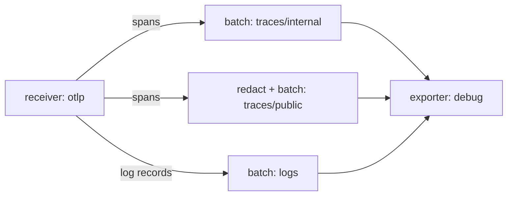

# Shared Components And Instances

Real Collectors rarely run one pipeline. A gateway often handles traces, metrics and logs, and it sometimes needs two different treatments of the same traces. The configuration file lets several pipelines name the same receiver, the same processor or the same exporter. This part explains what the Collector builds when that happens: which objects it shares, which it creates once for each pipeline, and what that means for the data you see.

## One name in two pipelines

<!-- astrona:playground:renew -->

Start with a case you can run. The new file below defines the receiver `otlp`, the processors `batch` and `attributes/redact` and the exporter `debug` once each. It then uses them in three pipelines. The pipeline `traces/internal` keeps every attribute. The pipeline `traces/public` removes the attribute `user.email` first. The pipeline `logs` carries log records. Save this as `gateway.yaml`:

```yaml
extensions:
  health_check:
    endpoint: 0.0.0.0:13133
receivers:
  otlp:
    protocols:
      http:
        endpoint: 0.0.0.0:4318
processors:
  batch:
    timeout: 1s
  attributes/redact:
    actions:
      - key: user.email
        action: delete
exporters:
  debug:
    verbosity: detailed
service:
  extensions: [health_check]
  telemetry:
    metrics:
      readers:
        - pull:
            exporter:
              prometheus:
                host: 0.0.0.0
                port: 8888
  pipelines:
    traces/internal:
      receivers: [otlp]
      processors: [batch]
      exporters: [debug]
    traces/public:
      receivers: [otlp]
      processors: [attributes/redact, batch]
      exporters: [debug]
    logs:
      receivers: [otlp]
      processors: [batch]
      exporters: [debug]
```

The Collector reads this file once at start from the ConfigMap, so the ConfigMap has to change first and the Deployment has to restart afterwards. Replace the ConfigMap with the new file:

```sh
kubectl -n starfleet create configmap collector-config --from-file=config.yaml=gateway.yaml --dry-run=client -o yaml | kubectl apply -f -
```

Then restart the `gateway` and wait for the new pod:

```sh
kubectl -n starfleet rollout restart deployment/gateway
kubectl -n starfleet rollout status deployment/gateway
```

## What the Collector builds

The Collector builds objects from the file in three steps. It creates one instance of each receiver and each exporter that any pipeline uses. It creates one instance of each processor for every pipeline that lists it. It then connects the objects: the receiver instance gets a list of the first processor (or exporter) of every pipeline that names it, and each pipeline ends in the exporter instances it lists.



The diagram shows one receiver and one exporter instance with a separate processor chain for each of the three pipelines. The name `batch` appears three times in the file, but the Collector runs three batch processors, each with its own buffer and its own timer.

This has a practical effect. The receiver listens on port 4318 once. Two receivers with the same port would fail, and one receiver used in three pipelines does not. The exporter `debug` is also one object, so every pipeline writes to the same output. A processor that keeps state, such as `batch`, never mixes data of two pipelines, because each pipeline owns its instance.

## Check the shared receiver and the shared exporter

Send one trace and one log record. The helper below posts one OTLP trace; the log request uses the same pattern with a log body. Paste both helpers once:

```sh
send_trace() {
  now="$(date +%s)000000000"
  kubectl -n starfleet exec deploy/shuttle -- curl -s -m 15 -w '\nHTTP %{http_code}\n' -X POST -H 'Content-Type: application/json' \
    -d "{\"resourceSpans\":[{\"resource\":{\"attributes\":[{\"key\":\"service.name\",\"value\":{\"stringValue\":\"scout\"}}]},\"scopeSpans\":[{\"scope\":{\"name\":\"lab\"},\"spans\":[{\"traceId\":\"5b8efff798038103d269b633813fc60c\",\"spanId\":\"eee19b7ec3c1b174\",\"name\":\"$1\",\"kind\":1,\"startTimeUnixNano\":\"$now\",\"endTimeUnixNano\":\"$now\",\"attributes\":[{\"key\":\"user.email\",\"value\":{\"stringValue\":\"pilot@example.com\"}}]}]}]}]}" \
    http://gateway.starfleet.svc.cluster.local:4318/v1/traces
}

send_log() {
  now="$(date +%s)000000000"
  kubectl -n starfleet exec deploy/shuttle -- curl -s -m 15 -w '\nHTTP %{http_code}\n' -X POST -H 'Content-Type: application/json' \
    -d "{\"resourceLogs\":[{\"resource\":{\"attributes\":[{\"key\":\"service.name\",\"value\":{\"stringValue\":\"scout\"}}]},\"scopeLogs\":[{\"scope\":{\"name\":\"lab\"},\"logRecords\":[{\"timeUnixNano\":\"$now\",\"severityText\":\"INFO\",\"body\":{\"stringValue\":\"$1\"}}]}]}]}" \
    http://gateway.starfleet.svc.cluster.local:4318/v1/logs
}
```

Send a span and a log record, wait a few seconds for the batch processors, and look at the output of the `debug` exporter:

```sh
send_trace shared-span
send_log shared-log
kubectl -n starfleet logs deploy/gateway --since=2m | grep -E 'shared-span|shared-log|user.email'
```

Both helpers print `HTTP 200`. The `grep` shows the span name `shared-span` twice, once for each traces pipeline, and the log body `shared-log` once. Only one of the two span copies has a line for the attribute `user.email`. The receiver delivered the same span to two pipelines, and the `attributes/redact` processor in `traces/public` changed only its own copy. This works because the Collector knows which processors change data. When a pipeline contains a processor that modifies telemetry, the Collector gives that pipeline its own copy of the data, so the other pipelines keep the original.

## Names, types and what may be shared

A component can be used in a pipeline only if it supports the signal of the pipeline. The receiver `otlp` supports all three signals, and so do `batch`, `attributes` and `debug`. Other components support fewer signals. A processor that works on metrics only cannot appear in a `traces` pipeline, and the Collector rejects such a file at start with a message that says the component does not support that signal.

The name after the slash gives you several instances of one component type with different settings. The definition `attributes/redact` and a second definition `attributes/tag` are two processors of the type `attributes`. The same idea applies to exporters: `otlphttp/backend` and `otlphttp/archive` are two instances of the type `otlphttp` that send to two addresses. Sharing means using one name in several pipelines, and variation means defining several names.

## What you know now

A receiver and an exporter exist once for every name, and every pipeline that lists them connects to the same object. A processor exists once for each pipeline that lists it, so its state is never shared. When a pipeline changes data, it works on its own copy. The next question is what happens when one pipeline has several exporters, and why the order of the processors matters for what each exporter receives.

## Common pitfalls

> [!WARNING]
> - **Assuming a shared processor shares state.** Each pipeline has its own instance of every processor it lists. Two pipelines with `batch` do not batch together.
> - **Expecting separate output from a shared exporter.** Pipelines that list the same `debug` exporter write to the same output. Use two exporter names when the destinations must differ.
> - **Defining a second receiver on the same port.** Two receiver names that bind port 4318 make the Collector fail at start. Use one receiver in several pipelines instead.
> - **Forgetting the replace-and-restart steps.** Editing a local file changes nothing. The ConfigMap must change, and the Deployment must restart.
