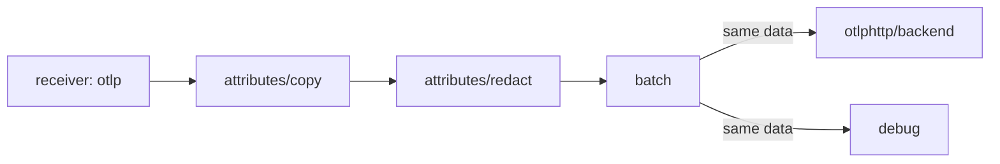

# Fan-Out And Processor Order

A pipeline usually has to deliver the same telemetry to more than one destination: an analysis backend for people, a second system for long-term storage and the `debug` exporter for the person who runs the Collector. Fan-out means that one pipeline lists several exporters and every exporter receives the data. Fan-out is simple to write and easy to get wrong, because all exporters of a pipeline receive the output of the same processor chain, in an order that you define. This part shows what each exporter receives and why the order of the processors decides it.

## Fan-out happens after the last processor

The exporters of a pipeline do not process anything by themselves. The pipeline ends with a step that the Collector calls the fan-out consumer: it takes the data that leaves the last processor and hands it to each exporter in the `exporters` list. Because this happens after the last processor, every exporter of the pipeline sees the same processed data. No exporter can receive the original, and no exporter can receive a different version than its neighbours.



The diagram shows one pipeline: three processors in list order, then two exporters that get identical data.

A consequence follows for privacy. If one destination must never see a value, the pipeline that feeds it must remove the value before its exporters. Adding a restrictive processor to the pipeline of the safe destination does not help when another pipeline with a different chain feeds the unsafe one. The `debug` exporter is an exporter like any other: with `verbosity: detailed` it writes every attribute to the Collector output, and anyone who can run `kubectl logs` can read it.

## Processor order changes the result

Processors run in the order of the list. Each processor receives the output of the one before it. Two processors that look independent can still depend on each other. A good example uses two actions of the `attributes` processor: one copies the value of `user.email` into a new attribute `email.backup`, and the other deletes `user.email`. The first processor reads `user.email`, so it must run while the attribute still exists.

<!-- astrona:playground:renew -->

Save this as `gateway.yaml`. The traces pipeline lists the copy first and the removal second, which is the wrong order for a privacy rule. The pipeline exports to `otlphttp/backend`, the exporter that sends to the second Collector, and to `debug`:

```yaml
extensions:
  health_check:
    endpoint: 0.0.0.0:13133
receivers:
  otlp:
    protocols:
      http:
        endpoint: 0.0.0.0:4318
processors:
  batch:
    timeout: 1s
  attributes/copy:
    actions:
      - key: email.backup
        action: insert
        from_attribute: user.email
  attributes/redact:
    actions:
      - key: user.email
        action: delete
exporters:
  debug:
    verbosity: detailed
  otlphttp/backend:
    endpoint: http://backend.starfleet.svc.cluster.local:4318
service:
  extensions: [health_check]
  telemetry:
    metrics:
      readers:
        - pull:
            exporter:
              prometheus:
                host: 0.0.0.0
                port: 8888
  pipelines:
    traces:
      receivers: [otlp]
      processors: [attributes/copy, attributes/redact, batch]
      exporters: [otlphttp/backend, debug]
```

Replace the ConfigMap with it and restart the `gateway`:

```sh
kubectl -n starfleet create configmap collector-config --from-file=config.yaml=gateway.yaml --dry-run=client -o yaml | kubectl apply -f -
kubectl -n starfleet rollout restart deployment/gateway
kubectl -n starfleet rollout status deployment/gateway
```

Paste the trace helper. It posts one OTLP trace from the `shuttle` pod to the `gateway`, with the attribute `user.email` set to `pilot@example.com`, and prints the HTTP status code:

```sh
send_trace() {
  now="$(date +%s)000000000"
  kubectl -n starfleet exec deploy/shuttle -- curl -s -m 15 -w '\nHTTP %{http_code}\n' -X POST -H 'Content-Type: application/json' \
    -d "{\"resourceSpans\":[{\"resource\":{\"attributes\":[{\"key\":\"service.name\",\"value\":{\"stringValue\":\"scout\"}}]},\"scopeSpans\":[{\"scope\":{\"name\":\"lab\"},\"spans\":[{\"traceId\":\"5b8efff798038103d269b633813fc60c\",\"spanId\":\"eee19b7ec3c1b174\",\"name\":\"$1\",\"kind\":1,\"startTimeUnixNano\":\"$now\",\"endTimeUnixNano\":\"$now\",\"attributes\":[{\"key\":\"user.email\",\"value\":{\"stringValue\":\"pilot@example.com\"}}]}]}]}]}" \
    http://gateway.starfleet.svc.cluster.local:4318/v1/traces
}
```

Then send a span and search both Collectors for the two attribute names:

```sh
send_trace order-one
kubectl -n starfleet logs deploy/backend --since=2m | grep -E 'order-one|user.email|email.backup'
kubectl -n starfleet logs deploy/gateway --since=2m | grep -E 'order-one|user.email|email.backup'
```

Wait a few seconds if a command prints nothing, because the `batch` processor holds the span for one second. In both logs you should find the span name and a line for `email.backup` with the value `pilot@example.com`, and no line for `user.email`. The deletion worked, and the address still travelled to both destinations in a new attribute. The processors ran in the order you wrote them, and the copy ran before the data was removed.

## Fix the order

Swap the two names in the processors list of the pipeline, so that the line reads `processors: [attributes/redact, attributes/copy, batch]`, and save the file again as `gateway.yaml`. Now the removal runs first. When the copy runs, `user.email` no longer exists, so the `insert` action finds no source value and adds nothing. Replace the ConfigMap, restart the `gateway` and send a second span:

```sh
kubectl -n starfleet create configmap collector-config --from-file=config.yaml=gateway.yaml --dry-run=client -o yaml | kubectl apply -f -
kubectl -n starfleet rollout restart deployment/gateway
kubectl -n starfleet rollout status deployment/gateway
send_trace order-two
kubectl -n starfleet logs deploy/backend --since=1m | grep -E 'order-two|user.email|email.backup'
```

The `backend` log now shows the span name `order-two` and no attribute line for `pilot@example.com`. The order of two list entries changed what both exporters received. The `batch` processor shows the same effect from another side: it comes last, because it groups the final data for sending, and a batch before a data-changing processor would only delay the change.

## Fan-out is not a transaction

All exporters of the pipeline receive the data, but they do not succeed or fail together. The `otlphttp/backend` exporter can reach its destination while another exporter fails. The data in the destinations then differs, and the Collector does not roll back the successful delivery. How a failure in one exporter affects the pipeline depends on the exporter settings for queue and retry. Those settings decide whether the failure stays inside the exporter or returns to the sender, and they are the next topic of this course.

There are also costs to keep in mind. Every exporter adds network traffic, memory for its buffers and credentials to protect. A diagnostic exporter that stays in a production pipeline exposes full payloads. A short design check for every exporter in a list is: who may read this destination, and what is the worst value that this pipeline can hold?

## What you know now

A pipeline with several exporters hands the same processed data to every one of them. The order of the processors decides what that data contains, so a copy before a removal keeps the value and a removal before a copy does not. Fan-out gives no shared success: each exporter delivers by itself. The question left open is what the Collector does when an exporter is slow or unreachable, and that is a matter of queues, retries and backpressure.

## Common pitfalls

> [!WARNING]
> - **Removing a value after copying it.** A processor that reads an attribute must run while the attribute exists. Put removal and masking before any processor that copies or derives from the value.
> - **Treating `debug` as harmless.** At `detailed` verbosity it prints every attribute. Remove it from a pipeline that handles confidential data.
> - **Checking only one destination.** Each exporter delivers separately. Look at the logs or the receiving system of every exporter you added.
> - **Putting `batch` first.** The batch processor should come after the processors that change data, so it groups the final result.
