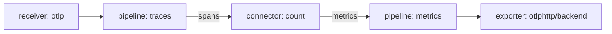

# Connectors Between Pipelines

A pipeline normally ends at a destination outside the Collector. Sometimes the next consumer of the data is another pipeline inside the same Collector. A team may want to count spans and publish the count as a metric, or to merge two log streams into one path, or to turn spans into request and duration metrics. The Collector solves this with a component type called a connector. This part shows how a connector sits between two pipelines, which signal pairs exist and which errors the Collector reports when the wiring is wrong.

## One component, two sides

A connector is a component that acts as an exporter at the end of one pipeline and as a receiver at the start of another pipeline. It takes the data that leaves the first pipeline, and it may pass it on unchanged or create new data of another signal type. The connector is defined once under `connectors`. It then appears in the `exporters` list of one pipeline and in the `receivers` list of another.



The diagram shows spans leaving the `traces` pipeline into the connector `count`, which sends metrics into the `metrics` pipeline.

A connector is not a network hop. Nothing is serialised and no port is opened. The data moves inside the Collector process from one pipeline to the next as ordinary in-memory objects. This makes connectors cheap, and it also means that an overloaded second pipeline can slow down the first one, which the next parts explain.

## Signal pairs

Every connector supports a fixed list of pairs. A pair names the signal type of the pipeline that exports to the connector and the signal type of the pipeline that receives from it. The `forward` connector joins pipelines of the same type: traces to traces, metrics to metrics and logs to logs. It takes no settings, and it merges several pipelines into one or splits one pipeline into several. The `count` connector counts spans, span events, metrics, data points and log records, and it supports traces, metrics and logs as inputs and metrics as output. The span metrics connector turns spans into metrics for request counts and durations. Its type name in recent releases is `span_metrics`, and older releases used `spanmetrics`.

By default `count` creates the metric `trace.span.count` for spans and `trace.span.event.count` for span events, `metric.count` and `metric.datapoint.count` for metrics, and `log.record.count` for log records. The default names are replaced when you set a custom metric under the keys `spans`, `spanevents`, `metrics`, `datapoints` or `logs`.

## Build a counting path

<!-- astrona:playground:renew -->

Start with a concrete case. The `gateway` in the playground receives traces and exports them to `otlphttp/archive`, `otlphttp/backend` and `debug`. The exporter `otlphttp/archive` sends to the address `archive`, which does not exist yet. The exporter retries in the background, and this part ignores it. You will add the connector `count` and a `metrics` pipeline that sends the counts to the `backend`. Save this as `gateway.yaml`:

```yaml
extensions:
  health_check:
    endpoint: 0.0.0.0:13133
receivers:
  otlp:
    protocols:
      http:
        endpoint: 0.0.0.0:4318
processors:
  attributes/redact:
    actions:
      - key: user.email
        action: delete
exporters:
  debug:
    verbosity: detailed
  otlphttp/backend:
    endpoint: http://backend.starfleet.svc.cluster.local:4318
  otlphttp/archive:
    endpoint: http://archive.starfleet.svc.cluster.local:4318
connectors:
  count: {}
service:
  extensions: [health_check]
  telemetry:
    metrics:
      readers:
        - pull:
            exporter:
              prometheus:
                host: 0.0.0.0
                port: 8888
  pipelines:
    traces:
      receivers: [otlp]
      processors: [attributes/redact]
      exporters: [otlphttp/archive, otlphttp/backend, debug, count]
    metrics:
      receivers: [count]
      exporters: [otlphttp/backend]
```

The Collector reads its file once at start, so replace the ConfigMap and restart the `gateway`:

```sh
kubectl -n starfleet create configmap collector-config --from-file=config.yaml=gateway.yaml --dry-run=client -o yaml | kubectl apply -f -
kubectl -n starfleet rollout restart deployment/gateway
kubectl -n starfleet rollout status deployment/gateway
```

Paste the trace helper. It posts one OTLP trace from the `shuttle` pod to the `gateway` and prints the HTTP status code:

```sh
send_trace() {
  now="$(date +%s)000000000"
  kubectl -n starfleet exec deploy/shuttle -- curl -s -m 15 -w '\nHTTP %{http_code}\n' -X POST -H 'Content-Type: application/json' \
    -d "{\"resourceSpans\":[{\"resource\":{\"attributes\":[{\"key\":\"service.name\",\"value\":{\"stringValue\":\"scout\"}}]},\"scopeSpans\":[{\"scope\":{\"name\":\"lab\"},\"spans\":[{\"traceId\":\"5b8efff798038103d269b633813fc60c\",\"spanId\":\"eee19b7ec3c1b174\",\"name\":\"$1\",\"kind\":1,\"startTimeUnixNano\":\"$now\",\"endTimeUnixNano\":\"$now\",\"attributes\":[{\"key\":\"user.email\",\"value\":{\"stringValue\":\"pilot@example.com\"}}]}]}]}]}" \
    http://gateway.starfleet.svc.cluster.local:4318/v1/traces
}
```

Send a span and search the `backend` log for the span and for the count:

```sh
send_trace counted-span
kubectl -n starfleet logs deploy/backend --since=2m | grep -E 'counted-span|trace.span.count'
```

The helper prints `HTTP 200`. The `backend` log shows the span name `counted-span`, delivered by `otlphttp/backend` from the `traces` pipeline. It also shows a metric with the name `trace.span.count`, delivered by the `metrics` pipeline from the connector. Two pipelines of different signals, one Collector, one exporter instance: the exporter `otlphttp/backend` serves both, and the OTLP exporter sends traces and metrics to different URL paths.

## What the Collector refuses

The Collector checks every connector when it starts. A connector must appear at least once as an exporter and at least once as a receiver, and each pair of pipelines must be a supported signal pair. If you list `count` as a receiver of a pipeline but no pipeline exports to it, the Collector stops with an error that names the connector and says it is used as a receiver but not as an exporter. The same applies in the other direction.

Remove `count` from the `exporters` list of `traces`, replace the ConfigMap and restart the `gateway` with the same two commands. The new pod fails to start, and the old pod stays in service until a new pod is ready. Read the last lines of the logs of the pods:

```sh
kubectl -n starfleet get pods -l app=gateway
kubectl -n starfleet logs -l app=gateway --prefix --tail=15
```

The pod list shows one pod that is not ready, and the log of the failing pod names the connector and the pipeline. Put `count` back into the exporters of `traces`, replace the ConfigMap and restart again to return to a working state.

A related error appears when a component does not support the signal of a pipeline. For example, a metrics-only component in a `traces` pipeline makes the Collector stop at start with a message about an unsupported signal. In both cases the file never runs half-way, and the log tells you the pipeline and the component.

## What you know now

A connector joins two pipelines inside one Collector. It is an exporter on one side and a receiver on the other, and it supports a fixed list of signal pairs. The `forward` connector merges or splits pipelines of one type, the `count` connector derives counts as metrics, and the span metrics connector derives request and duration metrics. The Collector refuses a connector that is used on one side only. A connector passes data in memory, so a slow consumer on one side can affect the other. The open question is what happens when an exporter is slow or unreachable.

## Common pitfalls

> [!WARNING]
> - **Using a connector on one side only.** The Collector refuses to start. List it as an exporter of one pipeline and as a receiver of another.
> - **Choosing a pair that is not supported.** `count` outputs metrics. A `traces` pipeline cannot receive from it.
> - **Looking for a port.** A connector does not listen and does not send on the network. Look for its output in the pipeline that receives from it.
> - **Expecting the original data to change.** A counting connector creates new data. The spans in the `traces` pipeline continue unchanged to its other exporters.
