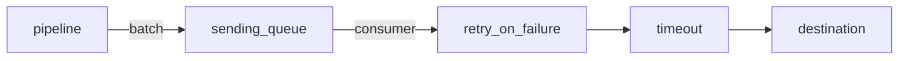

# Sending Queue, Retry And Timeout

Destinations fail. A backend restarts, a network path drops packets, or an address does not exist yet. The Collector has to decide what happens to the data meanwhile and what the sender of that data sees. Every network exporter in the Collector has three settings that answer these questions: a timeout for one attempt, a retry policy for failed attempts and a sending queue that decouples the pipeline from the destination. This part explains how the three layers work together and what the sender observes with and without the queue.

## Three layers inside an exporter

Exporters that send data over the network share a common helper that provides three layers, and the settings have the same names in every exporter that uses it. The `otlphttp` exporter is one of them. When a pipeline hands a batch of data to the exporter, it first meets the sending queue. A queue consumer then takes the batch, the retry layer controls repeated attempts, and the timeout limits each single attempt.



The diagram shows the order inside the exporter: the queue first, then retry, then one attempt with its timeout.

The defaults are as follows. The `timeout` is `5s` for one attempt. The `retry_on_failure` block is enabled with `initial_interval` of `5s`, `max_interval` of `30s` and `max_elapsed_time` of `300s`: the exporter waits 5 seconds after the first failure, increases the wait up to 30 seconds and gives up on a batch after 300 seconds in total. A value of `0` for `max_elapsed_time` means that retries never stop. The `sending_queue` is enabled with `num_consumers` of `10`, `queue_size` of `1000` and `block_on_overflow` set to `false`. The queue is measured in requests by default. The option `sizer` can change the unit to `items` or `bytes`.

## What the sender sees

The queue decides how the failure of a destination reaches the sender. With the queue enabled, the exporter puts the batch into the queue and returns at once. The pipeline continues, and the receiver can answer the sender. A queue consumer sends the batch in the background, and retries happen there. The sender sees a success even though the destination may be down, because the Collector accepted the data and holds it.

With the queue disabled, the exporter sends the batch in the same call that the pipeline made. A failed attempt then waits for the retry interval inside that call, so the pipeline and the receiver wait too. The sender receives its answer only when the exporter succeeds or gives up. This keeps the data out of Collector memory, and it also moves the delay to the sender and to every exporter that comes after the slow one.

## See the queue at work

<!-- astrona:playground:renew -->

The `gateway` needs a traces pipeline that exports to `otlphttp/archive`, `otlphttp/backend` and `debug`, with the settings of `otlphttp/archive` written out. The Service `archive` does not exist, so every attempt fails when the name does not resolve. Save this as `gateway.yaml`. All the values of `otlphttp/archive` shown here are the defaults, and they are spelled out so you can change them:

```yaml
extensions:
  health_check:
    endpoint: 0.0.0.0:13133
receivers:
  otlp:
    protocols:
      http:
        endpoint: 0.0.0.0:4318
processors:
  attributes/redact:
    actions:
      - key: user.email
        action: delete
exporters:
  debug:
    verbosity: detailed
  otlphttp/backend:
    endpoint: http://backend.starfleet.svc.cluster.local:4318
  otlphttp/archive:
    endpoint: http://archive.starfleet.svc.cluster.local:4318
    timeout: 5s
    retry_on_failure:
      enabled: true
      initial_interval: 5s
      max_interval: 30s
      max_elapsed_time: 300s
    sending_queue:
      enabled: true
      num_consumers: 10
      queue_size: 1000
service:
  extensions: [health_check]
  telemetry:
    metrics:
      readers:
        - pull:
            exporter:
              prometheus:
                host: 0.0.0.0
                port: 8888
  pipelines:
    traces:
      receivers: [otlp]
      processors: [attributes/redact]
      exporters: [otlphttp/archive, otlphttp/backend, debug]
```

Replace the ConfigMap and restart the `gateway`:

```sh
kubectl -n starfleet create configmap collector-config --from-file=config.yaml=gateway.yaml --dry-run=client -o yaml | kubectl apply -f -
kubectl -n starfleet rollout restart deployment/gateway
kubectl -n starfleet rollout status deployment/gateway
```

Paste the trace helper if your terminal does not have it, and send one trace. The helper posts one OTLP trace from the `shuttle` pod and prints the HTTP status code:

```sh
send_trace() {
  now="$(date +%s)000000000"
  kubectl -n starfleet exec deploy/shuttle -- curl -s -m 15 -w '\nHTTP %{http_code}\n' -X POST -H 'Content-Type: application/json' \
    -d "{\"resourceSpans\":[{\"resource\":{\"attributes\":[{\"key\":\"service.name\",\"value\":{\"stringValue\":\"scout\"}}]},\"scopeSpans\":[{\"scope\":{\"name\":\"lab\"},\"spans\":[{\"traceId\":\"5b8efff798038103d269b633813fc60c\",\"spanId\":\"eee19b7ec3c1b174\",\"name\":\"$1\",\"kind\":1,\"startTimeUnixNano\":\"$now\",\"endTimeUnixNano\":\"$now\",\"attributes\":[{\"key\":\"user.email\",\"value\":{\"stringValue\":\"pilot@example.com\"}}]}]}]}]}" \
    http://gateway.starfleet.svc.cluster.local:4318/v1/traces
}
send_trace queued-span
```

The helper prints `HTTP 200` within a moment. The `otlphttp/archive` exporter accepted the batch into its queue and returned, so the receiver answered and the other two exporters received the span. Check the `backend` and the log of the `gateway`:

```sh
kubectl -n starfleet logs deploy/backend --since=2m | grep queued-span
kubectl -n starfleet logs deploy/gateway --since=2m | grep -i -E 'retry|failed|queued-span'
```

The first command prints the span. The second prints the span of the `debug` exporter and, after a few seconds, warning lines from the exporter `otlphttp/archive` that report a failed export and that it will retry after an interval. The exact wording depends on the Collector version. The warnings come from the queue consumers in the background, not from the request.

## Switch the queue off

Edit `gateway.yaml` and change `enabled: true` to `enabled: false` under `sending_queue` of `otlphttp/archive`. Replace the ConfigMap and restart, and send a second trace:

```sh
kubectl -n starfleet create configmap collector-config --from-file=config.yaml=gateway.yaml --dry-run=client -o yaml | kubectl apply -f -
kubectl -n starfleet rollout restart deployment/gateway
kubectl -n starfleet rollout status deployment/gateway
send_trace unqueued-span
```

This time the helper waits for its full limit of 15 seconds and prints `HTTP 000`, which is the code that curl reports when it gives up before the server answers. The exporter now retries inside the request, with an initial wait of 5 seconds, and the receiver cannot answer before the exporter returns. Check the `backend` log for `unqueued-span` and observe whether the span arrived. The result depends on the order of the exporters and on whether the Collector cancels the request when the client leaves, so look at the log and do not assume.

## What you know now

An exporter has a queue, a retry policy and a timeout, in that order. With the queue enabled the pipeline continues at once and failures are handled in the background, which also means the Collector holds data in memory until it is sent or dropped. With the queue disabled the delay of a failing destination reaches the receiver and the sender. The open question is what happens when the queue itself fills up and what that does to the other exporters.

## Common pitfalls

> [!WARNING]
> - **Reading `HTTP 200` as delivered.** With the queue enabled, a `200` means the Collector accepted the data. It does not mean that the destination has it.
> - **Switching the queue off to save memory.** The delay of a failing destination then reaches the sender and the exporters after it.
> - **Using long retries and short sender timeouts.** An exporter that retries for 300 seconds inside a request outlasts every sender timeout.
> - **Treating retry as a guarantee.** After `max_elapsed_time` the exporter drops the batch. Set `0` only when you accept unlimited waiting.
