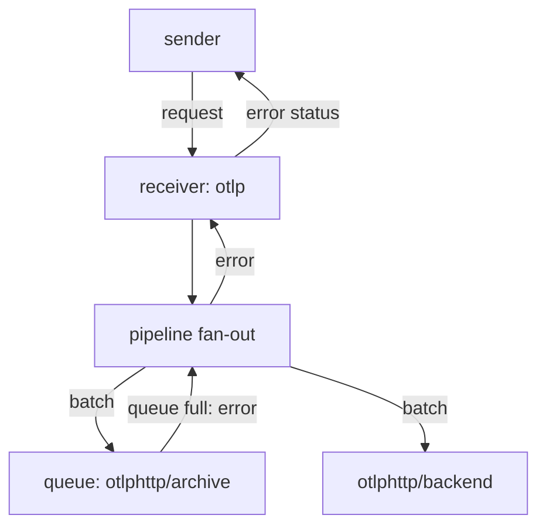

# Backpressure And Failing Exporters

A queue gives a failing destination time to recover, but a queue has a size. When data arrives faster than an exporter can send it, or when the destination stays down, the queue fills. At that point the Collector must choose between three outcomes: refuse the data, make the sender wait, or drop it. This part explains how a full queue affects the sender and the other exporters of the same pipeline, and how the Collector's own metrics show the state.

## Backpressure is a signal that moves backwards

Backpressure means that a slow consumer pushes back on the producer that feeds it. In a Collector the chain is: the sender posts data, the receiver passes it to the pipeline, the pipeline passes it to each exporter, and the exporter queue holds it for the destination. When the queue is full, the exporter returns an error to the pipeline. The pipeline returns that error to the receiver, and the receiver answers the sender with an error status.

The behavior at a full queue depends on `block_on_overflow`. With the default `false`, the exporter rejects the new batch at once. With `true`, the call waits until a consumer frees a place, and the pause continues back to the sender. The rejected batch never reaches the retry layer, and the exporter counts it in the metrics that start with `otelcol_exporter_enqueue_failed_`. Data that was already in the queue is not touched, and the consumers keep working on it.



The diagram shows the error path of a full queue: the exporter returns the error to the fan-out, the fan-out returns it to the receiver and the receiver answers the sender.

## One failing exporter and the others

The fan-out of a pipeline calls every exporter with the same data, one after the other. In the current implementation it does not stop at the first error: it calls all exporters and combines the errors. A full queue in one exporter therefore does not stop the other exporters from receiving the batch. The healthy exporters deliver the data, and the sender still receives an error, because the combined result of the call is a failure.

This has a second effect. A sender that gets an error usually sends the same batch again. The healthy destinations then receive the data a second time. A failure in one destination can therefore duplicate records in another. Whether duplicates matter depends on the destination. Some systems ignore repeated spans with the same identifiers, and others count them twice.

Where the exporters wait matters too. With the queue enabled, the call of a failing exporter returns in microseconds. With the queue disabled, the call waits for the retry logic. Because the fan-out calls the exporters in sequence, a blocked call delays all exporters listed after it. That is why the position of an exporter without a queue in the list matters, and why the safe default is a queue on every network exporter.

## Make the queue overflow

<!-- astrona:playground:renew -->

To see a full queue, make it small. Save this as `gateway.yaml`. The exporter `otlphttp/archive` now has a queue for two requests and one consumer. The first batch is taken by the consumer, and while it waits for its retry, two more batches fit in the queue. The rest are rejected:

```yaml
extensions:
  health_check:
    endpoint: 0.0.0.0:13133
receivers:
  otlp:
    protocols:
      http:
        endpoint: 0.0.0.0:4318
processors:
  attributes/redact:
    actions:
      - key: user.email
        action: delete
exporters:
  debug:
    verbosity: detailed
  otlphttp/backend:
    endpoint: http://backend.starfleet.svc.cluster.local:4318
  otlphttp/archive:
    endpoint: http://archive.starfleet.svc.cluster.local:4318
    sending_queue:
      enabled: true
      num_consumers: 1
      queue_size: 2
service:
  extensions: [health_check]
  telemetry:
    metrics:
      readers:
        - pull:
            exporter:
              prometheus:
                host: 0.0.0.0
                port: 8888
  pipelines:
    traces:
      receivers: [otlp]
      processors: [attributes/redact]
      exporters: [otlphttp/archive, otlphttp/backend, debug]
```

Replace the ConfigMap and restart the `gateway`:

```sh
kubectl -n starfleet create configmap collector-config --from-file=config.yaml=gateway.yaml --dry-run=client -o yaml | kubectl apply -f -
kubectl -n starfleet rollout restart deployment/gateway
kubectl -n starfleet rollout status deployment/gateway
```

Paste the trace helper, and send ten traces one after the other. Each call prints its HTTP status code:

```sh
send_trace() {
  now="$(date +%s)000000000"
  kubectl -n starfleet exec deploy/shuttle -- curl -s -m 15 -w '\nHTTP %{http_code}\n' -X POST -H 'Content-Type: application/json' \
    -d "{\"resourceSpans\":[{\"resource\":{\"attributes\":[{\"key\":\"service.name\",\"value\":{\"stringValue\":\"scout\"}}]},\"scopeSpans\":[{\"scope\":{\"name\":\"lab\"},\"spans\":[{\"traceId\":\"5b8efff798038103d269b633813fc60c\",\"spanId\":\"eee19b7ec3c1b174\",\"name\":\"$1\",\"kind\":1,\"startTimeUnixNano\":\"$now\",\"endTimeUnixNano\":\"$now\",\"attributes\":[{\"key\":\"user.email\",\"value\":{\"stringValue\":\"pilot@example.com\"}}]}]}]}]}" \
    http://gateway.starfleet.svc.cluster.local:4318/v1/traces
}
for number in 1 2 3 4 5 6 7 8 9 10; do send_trace burst-$number; done
```

The first requests print `HTTP 200`. When the queue is full, later requests are expected to print a status other than `200`, which is the error that travelled back from the exporter. The exact status and how many requests fail depend on timing, because the consumer frees a place when its attempt fails. Now count how many spans the healthy `backend` received, which shows that the other exporter was not skipped:

```sh
kubectl -n starfleet logs deploy/backend --since=5m | grep -c 'burst-'
```

The number can be higher than the count of `200` answers, because the exporters after the full queue still received the batch whose request returned an error.

## Read the metrics of the Collector

The Collector counts what happens inside it. The `gateway` publishes its own metrics in Prometheus text format on port 8888, because the file sets a `readers` entry with the host `0.0.0.0`. The names that matter here are `otelcol_exporter_queue_size` and `otelcol_exporter_queue_capacity` (the queue length and its limit), `otelcol_exporter_send_failed_spans` (batches that the exporter tried and failed to send), `otelcol_exporter_enqueue_failed_spans` (batches the full queue refused), and `otelcol_receiver_accepted_spans` and `otelcol_receiver_refused_spans` for the receiver side. Counters can end with `_total` in the text output.

```sh
kubectl -n starfleet exec deploy/shuttle -- curl -s http://gateway.starfleet.svc.cluster.local:8888/metrics | grep -E 'otelcol_exporter_(queue|enqueue_failed|send_failed)|otelcol_receiver_(accepted|refused)_spans'
```

Look at the lines for `otlphttp/archive`. The enqueue failures grow with the rejected batches, and the queue size stays near its capacity while the destination is down. The receiver counts the refused spans for the requests that returned an error. Watching the ratio of queue size to capacity warns you before data is lost.

## What you know now

A full queue returns an error through the pipeline to the sender, unless `block_on_overflow` makes the call wait. Healthy exporters in the same pipeline still receive the data, and the sender's retry can produce duplicates at those destinations. The Collector metrics on port 8888 show queue size, capacity, enqueue failures and send failures for every exporter. A memory queue loses its contents when the Collector restarts, so data that must survive a restart needs persistent storage for the queue, which the exporter can use through a storage extension.

## Common pitfalls

> [!WARNING]
> - **Blaming the healthy backend.** An error status at the sender can come from a different exporter in the pipeline. Check the metrics per exporter before you debug the destination that works.
> - **Ignoring duplicates.** A sender that retries after an error sends the batch to every destination again.
> - **Setting `block_on_overflow: true` without a limit on senders.** The wait travels back to the sender and can stall it.
> - **Sizing the queue by guess.** Compare `otelcol_exporter_queue_size` with `otelcol_exporter_queue_capacity` during a real outage before you choose a size.
