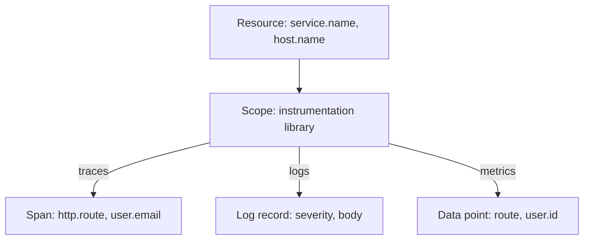

# Changing Attributes With The Attributes And Resource Processors

An application often sends attributes that nobody should store. A span can carry an authorization header, a user email address or the name of the host it ran on. Fixing every application is slow, so the Collector offers a central place to change attributes while the data is in transit. This part shows the two processors that do the simple jobs: the attributes processor and the resource processor.

## Where attributes live

An attribute is a key and a value attached to a piece of telemetry, for example `http.route` with the value `/orders`. OpenTelemetry attaches attributes at different levels, and the level decides which processor can reach them.

A **resource** describes the thing that produced the data, such as a service or a host. Its attributes (`service.name`, `host.name`) apply to everything in that batch. A **span**, a **log record** or a **metric data point** describes one single observation, and it has its own attributes (`http.route`, `user.email`). A resource contains many observations, and each observation keeps its own attributes.



The diagram shows that every observation sits below a resource, so a change to a resource attribute reaches all observations in the request at once, while a change to a span attribute reaches only that span.

## The attributes processor

The attributes processor changes the attributes of spans, log records and metric data points. It does not change resource attributes. Its configuration is a list of `actions`, and the Collector runs them in the order that they appear in the list. Each action names a `key` and an `action`.

| Action | What it does when the key exists | What it does when the key is missing |
| --- | --- | --- |
| `insert` | Nothing. The old value stays. | Adds the key with the new value. |
| `update` | Replaces the value. | Nothing. |
| `upsert` | Replaces the value. | Adds the key with the new value. |
| `delete` | Removes the key. | Nothing. |
| `hash` | Replaces the value with a hash of the old value. | Nothing. |

The new value comes from `value` (a fixed value), from `from_attribute` (the value of another attribute) or from `from_context`. Two more actions exist. `extract` reads named groups out of a regular expression and writes them as new attributes. `convert` changes the type of a value to `int`, `double` or `string`.

The `hash` action matters for privacy. A hash is a fixed-length string computed from the value. The same input always gives the same hash, so you can still count how many requests came from one user, but you cannot read the email address. The hash algorithm depends on the Collector version and on a feature gate, which is a switch that turns a behavior on or off, so the exact length can differ. Do not rely on a specific length.

## The resource processor

The resource processor has the same actions, but it works on the resource attributes. Use it for facts about the producer. Typical jobs are adding the environment name to everything that passes, and removing a host name that must not leave the cluster.

The processor configuration looks the same as the one for the attributes processor, with `attributes` in place of `actions`. The two processors never touch each other's level. This is the most common mistake: a `delete` for `host.name` in the attributes processor does nothing to a `host.name` that sits on the resource.

## Try it: change attributes and resources

<!-- astrona:playground:renew -->

The playground has a pass-through Collector. Define a small helper first. It posts the JSON document on standard input to the Collector and prints the HTTP status:

```sh
send() { kubectl -n otel exec -i sender -- curl -s -o /dev/null -w '%{http_code}\n' -H 'Content-Type: application/json' -X POST "http://collector:4318/v1/$1" -d @-; }
```

Save this test span as `span.json`. It has a resource with `service.name` and `host.name`, and one span with three attributes, two of them sensitive:

```json
{
  "resourceSpans": [{
    "resource": {"attributes": [
      {"key": "service.name", "value": {"stringValue": "scout"}},
      {"key": "host.name", "value": {"stringValue": "node-a"}}
    ]},
    "scopeSpans": [{
      "scope": {"name": "manual"},
      "spans": [{
        "traceId": "5b8efff798038103d269b633813fc60c",
        "spanId": "eee19b7ec3c1b174",
        "name": "checkout",
        "kind": 2,
        "startTimeUnixNano": "1700000000000000000",
        "endTimeUnixNano": "1700000001000000000",
        "attributes": [
          {"key": "http.route", "value": {"stringValue": "/orders"}},
          {"key": "user.email", "value": {"stringValue": "jason@starfleet.test"}},
          {"key": "http.request.header.authorization", "value": {"stringValue": "Bearer secret"}}
        ]
      }]
    }]
  }]
}
```

Send it and read the Collector log. The status is `200`, and the log shows the span with all three attributes and the resource with `host.name`:

```sh
send traces < span.json
kubectl -n otel logs deploy/collector --tail=40
```

Now add the two processors. Save this as `collector-config.yaml`. It defines `resource/environment` and `attributes/privacy`, and lists them in the traces pipeline. The name after the slash is a free label that lets you define several processors of the same kind:

```yaml
apiVersion: v1
kind: ConfigMap
metadata:
  name: collector-config
  namespace: otel
data:
  config.yaml: |
    receivers:
      otlp:
        protocols:
          http:
            endpoint: 0.0.0.0:4318
    processors:
      resource/environment:
        attributes:
          - key: deployment.environment.name
            value: training
            action: upsert
          - key: host.name
            action: delete
      attributes/privacy:
        actions:
          - key: http.request.header.authorization
            action: delete
          - key: user.email
            action: hash
    exporters:
      debug:
        verbosity: detailed
    extensions:
      health_check:
        endpoint: 0.0.0.0:13133
    service:
      extensions: [health_check]
      pipelines:
        traces:
          receivers: [otlp]
          processors: [resource/environment, attributes/privacy]
          exporters: [debug]
        metrics:
          receivers: [otlp]
          exporters: [debug]
        logs:
          receivers: [otlp]
          exporters: [debug]
```

Apply it, then restart the Deployment. The Collector reads its configuration only when it starts, so a changed ConfigMap has no effect until the pod restarts:

```sh
kubectl apply -f collector-config.yaml
kubectl -n otel rollout restart deployment/collector
kubectl -n otel rollout status deployment/collector
```

Send the same span again and read the log:

```sh
send traces < span.json
kubectl -n otel logs deploy/collector --tail=40
```

Look at the newest span in the output. The resource now has `deployment.environment.name` with the value `training` and no `host.name`, and it keeps `service.name`. The span keeps `http.route`, has no authorization header, and shows `user.email` as a long hexadecimal string instead of the address. Each of these changes came from a different processor action.

## What the processors do not do

A processor works on one item at a time and does not know the history. It does not check that the new value is correct, and it does not remember what it changed. The `delete` action cannot bring a value back later, so the original is gone for every step after this one in the pipeline and for every exporter that follows. If a second pipeline sends the same data to another exporter without these processors, that exporter still receives the original values.

The processors also have a limit for metrics. The attributes processor changes data point attributes, but it does not merge data points afterward. If two data points differ only by the attribute that you delete, the processor leaves them as two separate points with the same attributes. The processors in this part are therefore safe for adding attributes and for removing attributes from spans and logs. Removing a metric attribute needs extra care, which a later module explains.

You now know which processor changes which level, and what each action does. What is still open is how to remove entire items, and not only attributes, which is the job of the filter processor.

## Common pitfalls

> [!WARNING]
> Defining a processor under `processors:` does not use it. A processor works only when its name is in the `processors` list of a pipeline. The attributes processor never changes resource attributes, and the resource processor never changes span attributes. A `delete` that targets the wrong level succeeds without any message and changes nothing. After a ConfigMap change, restart the Deployment, or the Collector keeps running with the old configuration.
