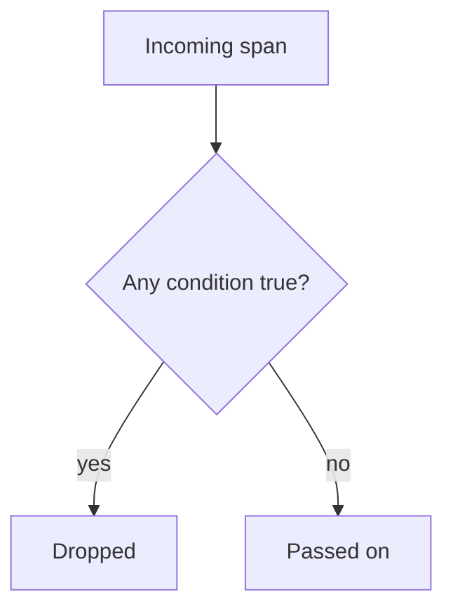

# Dropping Data With The Filter Processor

Some telemetry has no value. Health check requests produce a span every few seconds, and debug log records fill storage that nobody reads. Removing an attribute does not help here, because the whole item is the problem. The filter processor removes whole spans, log records, metrics and data points, and this part shows how it decides what to remove.

## A true condition drops the data

The filter processor takes a list of conditions written in the OpenTelemetry Transformation Language (OTTL), a small expression language that the Collector uses in several components. A condition is an expression that is true or false for one item. The key rule is easy to get backwards: **when a condition is true, the processor drops the item.** The conditions in one list are combined with OR. If any one of them is true, the item is dropped.

Each signal has its own list: `trace_conditions`, `metric_conditions` and `log_conditions`. The path in a condition starts with the level that it reads. `span.attributes["http.route"]` reads an attribute of a span, `log.severity_number` reads the severity of a log record, and `resource.attributes["service.name"]` reads a resource attribute.



The diagram shows that a span is kept only when no condition matches it. A condition describes what to remove, not what to keep.

## Contexts and what they can drop

The path prefix also sets how much the processor removes when a condition matches.

| Signal | Prefixes | What a true condition removes |
| --- | --- | --- |
| Traces | `resource`, `scope`, `span`, `spanevent` | A span (or a span event when the condition is about the event). A `resource` condition drops everything from that resource. |
| Metrics | `resource`, `scope`, `metric`, `datapoint` | A whole metric, or one data point. The metric is dropped when all its data points are dropped. |
| Logs | `resource`, `scope`, `log` | A log record. |

A condition that reads two levels runs at the lowest level that it names. For example, `resource.attributes["host.name"] == "localhost" or span.name == "app_3"` is evaluated once for each span, with the resource of that span in view.

Useful expressions are `span.name == "GET /healthz"`, `log.severity_number < SEVERITY_NUMBER_INFO`, `metric.name == "scout.debug.counter"` and `IsMatch(log.body, ".*password.*")`. `IsMatch` is an OTTL function that returns true when a regular expression matches the value.

## Error mode

A condition can fail while it runs. For example, it can compare a string with a number, or it can read a value of the wrong type. The `error_mode` setting decides what happens next.

| Value | What the processor does when a condition fails |
| --- | --- |
| `ignore` | Writes the error to the Collector log and goes on with the next condition. This is the default. |
| `silent` | Goes on and writes nothing. |
| `propagate` | Returns the error to the pipeline, and the whole payload is dropped. |

The choice is a decision about risk. With `ignore`, a broken condition does not stop the data, but it also does not drop the items you wanted dropped, and the only trace is a log line. With `propagate`, a failing condition loses a whole payload, but nothing passes unchecked. With `silent`, you lose even the log line. For a filter that only reduces noise, `ignore` is usually fine. For a filter that protects a boundary, a failure that goes unnoticed is more serious.

## Try it: drop health checks and debug logs

<!-- astrona:playground:renew -->

Define the helper that posts a JSON document to the Collector:

```sh
send() { kubectl -n otel exec -i sender -- curl -s -o /dev/null -w '%{http_code}\n' -H 'Content-Type: application/json' -X POST "http://collector:4318/v1/$1" -d @-; }
```

Save this as `collector-config.yaml`. The filter drops spans whose `http.route` is `/healthz` and log records with a severity below INFO:

```yaml
apiVersion: v1
kind: ConfigMap
metadata:
  name: collector-config
  namespace: otel
data:
  config.yaml: |
    receivers:
      otlp:
        protocols:
          http:
            endpoint: 0.0.0.0:4318
    processors:
      filter/noise:
        error_mode: ignore
        trace_conditions:
          - span.attributes["http.route"] == "/healthz"
        log_conditions:
          - log.severity_number < SEVERITY_NUMBER_INFO
    exporters:
      debug:
        verbosity: detailed
    extensions:
      health_check:
        endpoint: 0.0.0.0:13133
    service:
      extensions: [health_check]
      pipelines:
        traces:
          receivers: [otlp]
          processors: [filter/noise]
          exporters: [debug]
        metrics:
          receivers: [otlp]
          exporters: [debug]
        logs:
          receivers: [otlp]
          processors: [filter/noise]
          exporters: [debug]
```

Apply it and restart the Collector:

```sh
kubectl apply -f collector-config.yaml
kubectl -n otel rollout restart deployment/collector
kubectl -n otel rollout status deployment/collector
```

Save this as `spans-two.json`. It has two spans in one request, one for an order and one for a health check:

```json
{
  "resourceSpans": [{
    "resource": {"attributes": [{"key": "service.name", "value": {"stringValue": "scout"}}]},
    "scopeSpans": [{
      "scope": {"name": "manual"},
      "spans": [
        {
          "traceId": "5b8efff798038103d269b633813fc60c", "spanId": "eee19b7ec3c1b174",
          "name": "orders", "kind": 2,
          "startTimeUnixNano": "1700000000000000000", "endTimeUnixNano": "1700000001000000000",
          "attributes": [{"key": "http.route", "value": {"stringValue": "/orders"}}]
        },
        {
          "traceId": "5b8efff798038103d269b633813fc60c", "spanId": "eee19b7ec3c1b175",
          "name": "health", "kind": 2,
          "startTimeUnixNano": "1700000000000000000", "endTimeUnixNano": "1700000001000000000",
          "attributes": [{"key": "http.route", "value": {"stringValue": "/healthz"}}]
        }
      ]
    }]
  }]
}
```

Send it and read the log:

```sh
send traces < spans-two.json
kubectl -n otel logs deploy/collector --tail=40
```

The log shows the span `orders` and does not show the span `health`. The debug exporter prints how many spans it received, and that count is now one. The two spans entered the Collector together, and the filter removed one of them from the batch.

Save this as `logs-two.json`. It has one DEBUG record (severity number 5) and one INFO record (severity number 9):

```json
{
  "resourceLogs": [{
    "resource": {"attributes": [{"key": "service.name", "value": {"stringValue": "scout"}}]},
    "scopeLogs": [{
      "scope": {"name": "manual"},
      "logRecords": [
        {"timeUnixNano": "1700000000000000000", "severityNumber": 5, "severityText": "DEBUG", "body": {"stringValue": "cache miss"}},
        {"timeUnixNano": "1700000000000000000", "severityNumber": 9, "severityText": "INFO", "body": {"stringValue": "order accepted"}}
      ]
    }]
  }]
}
```

Send it and read the log:

```sh
send logs < logs-two.json
kubectl -n otel logs deploy/collector --tail=30
```

Only the record with the body `order accepted` appears. The record `cache miss` has severity number 5, which is below 9, so the condition is true and the filter drops it.

## What a filter changes about the evidence

A filter changes which events exist downstream. After this configuration, no backend can tell how often the health check ran, and no one can look up the debug records of a failing request. A dashboard that counts requests now counts only requests that are not health checks. This is often the goal, but the people who read the data need to know that they see a selected part of the traffic and not all of it.

A second effect appears when a filter reads an attribute that a different processor can change. The filter sees the value at the moment it runs, not the value that the application sent. The next part uses this to show why order matters.

This part showed how a condition decides, what the three error modes do and how to drop data by span, by log severity and by name. The open question is what happens when more than one processor changes the same data.

## Common pitfalls

> [!WARNING]
> The condition describes what to drop. Writing the condition for what you want to keep drops everything else. A filter that uses `error_mode: ignore` keeps data when the expression fails, so a typo in an attribute name can leave all the noise in place without an error you notice. Dropping data is permanent for every exporter that comes after the filter in that pipeline.
