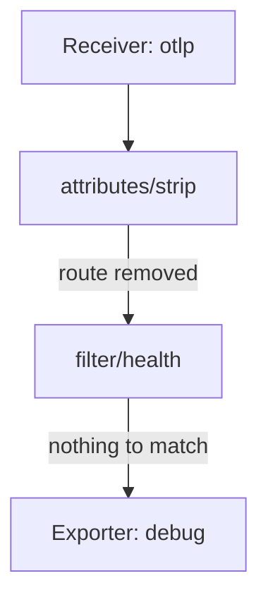

# Processor Order And The Level Of An Attribute

Two processors that are correct on their own can still give a wrong result together. The reason is that a pipeline runs its processors one after another, and each processor receives the output of the one before it. This part explains the order rule, shows a filter that stops working because of it, and then separates resource attributes from span attributes with the same experiment.

## Processors run in list order

In the `service` section, each pipeline has a `processors` list. The Collector sends data to the first processor in the list. That processor passes its output to the second one, and so on, until the last processor passes the data to the exporters. The order of the list is the order of execution. The order of the definitions under `processors:` has no meaning.



The diagram shows a pipeline where the attributes processor runs first. The filter after it never sees the route, because the attributes processor already deleted it.

This is the main rule: **a processor sees the data as the earlier processors left it.** A filter that reads an attribute needs that attribute to still exist, with the value it expects, when the filter runs. A rule that deletes or renames an attribute is a change to the input of every later processor.

## An example of order changing the result

Suppose the team wants to remove the attribute `http.route` from every span, because the routes expose internal names. The team also wants to drop health check spans, which are the spans with `http.route` set to `/healthz`.

If the attributes processor runs first, it deletes `http.route` from all spans. The filter then looks for `/healthz` in an attribute that no longer exists. The condition is never true, and the health check spans pass. The pipeline is valid and starts without any error. The only sign is that the health spans keep arriving.

If the filter runs first, it sees the original route, drops the health spans, and the attributes processor removes the route from the spans that remain. Both rules work. The two lists contain the same processors, and the only difference is the order.

The same reasoning applies to normalization. A filter that matches `/healthz` exactly will not match `/healthz?probe=1` until another processor removes the query string, so the normalizing processor must come first. There is no general rule such as "filters first". Look at what each processor reads and writes, and place a processor after every processor that changes what it reads.

## Resource attributes and span attributes

The second source of surprises is the level. A resource attribute and a span attribute can have the same key and different values. They are different attributes. The attributes processor changes the span level (and log record and data point levels), and the resource processor changes the resource level. A `delete` in one does not reach the other.

A condition in the filter processor chooses its level by its prefix. `span.attributes["host.name"]` reads the span attribute, and `resource.attributes["host.name"]` reads the resource attribute. When a rule seems to have no effect, check first whether the attribute lives at the level that the rule reads.

## Try it: swap the order and watch the result

<!-- astrona:playground:renew -->

Define the helper that posts a JSON document to the Collector:

```sh
send() { kubectl -n otel exec -i sender -- curl -s -o /dev/null -w '%{http_code}\n' -H 'Content-Type: application/json' -X POST "http://collector:4318/v1/$1" -d @-; }
```

Save this test document as `spans-levels.json`. The resource has `host.name` with the value `node-a`. The span `orders` has its own `host.name` attribute with the value `span-host` and the route `/orders`. The span `health` has the route `/healthz`:

```json
{
  "resourceSpans": [{
    "resource": {"attributes": [
      {"key": "service.name", "value": {"stringValue": "scout"}},
      {"key": "host.name", "value": {"stringValue": "node-a"}}
    ]},
    "scopeSpans": [{
      "scope": {"name": "manual"},
      "spans": [
        {
          "traceId": "5b8efff798038103d269b633813fc60c", "spanId": "eee19b7ec3c1b174",
          "name": "orders", "kind": 2,
          "startTimeUnixNano": "1700000000000000000", "endTimeUnixNano": "1700000001000000000",
          "attributes": [
            {"key": "http.route", "value": {"stringValue": "/orders"}},
            {"key": "host.name", "value": {"stringValue": "span-host"}}
          ]
        },
        {
          "traceId": "5b8efff798038103d269b633813fc60c", "spanId": "eee19b7ec3c1b175",
          "name": "health", "kind": 2,
          "startTimeUnixNano": "1700000000000000000", "endTimeUnixNano": "1700000001000000000",
          "attributes": [{"key": "http.route", "value": {"stringValue": "/healthz"}}]
        }
      ]
    }]
  }]
}
```

First, the wrong order. Save this as `collector-config.yaml`. The attributes processor `attributes/strip` deletes `http.route` and `host.name` from spans, and it runs before the filter:

```yaml
apiVersion: v1
kind: ConfigMap
metadata:
  name: collector-config
  namespace: otel
data:
  config.yaml: |
    receivers:
      otlp:
        protocols:
          http:
            endpoint: 0.0.0.0:4318
    processors:
      attributes/strip:
        actions:
          - key: http.route
            action: delete
          - key: host.name
            action: delete
      filter/health:
        trace_conditions:
          - span.attributes["http.route"] == "/healthz"
    exporters:
      debug:
        verbosity: detailed
    extensions:
      health_check:
        endpoint: 0.0.0.0:13133
    service:
      extensions: [health_check]
      pipelines:
        traces:
          receivers: [otlp]
          processors: [attributes/strip, filter/health]
          exporters: [debug]
        metrics:
          receivers: [otlp]
          exporters: [debug]
        logs:
          receivers: [otlp]
          exporters: [debug]
```

Apply it, restart the Collector, send the document and read the log:

```sh
kubectl apply -f collector-config.yaml
kubectl -n otel rollout restart deployment/collector
kubectl -n otel rollout status deployment/collector
send traces < spans-levels.json
kubectl -n otel logs deploy/collector --tail=60
```

Both spans arrive. The span `health` is still there, because the filter looked for `/healthz` after the attributes processor deleted the route. The span `orders` has no `http.route` and no `host.name` of its own. The resource still shows `host.name` with the value `node-a`. The attributes processor never touched the resource level.

Now fix the order and the level. Save this as `collector-config-fixed.yaml`. The filter runs first, and a resource processor named `resource/strip` removes `host.name` at the resource level:

```yaml
apiVersion: v1
kind: ConfigMap
metadata:
  name: collector-config
  namespace: otel
data:
  config.yaml: |
    receivers:
      otlp:
        protocols:
          http:
            endpoint: 0.0.0.0:4318
    processors:
      attributes/strip:
        actions:
          - key: http.route
            action: delete
          - key: host.name
            action: delete
      resource/strip:
        attributes:
          - key: host.name
            action: delete
      filter/health:
        trace_conditions:
          - span.attributes["http.route"] == "/healthz"
    exporters:
      debug:
        verbosity: detailed
    extensions:
      health_check:
        endpoint: 0.0.0.0:13133
    service:
      extensions: [health_check]
      pipelines:
        traces:
          receivers: [otlp]
          processors: [filter/health, attributes/strip, resource/strip]
          exporters: [debug]
        metrics:
          receivers: [otlp]
          exporters: [debug]
        logs:
          receivers: [otlp]
          exporters: [debug]
```

Apply it, restart the Collector, send the document again and read the log:

```sh
kubectl apply -f collector-config-fixed.yaml
kubectl -n otel rollout restart deployment/collector
kubectl -n otel rollout status deployment/collector
send traces < spans-levels.json
kubectl -n otel logs deploy/collector --tail=60
```

Now the span `health` is gone, because the filter ran while the route still existed. The span `orders` has no route and no span-level host name, and the resource has no `host.name`. Each of the three outcomes follows from the order of the list and the level of the attribute.

## Reasoning before you apply a change

Before changing a pipeline, write down for each processor what it reads and what it writes. Then check that no processor reads something that an earlier processor removes or rewrites. Review the effect on the people who use the data: a filter that stops matching is silent, and a dashboard only shows that a class of data is back or missing.

You now know that a processor sees the output of the processors before it, and that resource and span attributes are different data. What the module does not cover is how to write richer changes, such as masking part of a value, which needs the transform processor.

## Common pitfalls

> [!WARNING]
> The order in the `processors` list is the order of execution, and a pipeline starts without error when the order is wrong. A filter that reads an attribute after another processor deleted or rewrote it never matches. A `delete` in the attributes processor does not remove a resource attribute with the same key. Check the level (resource or span) and the position of each processor before you trust a rule.
