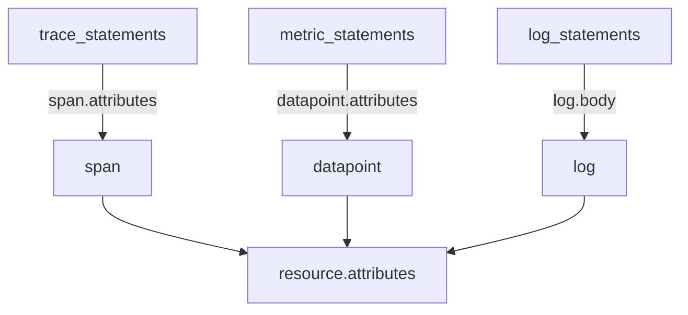

# Statements And Contexts In The Transform Processor

The attributes processor can delete a key or replace a whole value, but it cannot change a part of a value or choose by a condition on another field. The transform processor can. It runs small programs, called statements, against each span, log record or data point. This part explains how a statement is built, how the processor decides what the statement may read and write, and what happens when a statement fails.

## The shape of a statement

A statement is written in the OpenTelemetry Transformation Language (OTTL), a small language that several Collector components share. A statement has a function, its arguments, and an optional `where` clause:

`set(span.attributes["tier"], "edge") where span.attributes["http.route"] == "/orders"`

The function `set` is an editor: a function that changes data. The first argument, `span.attributes["tier"]`, is a path that says what to change. The second argument is the new value. The `where` clause is a condition. The statement runs for a span only when the condition is true, and it skips the other spans. Besides editors, OTTL has converters, which are functions that compute a value and change nothing, such as `IsMatch` and `SHA256`.

The editors used most often are these:

| Function | What it does |
| --- | --- |
| `set(target, value)` | Writes a value to a path. |
| `delete_key(map, key)` | Removes one key from an attribute map. |
| `delete_matching_keys(map, pattern)` | Removes every key whose name matches a regular expression. |
| `replace_pattern(target, regex, replacement)` | Replaces the part of a string that matches the regular expression. |
| `replace_all_patterns(map, mode, regex, replacement)` | Applies a replacement to all values (or all keys) of a map. |
| `keep_keys(map, keys)` | Removes every key that is not in the list. |
| `limit(map, count, priority_keys)` | Keeps at most `count` keys. |

## Contexts: what a statement can reach

A context is the level of the data that a statement works on. The first word of a path names it, so a reader and the processor both know the level without extra settings.

| Signal list | Contexts (path prefixes) |
| --- | --- |
| `trace_statements` | `resource`, `scope`, `span`, `spanevent` |
| `metric_statements` | `resource`, `scope`, `metric`, `datapoint`, `exemplar` |
| `log_statements` | `resource`, `scope`, `log` |

A path such as `span.attributes["http.route"]` reads the attributes of one span, and `resource.attributes["service.name"]` reads the resource that the span belongs to. A statement in `trace_statements` cannot use the `log` prefix, and the documentation does not allow it. The processor chooses the lowest context that the paths in a statement need. A statement that uses `datapoint` paths and `metric` paths runs once per data point, since the data point context can read both.



The diagram shows that each signal list has its own lowest context, and that all of them can reach the resource above. The statements in one list run in the order that they are written, and later statements see the changes of earlier ones.

Besides the flat list of strings, each signal also accepts groups. A group has `statements` and can add its own `error_mode` and a list of `conditions` that decide whether the group runs at all. Use groups when one set of statements needs another failure mode than the rest.

## Error mode

A statement can fail at run time, for example when `replace_pattern` reads an attribute that does not exist, and the function expected a string. The `error_mode` of the processor decides what happens. With `ignore`, the default, the processor writes the error to the Collector log and continues with the next statement. With `silent`, it continues without a log line. With `propagate`, it returns the error and the Collector drops the whole payload.

Two things follow. A statement that fails under `ignore` does not apply its change, so a rule that you meant as a protection quietly does not run. A statement that fails under `propagate` removes the entire payload, including the items that had no problem. A `where` clause that checks `!= nil` avoids most of these failures, because the statement does not run on items that lack the attribute.

## Try it: set and delete with statements

<!-- astrona:playground:renew -->

Define the helper that posts a JSON document to the Collector:

```sh
send() { kubectl -n otel exec -i sender -- curl -s -o /dev/null -w '%{http_code}\n' -H 'Content-Type: application/json' -X POST "http://collector:4318/v1/$1" -d @-; }
```

Save this as `collector-config.yaml`. The processor sets an attribute with a condition, sets a resource attribute and removes a key. Single quotes around each statement keep the double quotes of OTTL intact:

```yaml
apiVersion: v1
kind: ConfigMap
metadata:
  name: collector-config
  namespace: otel
data:
  config.yaml: |
    receivers:
      otlp:
        protocols:
          http:
            endpoint: 0.0.0.0:4318
    processors:
      transform/tag:
        error_mode: ignore
        trace_statements:
          - 'set(span.attributes["tier"], "edge") where span.attributes["http.route"] == "/orders"'
          - 'set(resource.attributes["deployment.environment.name"], "training")'
          - 'delete_key(span.attributes, "debug.note")'
    exporters:
      debug:
        verbosity: detailed
    extensions:
      health_check:
        endpoint: 0.0.0.0:13133
    service:
      extensions: [health_check]
      pipelines:
        traces:
          receivers: [otlp]
          processors: [transform/tag]
          exporters: [debug]
        metrics:
          receivers: [otlp]
          exporters: [debug]
        logs:
          receivers: [otlp]
          exporters: [debug]
```

Apply it and restart the Collector:

```sh
kubectl apply -f collector-config.yaml
kubectl -n otel rollout restart deployment/collector
kubectl -n otel rollout status deployment/collector
```

Save this as `spans-tier.json`. It has two spans: `orders` with the route `/orders` and a note, and `status` with another route:

```json
{
  "resourceSpans": [{
    "resource": {"attributes": [{"key": "service.name", "value": {"stringValue": "scout"}}]},
    "scopeSpans": [{
      "scope": {"name": "manual"},
      "spans": [
        {
          "traceId": "5b8efff798038103d269b633813fc60c", "spanId": "eee19b7ec3c1b174",
          "name": "orders", "kind": 2,
          "startTimeUnixNano": "1700000000000000000", "endTimeUnixNano": "1700000001000000000",
          "attributes": [
            {"key": "http.route", "value": {"stringValue": "/orders"}},
            {"key": "debug.note", "value": {"stringValue": "temporary"}}
          ]
        },
        {
          "traceId": "5b8efff798038103d269b633813fc60c", "spanId": "eee19b7ec3c1b175",
          "name": "status", "kind": 2,
          "startTimeUnixNano": "1700000000000000000", "endTimeUnixNano": "1700000001000000000",
          "attributes": [{"key": "http.route", "value": {"stringValue": "/status"}}]
        }
      ]
    }]
  }]
}
```

Send it and read the log:

```sh
send traces < spans-tier.json
kubectl -n otel logs deploy/collector --tail=50
```

The resource has `deployment.environment.name` with the value `training`. The span `orders` has `tier` with the value `edge`, and its `debug.note` attribute is gone. The span `status` has no `tier` attribute, because its route does not satisfy the `where` clause. The statement for the resource attribute uses only a `resource` path, so it runs in the resource context, once for the resource and not for each span. One statement changed one level, and the condition limited another.

You now know the statement form, the contexts and the failure modes. The next question is how to use them to remove sensitive values that sit inside other values.

## Common pitfalls

> [!WARNING]
> A path prefix must match the signal list. `log.body` in `trace_statements` is not allowed. A statement that fails under `error_mode: ignore` does not apply its change, and the only evidence is a line in the Collector log, so a rule that protects data can fail without notice. Under `propagate`, one failing statement drops the whole payload. Guard statements with `where` so that they run only on items that have the attribute they use.
