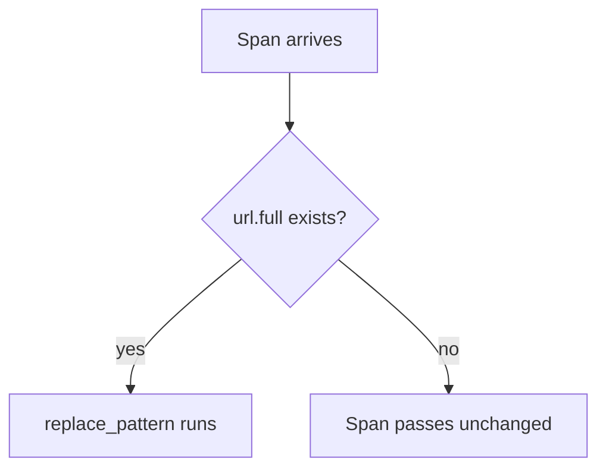

# Redacting Sensitive Attributes

A secret does not always sit in an attribute of its own. A token can be part of a URL, a card number can be part of a log message, and a password can hide in an attribute whose name nobody planned for. Redaction means removing or masking such values before they leave the Collector. This part shows the statements that do it, and then explains what redaction cannot do.

## Three tools for three shapes of secret

The first shape is a whole attribute that must go. Use `delete_key(span.attributes, "http.request.header.authorization")` when the key is known. When only a pattern is known, use `delete_matching_keys(span.attributes, "(?i).*password.*")`. The first argument is the map, and the second is a regular expression that matches key names. The prefix `(?i)` makes the match ignore case.

The second shape is a secret inside a value. For a URL such as `https://scout.starfleet.test/api?token=abc&page=1`, deleting the whole attribute would also remove the useful path and the page number. Use `replace_pattern(span.attributes["url.full"], "token=[^&]*", "token=REDACTED")`. The regular expression matches `token=` and every character up to the next `&`, so the result is `https://scout.starfleet.test/api?token=REDACTED&page=1`. The statement changes only the matched part.

The third shape is a value that you still want to compare. When two events must be linked to the same user without storing the user, replace the value with a hash. The converter `SHA256(value)` returns the SHA-256 hash of a string, and `set(span.attributes["user.email"], SHA256(span.attributes["user.email"]))` writes it back. Equal inputs give equal hashes, so the data stays usable for counting. A hash of a value with few possible forms, such as a short number, can be guessed by trying all forms, so it is a weaker protection than deletion.

## Guards and failure

Each of these statements reads an attribute that some spans do not have. When `replace_pattern` reads a missing attribute, there is no string to work on, and the function reports an error. Under `error_mode: ignore`, the Collector logs the error and continues. The span still passes, which is correct for a span without the attribute. The same failure on a span that has the attribute, for example because the regular expression is invalid, passes the secret unchanged and leaves only a log line.

Add `where span.attributes["url.full"] != nil` to every replacement. The statement then runs only on spans that have the attribute, and an error in the log means something real. Under `error_mode: propagate`, the guard matters even more. Without it, one span with no `url.full` fails the statement, and the Collector drops the whole payload, including every other span in the request.



The diagram shows what the guard does: the statement runs only when there is something to redact, and no error occurs for the other spans.

## Try it: redact a token, a header and a card number

<!-- astrona:playground:renew -->

Define the helper that posts a JSON document to the Collector:

```sh
send() { kubectl -n otel exec -i sender -- curl -s -o /dev/null -w '%{http_code}\n' -H 'Content-Type: application/json' -X POST "http://collector:4318/v1/$1" -d @-; }
```

Save this as `collector-config.yaml`. The processor redacts a URL token, deletes attributes whose key contains `password`, hashes the email address, and masks a card number in a log body:

```yaml
apiVersion: v1
kind: ConfigMap
metadata:
  name: collector-config
  namespace: otel
data:
  config.yaml: |
    receivers:
      otlp:
        protocols:
          http:
            endpoint: 0.0.0.0:4318
    processors:
      transform/redact:
        error_mode: ignore
        trace_statements:
          - 'replace_pattern(span.attributes["url.full"], "token=[^&]*", "token=REDACTED") where span.attributes["url.full"] != nil'
          - 'delete_matching_keys(span.attributes, "(?i).*password.*")'
          - 'set(span.attributes["user.email"], SHA256(span.attributes["user.email"])) where span.attributes["user.email"] != nil'
        log_statements:
          - 'replace_pattern(log.body.string, "card=[0-9]+", "card=****") where IsString(log.body)'
    exporters:
      debug:
        verbosity: detailed
    extensions:
      health_check:
        endpoint: 0.0.0.0:13133
    service:
      extensions: [health_check]
      pipelines:
        traces:
          receivers: [otlp]
          processors: [transform/redact]
          exporters: [debug]
        metrics:
          receivers: [otlp]
          exporters: [debug]
        logs:
          receivers: [otlp]
          processors: [transform/redact]
          exporters: [debug]
```

Apply it and restart the Collector:

```sh
kubectl apply -f collector-config.yaml
kubectl -n otel rollout restart deployment/collector
kubectl -n otel rollout status deployment/collector
```

Save this as `spans-secret.json`. The span `checkout` carries every kind of secret. The span `plain` has none of them, and it tests the guard:

```json
{
  "resourceSpans": [{
    "resource": {"attributes": [{"key": "service.name", "value": {"stringValue": "scout"}}]},
    "scopeSpans": [{
      "scope": {"name": "manual"},
      "spans": [
        {
          "traceId": "5b8efff798038103d269b633813fc60c", "spanId": "eee19b7ec3c1b174",
          "name": "checkout", "kind": 2,
          "startTimeUnixNano": "1700000000000000000", "endTimeUnixNano": "1700000001000000000",
          "attributes": [
            {"key": "url.full", "value": {"stringValue": "https://scout.starfleet.test/api?token=abc&page=1"}},
            {"key": "db.password", "value": {"stringValue": "swordfish"}},
            {"key": "user.email", "value": {"stringValue": "jason@starfleet.test"}}
          ]
        },
        {
          "traceId": "5b8efff798038103d269b633813fc60c", "spanId": "eee19b7ec3c1b175",
          "name": "plain", "kind": 2,
          "startTimeUnixNano": "1700000000000000000", "endTimeUnixNano": "1700000001000000000",
          "attributes": [{"key": "http.route", "value": {"stringValue": "/status"}}]
        }
      ]
    }]
  }]
}
```

Send it and read the log:

```sh
send traces < spans-secret.json
kubectl -n otel logs deploy/collector --tail=60
```

The span `checkout` shows `url.full` with `token=REDACTED&page=1`. The attribute `db.password` is gone. The attribute `user.email` holds a 64-character hexadecimal string, which is the SHA-256 hash. The span `plain` arrives with its route, because the guards skipped it. Search the whole log for the words `swordfish` and `abc&page` to confirm that the secrets appear nowhere:

```sh
kubectl -n otel logs deploy/collector | grep -c -e swordfish -e 'token=abc' || true
```

The count is `0`, because no line of the Collector log holds the original values. If the count is higher than zero, a statement did not apply, and the Collector log holds lines that report the failed statement.

## What redaction does not guarantee

Redaction is a second line of defense. It works only on the values and the patterns that someone thought of. A secret under another attribute name, in a span event, in a link or in the middle of a log message with a different format passes unchanged. The safest rule is to avoid collecting the secret in the application, so that no processor has to find it. Redaction also does not help with data that left earlier: if a second exporter or another pipeline receives the data without the processor, that destination has the original.

A related mistake is to treat a masked value as proof of privacy. A masked card number may still show the last four digits, a hashed email can be matched against a list of known emails, and a URL path can still hold a user name. State what the redaction covers, and test it with representative data.

You now know how to delete a key, mask a part of a value and hash a value, and how guards keep a failure from either dropping data or leaking it. What remains is how these changes affect metrics, and how the position of a processor decides who sees the secret.

## Common pitfalls

> [!WARNING]
> Regular expressions that are too short remove too much, and patterns that are too narrow miss variants. A statement with no `where` guard fails on items that lack the attribute, and under `ignore` that failure is quiet. A redaction in one pipeline does nothing for a second pipeline that receives the same data. Redaction cannot replace avoiding the secret at the source.
