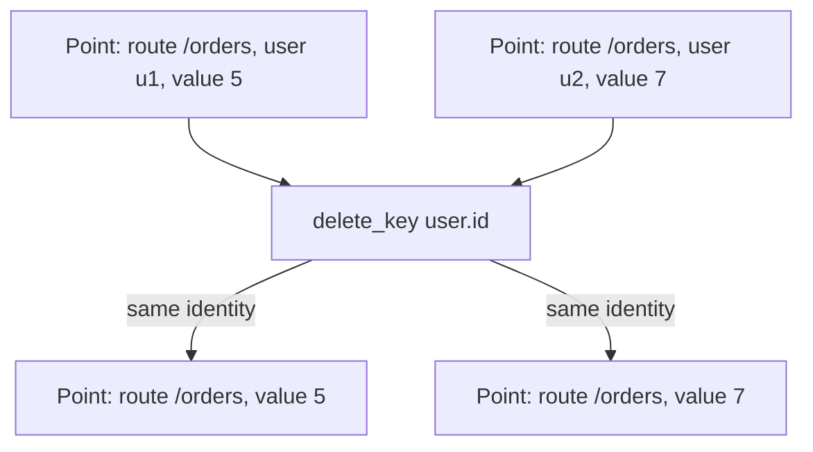
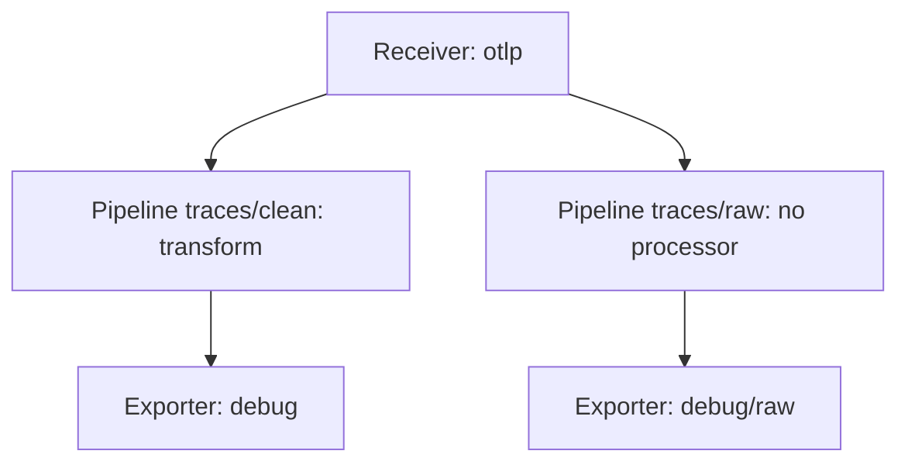

# Metric Identity, Pipeline Position And Verification

Deleting an attribute from a span or a log record is a local change. Deleting an attribute from a metric is not, because a metric attribute is part of what makes a data point unique. This part explains metric identity and cardinality, shows what the transform processor does and does not repair, and then looks at the position of a processor and at how to verify a change with the debug exporter.

## Metric identity and cardinality

A metric stream is identified by the metric name, the unit, the resource, the scope and the set of data point attributes. Each distinct combination is one time series. A counter named `shuttle.requests` with the attribute `route` has one series for each route. If it also has `user.id`, it has one series for each pair of route and user.

The number of distinct series is the cardinality. A high cardinality costs memory, storage and money at the backend, and an identifier such as `user.id` can raise it from a handful of series to millions. That is why teams remove such attributes. The change is valid only when the result still describes something real.

Suppose two data points both have `route=/orders`, one with `user.id=u1` and a value of 5, and one with `user.id=u2` and a value of 7. After `user.id` is deleted, the two points have identical attributes. They now claim to be the same series with two different values at the same time. A correct result would be one point with the value 12, but the processor does not compute it. The attributes processor and the transform processor change attributes and do not merge data points. A backend that receives the two points can reject one, keep one, or keep the last one, so the total is wrong or lost.



The diagram shows two points that were different series before the deletion and share one identity afterward. A separate aggregation step, such as a processor or a backend rule that sums by the remaining attributes, produces the correct sum. Deleting the label does not.

Renaming has the same risk. A statement that renames a metric or an attribute key changes the identity of every series. Dashboards and alerts that use the old name stop matching. Changing a unit or the instrument name without changing the values also gives wrong meaning. Treat these edits as breaking changes for every consumer.

## Pipeline position and who sees the secret

A pipeline is a path from receivers to exporters. Redaction protects the exporters of the pipeline where the processor sits. One receiver can feed several pipelines, and each pipeline receives its own copy of the data.



The diagram shows a receiver that feeds two pipelines. Only the first pipeline has the transform processor, so the exporter of the second pipeline receives the original values. A diagnostic exporter in a separate pipeline is a typical case: someone adds it to debug a problem, and it prints everything that the receiver got. In the same way, a processor placed after an exporter that must not see the original data does not help, and a processor that comes after a filter or a rewrite can see different values.

## Try it: duplicate identities and a raw pipeline

<!-- astrona:playground:renew -->

Define the helper that posts a JSON document to the Collector:

```sh
send() { kubectl -n otel exec -i sender -- curl -s -o /dev/null -w '%{http_code}\n' -H 'Content-Type: application/json' -X POST "http://collector:4318/v1/$1" -d @-; }
```

Save this as `collector-config.yaml`. It removes `user.id` from metric data points in a transform processor. It also defines a second traces pipeline, `traces/raw`, with its own exporter and no processor, so you can see the leak:

```yaml
apiVersion: v1
kind: ConfigMap
metadata:
  name: collector-config
  namespace: otel
data:
  config.yaml: |
    receivers:
      otlp:
        protocols:
          http:
            endpoint: 0.0.0.0:4318
    processors:
      transform/safe:
        error_mode: ignore
        trace_statements:
          - 'delete_key(span.attributes, "http.request.header.authorization")'
        metric_statements:
          - 'delete_key(datapoint.attributes, "user.id")'
    exporters:
      debug:
        verbosity: detailed
      debug/raw:
        verbosity: detailed
    extensions:
      health_check:
        endpoint: 0.0.0.0:13133
    service:
      extensions: [health_check]
      pipelines:
        traces:
          receivers: [otlp]
          processors: [transform/safe]
          exporters: [debug]
        traces/raw:
          receivers: [otlp]
          exporters: [debug/raw]
        metrics:
          receivers: [otlp]
          processors: [transform/safe]
          exporters: [debug]
        logs:
          receivers: [otlp]
          exporters: [debug]
```

Apply it and restart the Collector:

```sh
kubectl apply -f collector-config.yaml
kubectl -n otel rollout restart deployment/collector
kubectl -n otel rollout status deployment/collector
```

Save this as `metrics-users.json`. It is one counter with two data points that differ only by `user.id`:

```json
{
  "resourceMetrics": [{
    "resource": {"attributes": [{"key": "service.name", "value": {"stringValue": "shuttle"}}]},
    "scopeMetrics": [{
      "scope": {"name": "manual"},
      "metrics": [{
        "name": "shuttle.requests",
        "unit": "1",
        "sum": {
          "aggregationTemporality": 2,
          "isMonotonic": true,
          "dataPoints": [
            {"attributes": [{"key": "route", "value": {"stringValue": "/orders"}}, {"key": "user.id", "value": {"stringValue": "u1"}}],
             "startTimeUnixNano": "1700000000000000000", "timeUnixNano": "1700000060000000000", "asInt": "5"},
            {"attributes": [{"key": "route", "value": {"stringValue": "/orders"}}, {"key": "user.id", "value": {"stringValue": "u2"}}],
             "startTimeUnixNano": "1700000000000000000", "timeUnixNano": "1700000060000000000", "asInt": "7"}
          ]
        }
      }]
    }]
  }]
}
```

Send it and read the log:

```sh
send metrics < metrics-users.json
kubectl -n otel logs deploy/collector --tail=50
```

The metric `shuttle.requests` has two data points, with the values 5 and 7. Both show only `route` with the value `/orders`, and neither has `user.id`. The processor removed the attribute from each point and did not combine them. A backend that expects one point per series would now see a conflict.

Save this as `span-auth.json` for the second experiment. It is one span with an authorization header:

```json
{
  "resourceSpans": [{
    "resource": {"attributes": [{"key": "service.name", "value": {"stringValue": "scout"}}]},
    "scopeSpans": [{
      "scope": {"name": "manual"},
      "spans": [{
        "traceId": "5b8efff798038103d269b633813fc60c", "spanId": "eee19b7ec3c1b174",
        "name": "checkout", "kind": 2,
        "startTimeUnixNano": "1700000000000000000", "endTimeUnixNano": "1700000001000000000",
        "attributes": [{"key": "http.request.header.authorization", "value": {"stringValue": "Bearer secret"}}]
      }]
    }]
  }]
}
```

Send it and count how often the secret appears in the log:

```sh
send traces < span-auth.json
kubectl -n otel logs deploy/collector | grep -c 'Bearer secret'
```

The count is `1`. The span went through two pipelines. The pipeline `traces` removed the header, and the pipeline `traces/raw` printed the span as it arrived. The header names of the two exporters in the log fields tell you which one printed the line. The fix is to put the processor in every pipeline that must not show the secret, or to delete the raw pipeline.

## Verifying with the debug exporter

The debug exporter with `verbosity: detailed` prints every attribute of every item that reaches it, so it shows what a real exporter would send at that position. To verify a transformation, send test data with a known marker, read the output, and look for the changed values and for the absence of the original. Check three things: the original value is gone everywhere in the output, the intended change is present, and unrelated data still arrives.

The debug exporter is itself a leak path. It prints sensitive values to the Collector log, and logs are often stored and shared. Use it with test data, and remove it or move it behind the processors before it sees real traffic. Verification with representative samples shows that the cases you tried work. It does not prove that every possible value is covered.

You now know that attribute edits on metrics change identity and do not re-aggregate, that the layout of pipelines decides who sees the original data, and how to verify a change. The closing summary pulls these rules together.

## Common pitfalls

> [!WARNING]
> Deleting or renaming a metric attribute can leave several data points with the same identity, and no processor sums them for you. A processor protects only the pipelines where it is listed, so a second pipeline or a debug exporter can still print the original data. The debug exporter prints sensitive values to the Collector log, so use it with test data and take it out of production pipelines.
